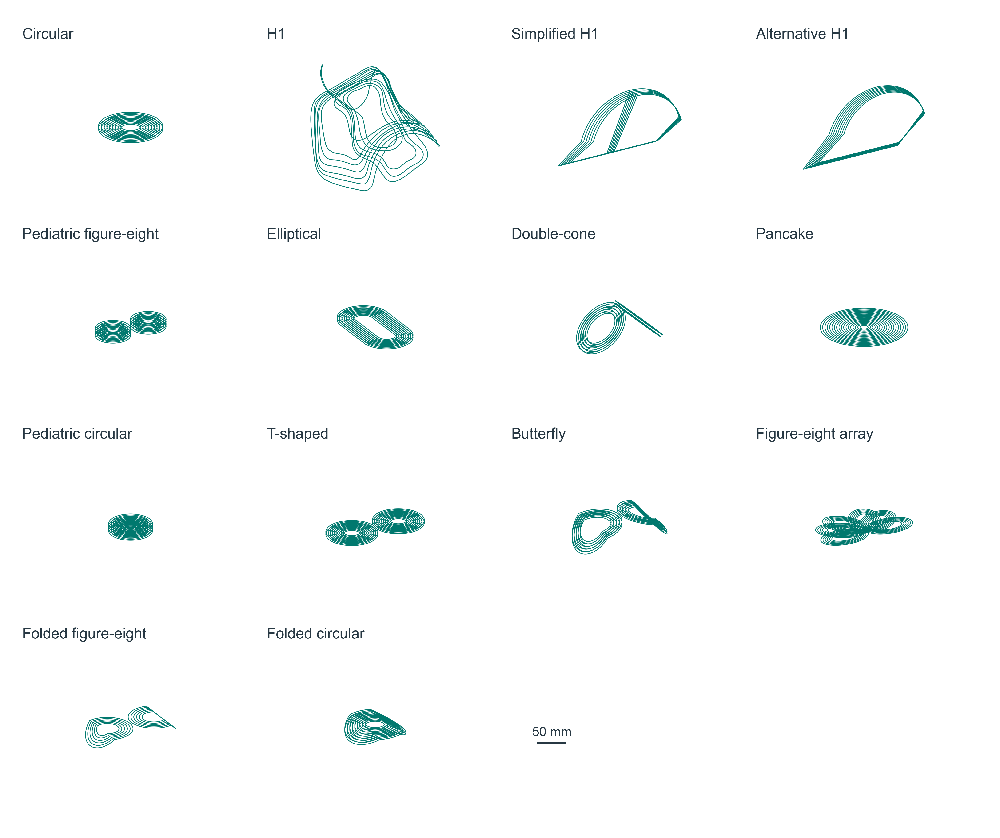
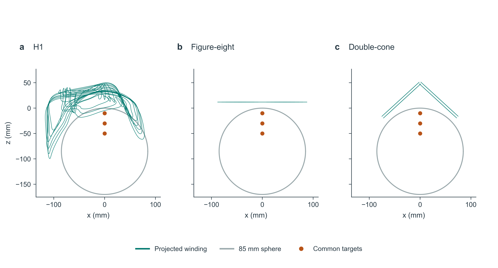
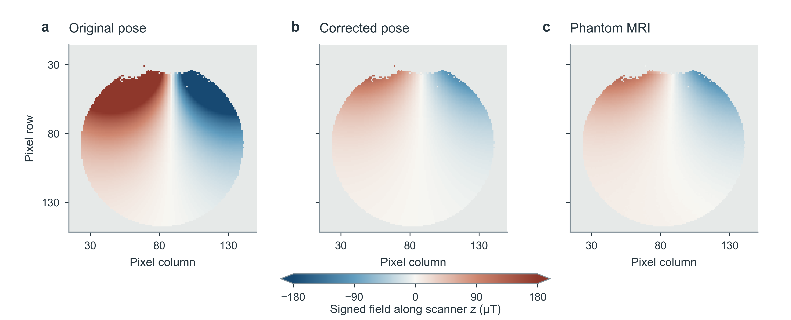
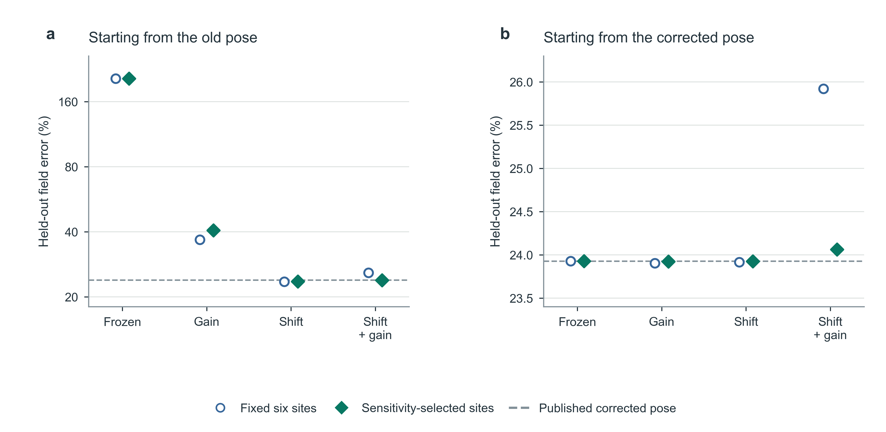
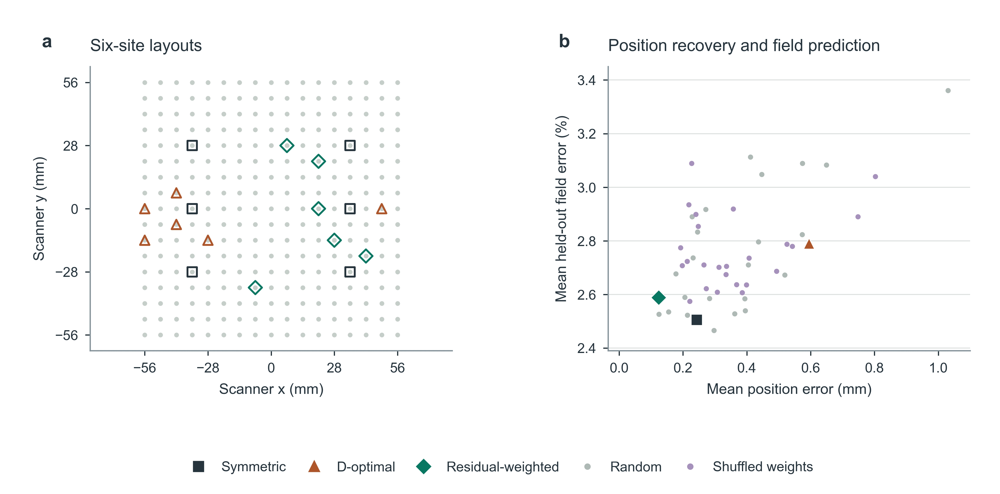
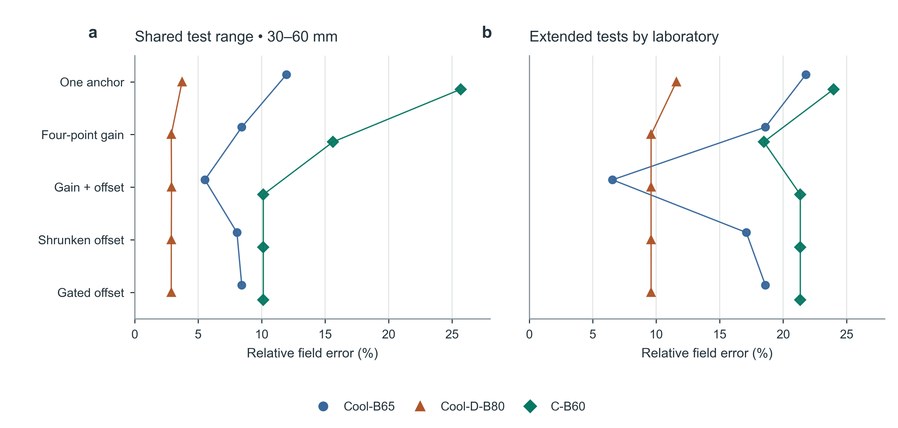

# TMS Coil Bench · 稀疏磁场测量与线圈摆位校准

经颅磁刺激（TMS）用线圈中的脉冲电流产生变化的磁场，在导电组织中感应出电场。重新安装线圈后，同一个磁场探头读数变小了，可能是线圈离探头更远，也可能是驱动电流或采集增益变了。如果只允许测六个位置，怎样分清这两种原因？

我们用十四类绕组建立磁场基准，结合八个研究团队的公开测量检验模型和校准方法，再从少量读数估计摆位修正。仓库提供 MATLAB 求解与反演代码、独立有限元计算、逐点数据和可重绘图件。

在一项有作者更正记录的八字线圈 MRI 实验中，固定公开电流，从六个点估出的轴向修正为 **32.56 mm**，与两版导航变换之差相差 **0.29 mm**。在另一只线圈的三轴扫描回放中，用已有扫描面的残差辅助选点，恢复人为错标位置的平均误差为 **0.124 mm**；若目标是预测整片磁场，固定对称六点的误差略低。两个数字分别描述一次已知配准错误和一组受控错标实验。

[绕组与求解图册](figures/core/README.md) · [跨实验室测量图册](figures/measurements/README.md) · [摆位与消融图册](figures/methods/README.md) · [复现入口](#reproduce) · [文献与数据](#sources)

## 1 · 从绕组形状算出探头读数

电流经过一小段铜线，会在周围产生有方向的磁场。给出每匝路径 $C_k$、电流 $I_k$ 以及测点位置 $\mathbf r$，即可把各段的贡献相加。若仪器只沿单位方向 $\mathbf n$ 读数，还需要做一次投影：

$$
\mathbf B(\mathbf r)=\frac{\mu_0}{4\pi}\sum_k I_k
\int_{C_k}\frac{\mathrm d\boldsymbol\ell'\times(\mathbf r-\mathbf r')}
{\|\mathbf r-\mathbf r'\|^3},
\qquad B_{\mathrm{probe}}=\mathbf n^\mathsf{T}\mathbf B.
$$

$\mathbf r'$ 是导线上的位置。移动绕组会改变各测点到导线的距离与方向；在线性空气芯模型里，加倍电流则会把所有测点的场同时加倍。MRI 实验使用带正负号的轴向分量 $B_z$，三轴霍尔探头可分别读取 $B_x,B_y,B_z$。导电体模中另有团队测量感应电场 $E$，单位为 V/m。磁场以 T、mT 或 µT 表示。

**图 1｜同样的电流，沿不同路径流动。** 先看导线围住的面积，再看两翼是否折起、回流部分离测点多远。两只外观看似相似的八字线圈，只要匝数或两翼位置不同，在同一深度就可能产生不同读数。H1 使用公开重建几何；示意图未定尺寸的变体在清单中单独记录假设。[排版 PDF](figures/core/geometry_overview.pdf) · [十四种模型参数](geometry_manifest.json)

空气场基准统一每匝电流 **1,000 A**，以导线中心线的支撑平面定义深度。在离平面 20 mm 处，以半峰值区域面积描述横向分布：

$$
A_{1/2}(z)=\int_{\Omega_z}
\mathbf 1\!\left[\|\mathbf B(x,y,z)\|\geq\tfrac12\max_{\Omega_z}\|\mathbf B\|\right]\,\mathrm dx\,\mathrm dy .
$$

这里每只线圈都用自己的平面峰值设阈值。面积较小表示该平面上的强磁场分布较集中；脑内刺激范围还需要组织电导与感应电场。完整图册逐一给出圆形、H1、简化 H1、另类 H1、儿童八字、椭圆、双锥、盘底、儿童圆形、T 型、蝶形、八字阵列、折叠八字和折叠圆形线圈的结果。[十四种模型的定量指标](results/metrics.csv) · [各线圈图版与图解](figures/core/README.md)

## 2 · 固定摆位，再比较模型

三个绕组都说“在 30 mm 深度测量”，首先要规定从哪里量。采用半径 85 mm 的球面作为台架基准，固定靶点和绕组到球面的最小净距 12 mm。若 $T$ 是将绕组放入台架坐标系的刚体变换，几何约束为

$$
\min_{\mathbf r'\in C}\bigl(\|T\mathbf r'-\mathbf c\|-R\bigr)=12\ {\rm mm}.
$$

$\mathbf c$ 和 $R$ 是球心和半径。最靠近球面的那段线可能处于靶点侧方，所以这条约束与“所有线圈到球顶等距”不同。

**图 2｜先看绕组在哪里，再读靶点的场。** 绿色线是导线在侧面的投影，灰圆是参照球面，橙点是三组共用的观测位置。在图示摆位下，30 mm 靶点处 H1、双锥和理想八字分别产生 **42.78、35.02、15.40 mT**。如果只改变 H1 工作面对准球顶的规则，H1 可降到 **20.57 mT**，与双锥交换顺序。做场强比较时，需同时保留电流、几何和参考面。[排版 PDF](figures/core/placement.pdf) · [逐摆位结果](placement_pilot/placement/target_fields.csv) · [H1 工作面对照](placement_pilot/placement/h1_orientation_comparison.csv)

用独立算法核对时，另行求解了圆形绕组的轴对称有限元和双锥绕组的三维有限元。Magpylib 与 MATLAB 在相同细线几何上重算 **145,292 点**。18 匝圆形有限元与 MATLAB 的轴上最大相对差为 **0.0572%**；双锥 3,571 点的整体向量相对差为 **0.4009%**。这些数值检验求解器之间的一致程度。检验实体线圈还要看探头或体模读数。[解析及圆形有限元图](figures/core/solver_validation.pdf) · [双锥有限元图](figures/core/double_cone_fem.pdf) · [软件对照表](results/magpylib/comparison.csv)

## 3 · 八字线圈仿真为何比 MRI 实测大 4.50 倍？

Petrov 等公开了八字形参考线圈的琼脂体模 MRI 切片、模拟矩阵和导航文件 [1]。我们重建每翼九匝的 BSM-819，在 1% 刺激器设置下使用论文给出的 **3.576 A 等效直流**。同一掩膜内有 10,622 个有效像素。设 $p_i$ 为预测、$y_i$ 为实测，同时报告整体幅值比和整张切片的相对 L2 误差。后者先逐像素求差，再汇总成一个数。

$$
q=\frac{\|p\|_2}{\|y\|_2},\qquad
\varepsilon=100\,\frac{\|p-y\|_2}{\|y\|_2}\%.
$$

即使 $q$ 接近 1，若正负场瓣的位置不对，$\varepsilon$ 仍然会较大。原工作流中的问题落在最终对齐矩阵。换用作者更正版后，绕组原点在扫描仪 z 轴上移动 **+32.27 mm**。八字绕组、电流和采样点保持一致。

**图 3｜比较颜色前，先确认三张图共用色标。** 旧摆位下，一正一负两个场瓣看起来都有，但强度大幅偏高。旧版、更正版与实测的场强均方根（把整片像素的场值平方、求平均再开方）依次为 **138.28、31.21、30.72 µT**。只替换 z 平移，整张切片的相对 L2 误差从 **352.56%** 降至 **7.73%**；完整更正版为 **7.63%**。这项控制实验把主要偏差定位到了摆位。[排版 PDF](figures/methods/mri_field_maps.pdf) · [逐版本逐模型评分](placement_pilot/public_benchmark/matched_figure8/placement_version_comparison.csv)

## 4 · 只剩一份旧文件，六个读数能否反推安装位移？

从旧绕组出发，沿已知的扫描仪 z 方向试探位移 $s$，每次重新计算六个像素上的磁场 $p_i(s)$。若测量链有未知的共同倍率，记为 $g$。估计只使用六点集合 $C$，另外 5,325 个远侧像素在参数固定后才评分：

$$
(\hat s,\hat g)=\arg\min_{s,g}\sum_{i\in C}\big[g\,p_i(s)-y_i\big]^2 .
$$

有独立电流记录时可以固定 $g=1$。这里用消融实验逐项开放参数，让不同方法在同一片远侧区域上接受检验。

| 六点校准的设置 | 估计 z 位移 | 与作者导航修正的差 | 远侧场相对误差 |
|---|---:|---:|---:|
| 原六点，直接使用旧摆位 | 0 mm | 32.27 mm | 204.48% |
| 原六点，只调倍率 | 0 mm | 32.27 mm | 36.73% |
| 原六点，固定电流、只调位移 | **32.56 mm** | **0.29 mm** | **23.49%** |
| 原六点，同时调位移与倍率 | 44.13 mm | 11.87 mm | 25.81% |
| 按绕组灵敏度选六点，同时调位移与倍率 | 30.09 mm | 2.18 mm | 23.83% |

**图 4｜多调一个参数，有时会把线圈推到错误的位置。** 左图从旧文件开始，右图从已更正的文件开始。纵轴都是 5,325 个留出像素的场误差；两块图的刻度不同，读数应对照各自纵轴。看右图最右侧的空心圆：同一次反演的记录显示，它多估了 **10.11 mm** 位移，远侧误差从 **23.93%** 升到 **25.92%**。六点上拟合变好，不能替代在其他位置实测。[排版 PDF](figures/methods/axial_refinement.pdf) · [参数消融、100 组随机布局及无故障对照](external_measurements/pose_refinement/README.md)

## 5 · 哪六个测点能分清横移、纵移和倍率？

丹麦 MC-B70 的公开三轴扫描包含 95,773 个位置 [2–3]。我们先冻结由部分测量层拟合的 254 个等效偶极子，再比较同预算六点布局。普通 D-最优布局优先选择对三个未知量的响应容易区分的位置。**本项目的改进**是再利用已有 +33.7 mm 开发层上的模型残差，给该平面上经常算不准的位置较小的权重。设 $J_i$ 为三轴读数对横移、纵移和倍率的灵敏度矩阵：

$$
w_i\propto\frac{1}{s_0^2+s_i^2},\qquad
\Phi(S)=\log\det\!\left(\epsilon I+\sum_{i\in S}w_i J_i^\mathsf TJ_i\right).
$$

$s_i^2$ 为邻近九个开发层测点的平均残差平方模长，$s_0^2$ 为全层残差平方模长的中位数。从满足 14 mm 最小间距的位置中，逐次加入使 $\Phi$ 增加最多的一点。比较时只改变选点，各组使用同一个无权估计器。读数取自真实扫描的邻位，对坐标人为错标一格，并施加 10% 的共同倍率。八种非零错标工况共用一只线圈；两个独立于校准的评分平面有 2,738 个位置。

**图 5｜找准坐标和预测整片场是两个目标。** 对八种人为错标求平均，普通 D-最优、固定对称和残差加权六点的位置误差分别为 **0.595、0.243、0.124 mm**。若改看两张留出场图，对称六点以 **2.505%** 略优于加权六点的 **2.588%**。开发层的残差排序在同侧两层高度相关，跨到线圈反面后相关系数为 **−0.119**。因此权重的空间适用范围值得单独检验。[排版 PDF](figures/methods/sensor_design.pdf) · [随机布局、打乱权重和 3/6/12 点消融](external_measurements/sensor_design/README.md)

## 6 · 换实验室后，能预测多远？

法国和德国团队分别公布了空气中的距离曲线 [4–5]。我们用丹麦数据库里的同型号线圈预测场随距离的变化。若模型给出 $M(d)$，一个已知距离 $d_0$ 的实测强度为 $b(d_0)$，最简单的预测是 $\hat b(d)=b(d_0)M(d)/M(d_0)$。将单点改为四个近点，还可以检验是否值得开放一个共同的距离零点偏移 $\delta$：

$$
\hat b(d)=g\,M(d+\delta),\qquad d_{\rm cal}\in\{10,15,20,25\}\ {\rm mm}.
$$

**图 6｜近处拟合得好，远处还要单独检查。** 左图让三款线圈都在 30–60 mm 的七个距离上接受检验，点越靠左表示误差越小。四点幅值校准将 Cool-B65、Cool-D-B80、C-B60 的误差从 **11.95%、3.72%、25.68%** 降至 **8.43%、2.88%、15.62%**。右图中，法国两款各用 140 mm 的一个实测端点，德国 C-B60 使用 41–70 mm 的 30 个测点。对德国这款再调距离零点，左图误差降至 **10.13%**，右图却从 **18.48%** 升至 **21.35%**。拟合得到的 +5 mm 恰好位于允许搜索的上界，无法据此确定实物偏移了 5 mm。[排版 PDF](figures/methods/depth_calibration.pdf) · [逐型号预测与标定范围](external_measurements/decay_calibration/README.md)

| 实测团队 | 已取得的观测 | 这组证据回答什么 |
|---|---|---|
| 荷兰乌得勒支 [1] | 八字体模的 MRI 有符号 $B_z$ 切片及两版导航文件 | 能否重现绝对幅值、找出配准误差，并从六点估计修正 |
| 丹麦合作组 [2–3] | MC-B70 三分量扫描，另有 25 款线圈的拾取波形 | 三个留出层共 6,965 点，向量场误差 2.50%；25 个波形的拟合误差中位数 6.65% |
| 德国雷根斯堡 [4] | 两款线圈共 181 个霍尔距离均值，取自发表图 | 近段指数模型外推到 41–70 mm 时，两型号误差 25.81% 和 7.31% |
| 法国里昂、圣艾蒂安 [5] | 两款线圈共 28 个型号与位置组合，取自图和正文 | 10 mm 单点标定后，140 mm 处分别低估 21.79% 和 11.59% |
| 美国 Abbasi 合作组 [6] | 两个微型八字、四个电流档，共 14 个霍尔读数标记 | 同一翼心位置用低档电流预测高档，两个原型的误差为 6.04%（4 点）和 16.48%（2 点） |
| 意大利 Bogi 等 [7] | 圆线圈七点峰值 $B$，部分数据被后续论文复用 | 按文献同组数据选用的电流计算，七点相对误差 16.99% |
| 芬兰和巴西 Matsuda 合作组 [8] | 40 个探头时序文件，另有 31 行带单位的定位统计 | 场质心两个方向的样本标准差为 0.72、0.24 mm，峰值 $E$ 的标准差为 1.04 V/m |
| 以色列 Roth 合作组 [9] | 盐水体模探针测量，读出 23 个电场剖面标记 | 同一侧方剖线 4.5 cm 处约为 H1 95 V/m、八字 19 V/m，适用条件是原实验的体模与驱动 |

每行都保留仪器、原始单位和校准条件。两篇复用同次台架测量的论文只算一组；读图均值也与原始波形分开计数。对深部刺激的讨论以导电头模中的 $E$ 为依据，当前十四类空气场数据支持指定工况下的 $B$ 比较。[八组测量图与逐图解读](figures/measurements/README.md) · [数据清单和再分析方法](external_measurements/README.md)

## 7 · 如何使用这些结果

- **比较线圈几何。** 同时说明电流、参考面、观测点和指标；图纸中未给出的尺寸、匝数或折角见[几何来源与假设](research/geometry_research.md)。
- **检查摆位。** 有独立电流测量时，先约束倍率；用没参加拟合的位置同时报告百分比误差和带单位的 RMSE。把一个扫描面的误差模式借给另一平面前，需检查两者的空间对应关系。
- **解释方法贡献。** 利用开发层局部残差辅助选点，并用同预算、打乱权重、无错标及异层数据做消融，是本项目检验的具体方法。磁跟踪和实验设计研究已有灵敏度选点、联合标定和模型误差加权的先例 [11–14]。六点回放不能给出不同设备实际拆装的通用精度。[近期方法比较](research/近期方法与改进设计.md)
- **借鉴其他磁场研究。** 标准化测点、先以解析结果检查求解器、分开模型误差与算法误差、在另一个平面检验预测，分别落实到本项目的摆位、圆环基准、单变量对照及跨层检验。所借鉴的方法及原文页码见[21 份资料的对应表](research/21份磁场资料与线圈实验的关联.md)；四篇直接影响实验设计的来源列在文末 [15–18]。

## 8 · 浏览、取图与复现

| 需要什么 | 从这里开始 |
|---|---|
| 一张可以排版的图，以及图中变量的含义 | [完整图件索引与重绘方法](figures/README.md)。各图册将 PNG、紧随图后的中文图解、PDF 和数值来源放在一起。 |
| 一只线圈的坐标、假设和指标 | [几何清单](geometry_manifest.json) · [MATLAB 线元求解](matlab/field_segments.m) · [指标总表](results/metrics.csv) |
| 核对旧版、新版、只改 z 平移的差别 | [MRI 原始对照与本地复算](placement_pilot/public_benchmark/matched_figure8/README.md) |
| 独立复算三维场或球面摆位 | [放置基准与有限元](placement_pilot/README.md) · [三维双锥收敛](placement_pilot/fem3d/README.md) |
| 八组实测复跑或三组方法消融 | [测量复跑入口](external_measurements/run_external_measurements.m) · [方法消融入口](external_measurements/run_method_experiments.m) |

已验证环境为 Windows、MATLAB R2025a、Python 3.13、Magpylib 6.3.0、Gmsh 4.15.2、GetDP 3.5.0。主空气场计算可用 RTX 4060 Laptop 8 GB，参数反演使用 CPU。首次复跑需联网获取按版本或校验值锁定的上游输入。以下 PowerShell 命令都从仓库根目录执行。

~~~powershell
# 安装数值依赖和有限元工具
.\setup_experiment.ps1 -DownloadFEMTools

# 十四类空气场、软件对照、敏感性分析与圆形有限元
.\run_all.ps1 -UseGPU

# 准备丹麦探头数据，再选所需的 MATLAB 实验组
& .\.venv\Scripts\python.exe .\external_measurements\measured_coil_library\prepare_inputs.py
matlab -sd (Get-Location).Path -batch "addpath('external_measurements'); run_method_experiments"
matlab -sd (Get-Location).Path -batch "addpath('external_measurements'); run_external_measurements"
~~~

GPU 选项需要 Parallel Computing Toolbox 和兼容的 NVIDIA 显卡。去掉 `-UseGPU` 即可在 CPU 上运行空气场主批次。双锥三维有限元与统一摆位使用[单独的运行入口](placement_pilot/README.md)。仓库存放求解脚本、可核对的数表、选定场矩阵及研究图版。Gmsh 网格和大体积场文件可在本机重新生成。

## 参考文献、数据集与软件来源

### 实测数据与线圈几何

1. Petrov PI 等，2017。*How much detail is needed in modeling a transcranial magnetic stimulation figure-8 coil: Measurements and brain simulations*。MRI 体模、等效电流及坐标更正。[论文](https://doi.org/10.1371/journal.pone.0178952) · [v1.1 数据与工作流](https://github.com/pip010/plosone-data-pub01/tree/v1.1/phantom_experiments) · [更正记录](https://github.com/pip010/plosone-data-pub01/releases/tag/v1.1)
2. Madsen、Drakaki、Thielscher。MC-B70 三轴探头扫描、外壳与等效源拟合。[研究论文](https://arxiv.org/abs/2112.14548) · [作者数据与代码，固定提交](https://github.com/simnibs/dipole-fit/tree/63d8cba254e3ade29c3db58eca9f5397a23e07c4)
3. Drakaki M 等，2022。*Database of 25 validated coil models for electric field simulations for TMS*。[论文](https://doi.org/10.1016/j.brs.2022.04.017) · [25 款线圈文件、波形及模型参数](https://github.com/simnibs/simnibs/tree/fde509f6f8de38a4b03947944cf7ee93b8bebabe/simnibs/resources/coil_models/Drakaki_BrainStim_2022)
4. Schecklmann M 等，2020。*Resting motor threshold and magnetic field output of the figure-of-8 and the double-cone coil*。德国霍尔台架，图 2。[论文与图](https://doi.org/10.1038/s41598-020-58034-2)
5. Quesada C 等，2024。*Field recordings of transcranial magnetic stimulation in human brain postmortem models*。本项目使用空气台架部分的图 2A 及端点。[论文](https://doi.org/10.1097/PR9.0000000000001134) · [开放全文](https://pmc.ncbi.nlm.nih.gov/articles/PMC10876241/)
6. Abbasi S 等，2024。*Design and Validation of Miniaturized Repetitive Transcranial Magnetic Stimulation (rTMS) Head Coils*。图 7、8 的微型八字线圈霍尔测量。[论文与图](https://doi.org/10.3390/s24051584)
7. Bogi、Zoppetti、Pinto，2009，Magstim 圆形线圈空间磁场测试报告，表 1。D’Agostino 等，2026，复用其中五点。[仪器测试报告](https://www.portaleagentifisici.it/filemanager/userfiles/DOCUMENTAZIONE/CEM/valutazioni/cem_rapporto_valutazione_transcranica.pdf?lg=IT) · [后续论文](https://doi.org/10.3389/fpubh.2025.1705893) · [补充表](https://doi.org/10.3389/fpubh.2025.1705893.s001)
8. Matsuda RH 等，2025。*Characterizing an electronic–robotic targeting platform for precise and fast brain stimulation with multi-locus transcranial magnetic stimulation*。[论文](https://doi.org/10.1088/1361-6560/adf36e) · [Zenodo 原始探头数据与工作簿](https://doi.org/10.5281/zenodo.15398706)
9. Roth Y 等，2007。*Three-Dimensional Distribution of the Electric Field Induced in the Brain by Transcranial Magnetic Stimulation Using Figure-8 and Deep H-Coils*。盐水头形体模，图 8、9。[论文](https://doi.org/10.1097/WNP.0b013e31802fa393) · [公开全文](https://www.brainsway.com/wp-content/uploads/2018/12/Roth_Journal_of_Clinical_Neurophysiology_2007_Fig-8_H-coil_Electrical_Field_Distribution.pdf)
10. Worbs T 等，2025。*Realistic electric field characterization of clinically used deformable large TMS coils in a large cohort*。H1 几何采用 SimNIBS 的 X 射线重建文件。[论文](https://doi.org/10.1016/j.brs.2025.05.136) · [固定版本 H1 模型](https://github.com/simnibs/simnibs/blob/fde509f6f8de38a4b03947944cf7ee93b8bebabe/simnibs/resources/coil_models/flexible_coils/Brainsway_H1.tcd) · [文件校验与许可](reference_models/h1_metadata.json)

### 标定、选点与跨空间检验

11. Matilainen N、Kataja J、Laakso I，2024。*Verification of neuronavigated TMS accuracy using structured-light 3D scans*。[论文](https://doi.org/10.1088/1361-6560/ad33b8)
12. MacLachlan RA 等，2025。*Calibration and Characterization of Electromagnetic Position and Orientation Trackers*。[论文](https://doi.org/10.1109/JSEN.2025.3533436) · [作者项目](https://osf.io/6fwjk/)
13. Talcoth O、Rylander T，2013。*Sensor selection in magnetic tracking based on convex optimisation*。[论文](https://doi.org/10.1049/el.2012.3030)
14. Koval K、Nicholson R，2025。*Non-intrusive optimal experimental design for large-scale nonlinear Bayesian inverse problems using a Bayesian approximation error approach*。另参见 Gomez 等在两层球壳上的 TMS 实体线圈测量。[误差感知选点论文](https://doi.org/10.1007/s10915-025-03008-7) · [Gomez 等，2026](https://doi.org/10.1088/1741-2552/ae4382) · [fdTMS 作者项目](https://github.com/luisgo/fdTMS)
15. 曹军宏等，2022，《面向实际应用的舰艇水下磁场标准化建模方法》，第 464–465 页。借鉴标准测点与坐标统一的做法。[论文](https://doi.org/10.19838/j.issn.2096-5753.2022.05.013)
16. 刘芙妍、颜冰，2022，《磁偶极子阵列模型的适用性研究与优化分析》。借鉴误差来源分解。[论文](https://doi.org/10.7498/aps.71.20212223)
17. 王锴松等，《地磁模拟法测量舰船感应磁场的数值模拟》。借鉴解析解、数值解和台架读数的分步核对。[论文](https://doi.org/10.12382/bgxb.2021.0110)
18. 陈功轩等，2026，《一种面向应用的电性等效源舰船磁场建模方法》，第 070803-11 页。借鉴建模平面与异深度检验平面分离的设计。[论文](https://doi.org/10.7498/aps.75.20251595)

### 软件、制图与图纸

- 磁场求解和网格生成。[Magpylib](https://magpylib.readthedocs.io/) · [Gmsh](https://gmsh.info/) · [GetDP](https://getdp.info/) · [SimNIBS 线圈格式](https://simnibs.github.io/simnibs/build/html/documentation/coils.html)
- 研究图件按出版尺寸重绘，标注字体、轴单位和色标以各图册说明为准。最终投稿时可按目标期刊栏宽重新导出。[Nature 图件制作指南](https://www.nature.com/documents/Final_guide_to_authors.pdf)
- 图纸来源：《组合磁场线圈 1.pdf》第 1–16 页及第 20–23 页算例。仓库以页码、参数和假设记录其依据。[本地几何记录](research/geometry_research.md) · [H1 上游许可](reference_models/SIMNIBS_LICENSE.txt)
