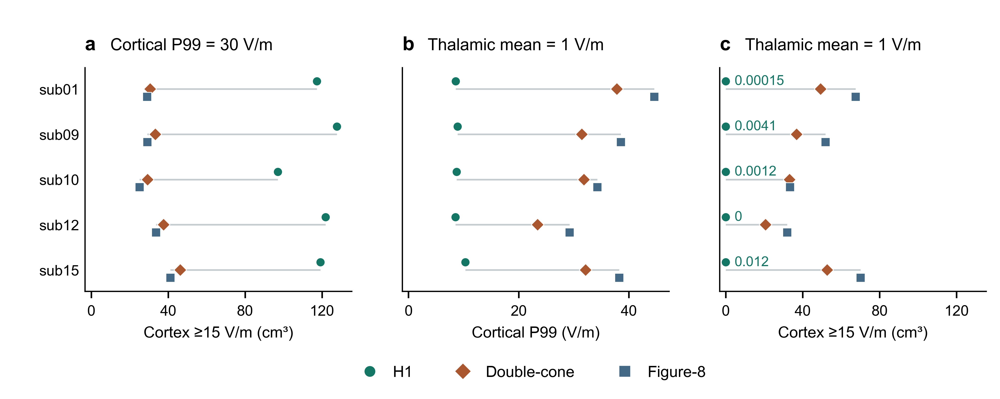
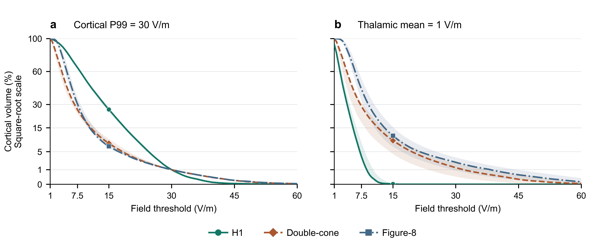

# 左丘脑电场相同时，皮层有多大范围处于强场？

在同一组五名受试者中，我们分别固定皮层强场水平和左丘脑靶区场强。这两个条件给出了不同的答案。把双侧大脑皮层电场的第 99 百分位（P99）统一到 **30 V/m** 时，H1 的皮层高场范围最大。把左丘脑平均电场统一到 **1 V/m** 时，H1 所需的皮层 P99 最低，皮层高场范围也最小。两句话中的“高场”均按 **总感应电场模长 ≥15 V/m** 计，五人逐一比较均得到上述结果。

## 一、固定同样的皮层 P99

对每名受试者的每只线圈分别调整电流变化率，使约 1% 的皮层体积达到或超过 30 V/m。再将所有达到其一半，即 15 V/m 的皮层四面体体积相加。这能区分“只有少数强点”和“较大一片皮层都接近强场”。

| 指标 | H1 | 双锥 | 八字 |
|---|---:|---:|---:|
| 皮层 ≥15 V/m 体积（cm³），中位数（个体范围） | 119.15（97.06–127.77） | 33.29（29.34–46.31） | 29.19（25.11–41.13） |
| 皮层 ≥15 V/m 占本人皮层体积，中位数 | 26.40% | 7.91% | 6.83% |
| 同时得到的左丘脑平均场（V/m），中位数 | 3.44 | 0.94 | 0.78 |

三种线圈在同一皮层强场水平下，H1 把较高的电场带到深部，也让大约四分之一的皮层达到 15 V/m。逐人按这档阈值比较，八字体积最小，双锥居中。把阈值提高到 45 V/m 后，H1 在五人中的皮层超阈体积反而都最小。单说某只线圈“最聚焦”会漏掉阈值决定的这一层差异。

## 二、固定同样的左丘脑平均场

现在把三种线圈调到相同的深部输出。1 V/m 是归一化参照，15 V/m 为靶区均值的 15 倍。除皮层较强的尾部外，我们也统计至少达到靶区均值的组织，以区分高场热点和较弱电场的覆盖范围。

| 指标（各列均为五人中位数） | H1 | 双锥 | 八字 |
|---|---:|---:|---:|
| 所需皮层 P99（V/m），括号内为个体范围 | 8.73（8.53–10.31） | 31.87（23.43–37.82） | 38.27（29.25–44.62） |
| 所需模拟电流变化率（A/µs） | 8.15 | 38.13 | 106.98 |
| 皮层 ≥15 V/m 体积（cm³） | 0.00122 | 36.80 | 51.85 |
| 靶区外灰质和白质 ≥15 V/m 体积（cm³） | 0.0323 | 71.28 | 105.96 |
| 皮层 ≥1 V/m 体积（cm³） | 429.77 | 463.90 | 465.57 |
| 皮层 ≥1 V/m 占本人皮层体积 | 92.26% | 99.78% | 99.95% |
| 靶区外灰质和白质 ≥1 V/m 体积（cm³） | 1022.05 | 1160.48 | 1182.25 |
| 靶区外灰质和白质 ≥1 V/m 占本人靶区外脑实质体积 | 85.70% | 98.61% | 99.55% |

H1 的 0.00122 cm³ 换算成 **1.22 mm³**。五人的网格中达到 15 V/m 的皮层单元分别只有 2、15、6、0、88 个，总体积在 0–0.01200 cm³ 之间。这一量级对网格分辨率敏感。五人中有一人的计算结果为零，表示该网格上没有皮层单元达到阈值。阈值降至 1 V/m 后，H1 在每个人的靶区外灰质和白质中仍覆盖了 84.05%–87.32%。这解释了为什么 H1 可以同时具有很小的皮层强场热点和很广的低强度场覆盖。

**图 1　同一个人、同一个左丘脑位置，改变比较条件后发生了什么。** 每行一名受试者。左图显示皮层 P99 相同时三种线圈的皮层高场体积。中图显示丘脑场相同时各自需要的皮层 P99。右图回到与左图相同的体积横轴，标签给出 H1 靠近零的读数，单位为 cm³。注意 sub10 的双锥和八字此时几乎重合，分别为 33.14 和 33.32 cm³。[矢量图](results/focality_paired.pdf)

**图 2　如果重新定义“强”，三种线圈的排序还成立吗？** 横轴是计入体积的最低场强，纵轴是达到它的皮层比例，采用平方根刻度，以便看清靠近零的小体积。线是五人中位数，阴影是最小至最大范围，点为主阈值 15 V/m。左图在 30 V/m 处三条曲线都接近 1%，这是按 P99 匹配的直接结果。以 7.5 V/m 计，五人的八字覆盖都大于双锥；以 15 V/m 计，五人均相反。右图在 1 V/m 附近显示三种线圈的弱场都覆盖了大部分皮层。[矢量图](results/focality_thresholds.pdf)

## 三、怎样得到体积

沿用 sub01、sub09、sub10、sub12、sub15 的原生 MRI、组织电导率、绕组和摆位。H1 取公开重建的固定形状，双锥为 95° 参数模型，八字为平面理想模型。三者沿用同一个体的头皮锚点及切平面规则，导线中心线至头皮的最短距离均为 12 mm。每人的靶区取左丘脑原生标签 10 内、距靶心不超过 5 mm 的灰质四面体重心。双侧大脑皮层取标签 3、42 与灰质的交集。“靶区外脑实质”取头模组织标签 1、2 的全部白质和灰质，剔除所选左丘脑靶区单元。皮层包含在靶区外脑实质内，两者的体积不能相加。

设基础驱动下第 $i$ 个单元的总电场模长为 $e_i=\|\mathbf E_i\|$，单元体积为 $v_i$。在同一头模、绕组、摆位与电导率下，电场随电流变化率线性缩放。设 $P$ 为皮层体积加权 P99，$T$ 为靶区体积加权平均模长。两种驱动缩放倍数分别为

$$
g_P=\frac{30\ \mathrm{V/m}}{P},\qquad
g_T=\frac{1\ \mathrm{V/m}}{T}.
$$

对解剖范围 $M$、绝对场强阈值 $t$，计算超阈体积和体积占比

$$
V_M(t;g)=\sum_{i\in M} v_i\,\mathbf{1}[g e_i\ge t],\qquad
f_M(t;g)=\frac{V_M(t;g)}{\sum_{i\in M}v_i}.
$$

固定阈值取 1、7.5、15、22.5、30、45、60 V/m，另保存连续阈值采样曲线。将每只线圈的阈值取为自身皮层 P99 的一半，得到的体积对驱动缩放保持不变；在皮层 P99＝30 V/m 时，它正好对应表一的 15 V/m 体积。如果改用别的共同丘脑场强，只要同比例改变阈值，覆盖范围也保持不变。若始终用绝对阈值 15 V/m，则需按实际目标强度重新读曲线。

表内先对每位受试者计算体积和占比，再分别取五人中位数。本次测量的是模型中的场强分布，15 V/m 和 1 V/m 都是实验的比较基准。由此推断神经激活范围还需要脉冲波形、神经纤维方向和兴奋阈值等数据。

## 数据核查与本地复跑

- 15 份基础驱动三维场均核对了网格拓扑、节点坐标与靶区。独立流程从各人的原生 MRI 分割和四面体重建掩膜，复算全部 210 条预设阈值记录。两种计算得到的皮层超阈体积最大绝对差小于 $2.1\times 10^{-11}$ cm³，靶区外脑实质小于 $10^{-10}$ cm³。
- 针对共同左丘脑均值 1 V/m，对五人、三种线圈分别用调整后的源项重新求解电势，共 15 次新的有限元求解。实得靶区均值与 1 V/m 的最大偏差小于 $3.7\times10^{-14}$ V/m。用重新求解的皮层电场逐单元判定，在 1 和 15 V/m 两档，两种方法选中的皮层单元完全一致。这是同一数值模型的复核。[逐人求解与阈值核查](results/verification)
- 五人的两种匹配条件、实际驱动、个体掩膜体积，以及每个阈值的体积和命中单元数均保存在本地。[逐人驱动及 P99](results/conditions.csv) · [预设阈值及单元数](results/thresholds.csv) · [阈值曲线数表](results/curves.csv) · [五人中位数与范围](results/cohort_summary.csv)

在项目根目录用 SimNIBS 4.6.0 附带的 `simnibs_python` 运行下列 PowerShell 命令。前一步三维场的生成方法见[五人左丘脑实验记录](../实验记录.md)。

~~~powershell
simnibs_python brain_field/cohort/focality/measure.py
foreach ($sid in 'sub01','sub09','sub10','sub12','sub15') {
    simnibs_python brain_field/cohort/focality/verify_target_solve.py $sid
}
simnibs_python brain_field/cohort/focality/summarize.py
simnibs_python brain_field/cohort/focality/plot.py
~~~

## 数据和方法出处

- SimNIBS 公开的五名受试者头模，来自 OpenNeuro ds000171 的一个子集。[头模与受试者说明](https://simnibs.github.io/simnibs/build/html/tutorial/advanced/group_analysis.html) · [OSF 数据](https://osf.io/ah5eu/) · [输入校验清单](../head_sources.json)
- SimNIBS 4.6.0 给出电场和电流变化率的线性关系。[驱动、场强及单位](https://simnibs.github.io/simnibs/build/html/faq.html) · [有限元实现](https://github.com/simnibs/simnibs/blob/v4.6.0/simnibs/simulation/fem.py)
- Deng、Lisanby、Peterchev 研究了半峰值体积与穿透深度，并讨论了固定深部靶强时浅部暴露的变化。本实验把双侧大脑皮层体积加权 P99 用作稳健的强场参照，用阈值以上组织体积描述空间范围。Deng 文中的 $S_{1/2}$ 还需要半值深度，本实验报告的量为体积。[深度与聚焦性研究](https://pubmed.ncbi.nlm.nih.gov/22483681/) · [深部靶点的线圈比较](https://pubmed.ncbi.nlm.nih.gov/24411523/)
- Worbs 等公开的 H1 重建线圈及其零形变几何。[H1 来源](https://doi.org/10.1016/j.brs.2025.05.136) · [项目三种绕组与摆位](../../../placement_pilot/placement/README.md)
