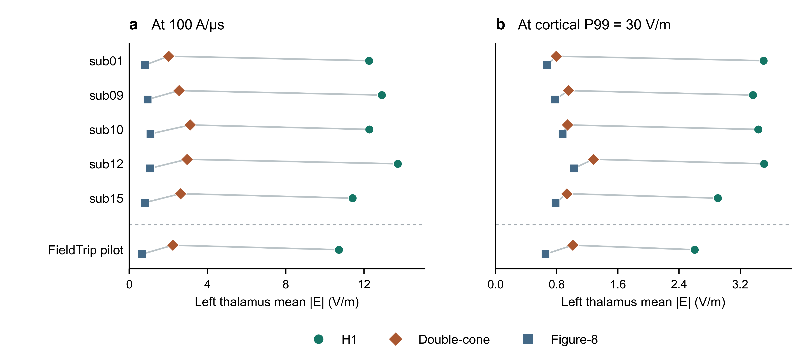

# 五个公开头模的左丘脑电场复跑记录

比较分两步。先让三种线圈使用相同电流变化率 **100 A/µs**；再为每一个人、每一只线圈单独设定电流变化率，使双侧大脑皮层的场强第 99 百分位（P99）达到 **30 V/m**。两步都在同一人的同一左丘脑靶区读出体积加权平均总电场。各受试者分别计数。

## 主要结果

- **相同电流变化率**下，H1 在 5/5 人的左丘脑均值居首。先逐人作比再取中位数，相对双锥为 **4.65 倍**（3.93–6.08），相对八字为 **13.82 倍**（11.32–15.44）。
- **相同皮层 P99**下，H1 在 5/5 人的左丘脑均值居首。先逐人作比再取中位数，相对双锥为 **3.53 倍**（2.74–4.42），相对八字为 **3.93 倍**（3.43–5.22）。

| 受试者 | 固定驱动 H1 | 双锥 | 八字 | 皮层匹配 H1 | 双锥 | 八字 |
|---|---:|---:|---:|---:|---:|---:|
| sub01 | 12.264 | 2.018 | 0.794 | 3.507 | 0.793 | 0.672 |
| sub09 | 12.915 | 2.547 | 0.935 | 3.368 | 0.954 | 0.778 |
| sub10 | 12.270 | 3.120 | 1.084 | 3.437 | 0.941 | 0.875 |
| sub12 | 13.733 | 2.955 | 1.077 | 3.515 | 1.281 | 1.025 |
| sub15 | 11.422 | 2.622 | 0.807 | 2.908 | 0.934 | 0.784 |
| FieldTrip Subject01（上轮参照） | 10.724 | 2.228 | 0.649 | 2.606 | 1.009 | 0.652 |

表中数值均为 V/m。最后一行来自另一数据集，仅作上轮参照；五人统计使用 SimNIBS 分组数据的全部五人。[含实际电流变化率、皮层 P99 及靶区样本量的数表](results/per_subject.csv) · [逐人配对倍率](results/paired_comparisons.csv)

**图｜在同一行比较三种绕组。** 左图固定驱动，右图固定皮层强场。点越靠右，该人的左丘脑平均电场越高。两个面板分别按横轴数值读数。虚线下方单列上一轮的 FieldTrip 受试者。[排版 PDF](results/paired_fields.pdf)

## 比较规则和核查

左丘脑用每个人原生 CHARM 解剖标签 10 定位，以距该标签质心最近的标签内体素为球心。主靶区取半径 5 mm 球内、同时落在左丘脑标签和有限元灰质的单元重心。皮层比较范围为左右大脑皮层标签 3、42 与有限元灰质的交集。每个单元以体积为权重求总电场模长的均值和百分位。

H1 使用公开重建绕组的零形变状态，双锥采用 95° 夹角模型，八字采用每翼六个同心环的平面模型。由靶点向个体头部上方投影，建立头皮锚点和局部切平面。三只线圈各自继承上轮的朝向，再沿法线调整，直到每只线圈的导线中心线到皮面的最近距离均为 12 mm。每个人的摆位都在读取电场前确定。

设 $T_{sc}$ 和 $P_{sc}$ 为受试者 $s$、线圈 $c$ 在共同驱动下的靶区均值和皮层 P99。电场随驱动线性变化，因此新的驱动和靶区均值为

$$
g_{sc}=\frac{30\ \mathrm{V/m}}{P_{sc}},\quad\dot I'_{sc}=g_{sc}\dot I,\quad T'_{sc}=g_{sc}T_{sc}.
$$

将皮层单元按场强从低至高排列，累计到皮层总体积 99% 时的场强就是 P99，约 1% 的皮层体积在这个值以上。统一 P99 后，比的是哪种线圈能把更高比例的场保留到靶区。将 30 V/m 换成另一个共同正值，只会同比例改变右栏数值。匹配这个百分位仍允许皮层热点的位置、面积和最大值随线圈改变。记录的电流变化率是模拟归一化量，实际设备输出受线圈与刺激器组合限制。

- 个体头顶至靶心的垂直深度范围为 74.17–79.60 mm，导线最小净距的设定值为 12 mm。固定形状 H1 外壳到皮面的最小间隔为 2.35–2.49 mm。
- 对新增的五人执行了 15 次基础驱动求解和 15 次匹配驱动重新求解。重新求解的皮层 P99 与 30 V/m 的最大绝对差为 5.79e-13 V/m；靶区向量相对于线性缩放的最大相对 L2 差为 7.08e-14。另从保存的 15 个固定驱动三维场逐个读回靶区和皮层数值，与直接求解的读数交叉核对。先前 FieldTrip 的匹配值直接由已保存的场缩放。
- 单独复核 sub01 时，从原生分割和四面体顶点重建了丘脑、皮层的单元编号及体积。两组编号与主分析完全一致。用独立的加权经验分布算法复算，三种线圈的皮层 P99 与主分析读数也逐一相同。
- 靶区半径 3 mm 时，固定驱动、匹配皮层条件下 H1 居首分别为 5/5、5/5 人。
- 靶区半径 5 mm 时，固定驱动、匹配皮层条件下 H1 居首分别为 5/5、5/5 人。
- 靶区半径 7.5 mm 时，固定驱动、匹配皮层条件下 H1 居首分别为 5/5、5/5 人。
- 在配备 RTX 4060 Laptop 和 32 GB 内存的机器上，SimNIBS 4.6.0 使用 CPU 逐人求解。五人主求解程序累计 12.8 分钟，单人峰值工作集最高 3.61 GiB。时间不含下载、摆位和制图。

这个样本来自同一公开队列。它检验这三套绕组、统一朝向、固定左丘脑位置下的跨个体一致性；对其他人群、靶点或摆位的排序，以及神经激活或疗效，仍需各自的数据。

## 本地复跑

从项目根目录用 SimNIBS 4.6.0 附带的 `simnibs_python` 运行下列命令。原始网格、ROI 索引及三种线圈的固定驱动全量场保存在 `tmp/brain_cohort/`，匹配驱动的实际求解指标及汇总表在本目录的 `results/`。既有 FieldTrip 对照使用上一轮生成的三份场和 ROI。首次运行时，先按[单头模复跑说明](../README.md)生成这些文件。下载新增头模时，脚本默认使用环境中的网络代理，也支持在脚本名后加 `--direct` 直连。

~~~powershell
simnibs_python brain_field/cohort/prepare_heads.py
foreach ($sid in 'sub01','sub09','sub10','sub12','sub15') {
    $modelDir = "tmp/brain_cohort/heads/$sid"
    simnibs_python brain_field/cohort/prepare_subject.py $sid --mesh "$modelDir/$sid.msh" --labels "$modelDir/segmentation/labeling.nii.gz"
    simnibs_python brain_field/cohort/solve_cohort.py $sid
    simnibs_python brain_field/cohort/measure_cohort.py $sid
}
simnibs_python brain_field/cohort/measure_cohort.py FieldTrip_Subject01
simnibs_python brain_field/cohort/measure_cohort.py aggregate
simnibs_python brain_field/cohort/plot_cohort.py
~~~

## 数据和方法来源

- SimNIBS Group Data Tutorial，v1.1。新增五名受试者来自 OpenfMRI/OpenNeuro ds000171，使用发布方提供的 CHARM 头模及个体解剖分割。[分组教程](https://simnibs.github.io/simnibs/build/html/tutorial/advanced/group_analysis.html) · [OSF 数据集](https://osf.io/ah5eu/) · [原始 MRI 队列](https://openneuro.org/datasets/ds000171) · [本地数据清单与校验值](head_sources.json)
- FieldTrip Subject01。前期单头模对照所用 MRI 与网格。[个体头模说明](https://www.fieldtriptoolbox.org/getting_started/othersoftware/simnibs/)
- Worbs 等，2025。H1 公开重建的绕组、名义形状和外壳几何。双锥和八字采用项目基准几何。[H1 重建论文](https://doi.org/10.1016/j.brs.2025.05.136) · [绕组模型与参数](../../placement_pilot/placement/README.md)
- SimNIBS 4.6.0。电场和电流变化率的定义及线性关系。[官方 FAQ](https://simnibs.github.io/simnibs/build/html/faq.html) · [有限元实现](https://github.com/simnibs/simnibs/blob/v4.6.0/simnibs/simulation/fem.py)
- Deng、Lisanby、Peterchev 以浅部场强归一化，研究了刺激深度与聚焦性的关系，并讨论了归一化到深部靶点场强时的取舍。本项目选择个体双侧大脑皮层的体积加权 P99 作为共同参照。[50 种线圈的深度与聚焦性研究](https://doi.org/10.1016/j.brs.2012.02.005) · [深部刺激的线圈设计研究](https://pmc.ncbi.nlm.nih.gov/articles/PMC4020988/)
