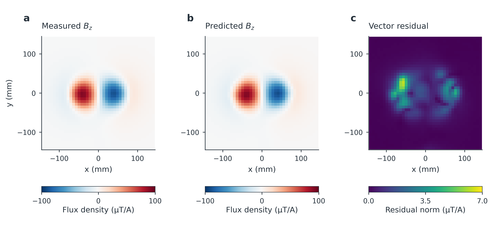

# 公开线圈台架测量与 MATLAB 复跑目录

若要查看在这些公开数据上提出的改进，可直接阅读[六点轴向位移反演](pose_refinement/README.md)、[利用开发层残差选择三轴测点](sensor_design/README.md)和[四点距离校准](decay_calibration/README.md)。三项实验的检验条件各自独立，共用一个[MATLAB 复跑入口](run_method_experiments.m)。

这里记录八组研究团队实际测了什么、项目采用了哪些公开记录、哪些参数借助了实测，以及怎样从资料复算。检索和复核日期为 2026-11-18。对更换安装配置后如何选择导航文件感兴趣的读者，可以先看[主实验的六点检查](../README.md#six-point-check)。

## 八组研究团队及可取得的数据

下表按实际采集团队计数。意大利报告和后续论文使用同一次测量。丹麦的三轴扫描和 25 款波形有共同研究团队。法国、德国两次采集相互独立，使用的部分预测模型均来自丹麦。读图得到的每个点多为原文报告的均值；一条线上的像素、同次扫描的相邻位置或连续时间样本均不能当作独立设备或独立重复次数。

| 实验室或合作组 | 直接使用的公开资料 | 本项目怎样比较、怎样复跑 |
|---|---|---|
| 荷兰乌得勒支，Petrov 等，2017 | 琼脂体模经过 MRI 相位处理的有符号 Bz 矩阵，10,622 个有效像素；另有作者模拟矩阵、导航文件两个版本。 | 给定绕组、电流和坐标预测 Bz；单独重评作者模拟；六个固定点选择导航版本，留出区域验证。原文〔1〕 · 作者更正〔2〕 · [逐像素输入与结果](../placement_pilot/public_benchmark/matched_figure8/README.md) · [六点评分](pose_check/pose_holdout_scores.csv) |
| 丹麦技术大学、丹麦磁共振研究中心与 MagVenture，Madsen、Drakaki 等 | MC-B70 的 NPZ 含 95,773 组坐标和三分量 B，另有外壳 STL。SimNIBS 发布 25 份有实测列和拟合列的时间 TSV。CCD 中的偶极子是由数据估计的模型参数。 | 254 个等效偶极子在部分数据上拟合，另取一层选正则化参数，最后检验三层。波形在原时轴上比较，不再调增益。扫描数据和作者代码〔3〕 · 25 款研究〔4〕 · [数据清单、逐点预测和波形](measured_coil_library/README.md) |
| 德国雷根斯堡，Schecklmann 等，2020 | 横向霍尔探头中心法线扫描。论文图 2 可读 C-B60 的 81 个均值和 D-B80 的 100 个均值。原作者将原始数据列为依申请取得。 | 5–40 mm 建模，41–70 mm 留出；另让丹麦同型号 C-B60 预测德国数据。分别保存了两套提点规则的敏感性。原图和方法〔5〕 · [181 个图示均值及复跑](regensburg/README.md) |
| 法国里昂及圣艾蒂安，Quesada 等，2024 | MAGPROBE-3D 探头和示波器测量，团队将 dB/dt 换算为 T。Cool-B65、Cool-D-B80 每款可取得图 2A 的 13 个距离均值和正文的 140 mm 端点；每款做过五轮测量。 | 10 mm 对齐幅值，15–60 mm 检验衰减，140 mm 单列外推。原文未列三分量合成的算法，本项目明示假设读数可与模型模长比较，并另算距离零点偏移的影响。原文〔6〕 · [28 个型号与位置组合](lyon/README.md) |
| 美国波特兰大学、加州大学圣迭戈分校和贝勒大学，Abbasi 等，2024 | 两个微型八字原型的一侧翼心霍尔 Bz，电流探头独立测得四档峰值电流。论文图 7、8 共 14 个实测标记，连续线来自作者的仿真。 | 对照简化双圆绕组、发表的 COMSOL 曲线和实测点；在两档电流共有的位置做跨电流预测。原文图 7、8〔7〕 · [逐标记坐标和 MATLAB 结果](abbasi/README.md) |
| 意大利 Bogi、Zoppetti、Pinto；D’Agostino 等后续复用 | Narda ELT-400 对 Magstim 9784-00 测得的 7 个峰值 B，报告表 1 提供坐标和绝对单位；后续论文列出其中 5 个点和 Sim4Life 数值。 | 用 14 匝模型按给定单位计算，并核对原表、外壳位置假设和导线离散。峰值电流沿用后续论文据同一批实测选定的 6.8 kA。2009 年仪器报告〔8〕 · 后续论文〔9〕 · [七点逐项结果](independent_lab/README.md) |
| 芬兰阿尔托大学和巴西圣保罗大学等，Matsuda 等，2025 | 球形导体台架。40 个原始探头 TXT 共 4,000 条波形、160 万个采样值；有单位的工作簿含 31 行统计输入。图 5 另有五组装卸前后的峰值 E。 | 核对 41 个文件的字节数和 MD5，重算波形峰值、工作簿的定位离散度和图中峰值差。TXT 保留采集单位，工作簿使用 mm 和 V/m。原文〔10〕 · 原始数据〔11〕 · [逐文件清单及复跑](independent_lab/README.md) |
| 以色列 Sheba 医学中心、魏茨曼科学研究所等，Roth 等，2007 | 盐水头形体模中实测的 E。图 8c 的 H1 和八字在同一条左侧扫描线上，图 9c 另给八字中央剖面；共提取 23 个标记。 | 从原图标记重算坐标和 V/m，统一在 4.5 cm 处插值。各线圈的驱动设置和摆位沿用原文，结果适用于该测量路径。原文〔12〕 · [读图误差和复绘图](measured_coil_library/roth/README.md) |

## 两种跨条件预测怎么读

**跨距离。** 法国团队测得 $b(d)$，另一个实验室的同型号模型给出磁场模长 $M(d)$。有一个已知距离 $d_0=10\ \mathrm{mm}$ 的实测值时，可以预报同一线圈另外一个距离的场强：

$$
\hat b(d)=b(d_0)\,\frac{M(d)}{M(d_0)}.
$$

分式决定模型形状，实测点决定绝对尺度。图示比较中 10 mm 必然相符，因此评分从 15 mm 开始。在 140 mm，两款预测分别为 4.46、8.78 mT，实测为 5.70、9.93 mT。近段的平均误差会掩盖这种远端偏差。[法国逐点评分和曲线](lyon/README.md)

**跨电流。** 对相同绕组、同一位置和波形形状相近的两档驱动，空气芯线性模型给出

$$
\hat B_z(I_2,d)=\frac{I_2}{I_1}\,B_{z,\mathrm{meas}}(I_1,d).
$$

美国原型 A 直接用 $1160/880$，原型 B 用 $2480/1680$。高档读数在模型给出预测以后才用于比较。B 原型的两个重合深度中，15 mm 预测 192.56 mT、实测 160.67 mT；20 mm 预测 111.86 mT、实测 109.11 mT。这样的逐点对照比给两种原型排一个总名次更能说明模型何处失准。[跨电流逐点数据](abbasi/current_transfer.csv)

**读图提示。** 两张带正负的图是同一个磁场分量 Bz，共用色标。残差图用三分量差向量的模长，数值总是非负。这个实验检验同一只 MC-B70 在尚未用于拟合的平面上能否重现场分布；法国实验增加了同型号跨研究团队的测试。两者独立性的含义不同。[丹麦等效源模型与训练、验证、测试划分](measured_coil_library/README.md)

## 另行核对的实测研究

以下研究给出了不同实验室的测量方法或图表。本轮没有将这些图表计入八组复跑数据。它们说明有哪些独立手段可以检验当前结论，也说明下一步需要怎样的原始资料。

| 一手来源 | 已发表的实测 | 与本项目的关系 |
|---|---|---|
| Bohning 等，南卡罗来纳医科大学，1997 | 通过 1.5 T MRI 测量志愿者中的线圈磁场，论文提供三维场图。 | 用于了解 MRI 测量的早期实现。本轮逐像素比较使用有坐标文件的 Petrov 体模。原文〔13〕 |
| Hernandez-Garcia 等，密歇根大学，2013 | 在 7 T 小动物 MRI 中用八字参考线圈激励体模，改变方向、频率和激励以重建时变磁场分量。 | 是独立于乌得勒支的 MRI 实验，可用于研究探头轴向与三分量重建的差异。原文〔14〕 |
| Salinas 等，得州大学圣安东尼奥团队，2007 | 将绕组线宽、线高、形状和匝数纳入模型，与线圈附近实测 E 比较。 | 可借鉴其逐项修改几何的控制实验，尤其适用于美国微型线圈中的近场残差。作者机构论文页〔15〕 |
| Nieminen 等，芬兰阿尔托大学，2015 | 扫描 TMS 设备的感应 E 分布，给出探头和空间采样方法。 | 有助于说明如何用空间扫描标定场的方向；与 Matsuda 的 Aalto 工作存在研究团队传承。原文〔16〕 |
| Tang 等，西澳大学等，2016 | 用霍尔探头以 1 mm 步距测量微型圆线圈轴向及横向的峰值，比较空气芯与铁芯。 | 提供额外的磁芯材质和空间衰减对照。现有空气芯解析式若用于铁芯，需要另行处理磁芯材料。原文及测量步骤〔17〕 |
| Gómez 等，2026 | 机器人测量两款新型线圈和商用参考线圈在球面上的 E，见图 17；作者另提供设计项目。 | 可借鉴双球壳的空间比较。设计代码和实测场图承担不同的证据作用。原文图 17〔18〕 · 项目代码〔19〕 |
| Lohr 等，弗吉尼亚联邦大学等，2026 | 四种小动物线圈在具有解剖和电导结构的鼠头体模中的 E 测量。 | 可借鉴导电体模构造。本次核对到公开工程中有 STL 与 Sim4Life 模型，原始探头波形未在该目录出现。论文〔20〕 · 作者 OSF 资料〔21〕 |

## 从项目根目录复跑八组数据

在 Windows PowerShell 中使用已配置的 Python 环境和 MATLAB R2025a。第一行准备并校验丹麦扫描、外壳和波形，第二行对八组公开资料重新计算。其他需要的公开输入由各子程序下载或读取项目缓存；德国、法国、以色列及美国论文的图示值如何读取，详见各实验页。已处理结果表与图均可直接浏览。

~~~powershell
& .\.venv\Scripts\python.exe .\external_measurements\measured_coil_library\prepare_inputs.py
matlab -sd (Get-Location).Path -batch "addpath('external_measurements'); run_external_measurements"
~~~

[统一 MATLAB 入口](run_external_measurements.m) · [14 类线圈、摆位及有限元复跑说明](../README.md) · [八字线圈上游文件与校验规则](../placement_pilot/public_benchmark/matched_figure8/README.md)

## 论文与数据来源

1. [原文](https://doi.org/10.1371/journal.pone.0178952)
2. [作者更正](https://github.com/pip010/plosone-data-pub01/releases/tag/v1.1)
3. [扫描数据和作者代码](https://github.com/simnibs/dipole-fit/tree/63d8cba254e3ade29c3db58eca9f5397a23e07c4)
4. [25 款研究](https://doi.org/10.1016/j.brs.2022.04.017)
5. [原图和方法](https://doi.org/10.1038/s41598-020-58034-2)
6. [原文](https://doi.org/10.1097/PR9.0000000000001134)
7. [原文图 7、8](https://doi.org/10.3390/s24051584)
8. [2009 年仪器报告](https://www.portaleagentifisici.it/filemanager/userfiles/DOCUMENTAZIONE/CEM/valutazioni/cem_rapporto_valutazione_transcranica.pdf?lg=IT)
9. [后续论文](https://doi.org/10.3389/fpubh.2025.1705893)
10. [原文](https://doi.org/10.1088/1361-6560/adf36e)
11. [原始数据](https://doi.org/10.5281/zenodo.15398706)
12. [原文](https://doi.org/10.1097/WNP.0b013e31802fa393)
13. [原文](https://pubmed.ncbi.nlm.nih.gov/9261822/)
14. [原文](https://pubmed.ncbi.nlm.nih.gov/23355446/)
15. [作者机构论文页](https://scholars.uthscsa.edu/en/publications/detailed-3d-models-of-the-induced-electric-field-of-transcranial-/)
16. [原文](https://doi.org/10.1016/j.brs.2015.01.004)
17. [原文及测量步骤](https://doi.org/10.3389/fncir.2016.00047)
18. [原文图 17](https://pmc.ncbi.nlm.nih.gov/articles/PMC12951185/)
19. [项目代码](https://github.com/luisgo/fdTMS)
20. [论文](https://pubmed.ncbi.nlm.nih.gov/41671583/)
21. [作者 OSF 资料](https://osf.io/aqtwh/)
