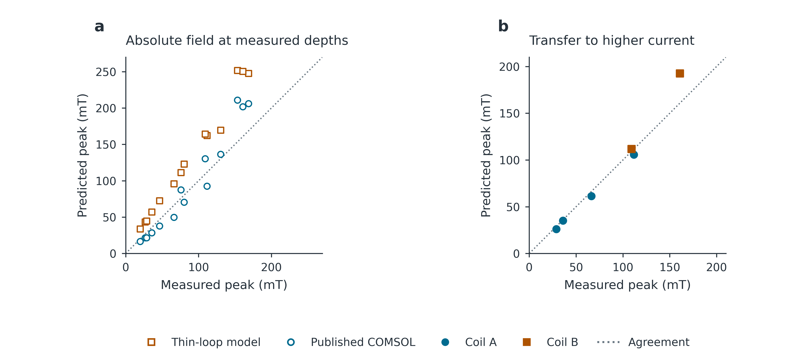

# 美国微型八字线圈的双电流霍尔台架

Abbasi 等在两个微型八字线圈**一侧绕组的中心**上方移动 DRV5056 霍尔传感器，沿 z 方向测量峰值 Bz，以 Rogowski 线圈记录峰值电流。A 线圈外形为 62 × 31 mm，每翼 9 匝，B 线圈为 76 × 38 mm，每翼 6 匝。比较的位置从线圈表面量起。此处把横轴从厘米换成毫米，纵轴保留毫特斯拉。〔1〕

**怎样读图。** 从出版商的无损 PNG 按灰色、黑色独立标记读取 14 个观测值。两图分别为 2511 × 1703、2391 × 1334 像素。横坐标按标记所在的名义距离记录，纵坐标用 0–300 mT 或 0–400 mT 轴刻度线性换算。一像素分别约 0.22 mT、0.44 mT，中心纵坐标移动 ±2 像素造成约 ±0.44 mT、±0.89 mT 的读数变化。该变化不包含探头校准、重复性和位置误差。原始采集没有随这些图点一并使用。图中的连续线是作者模拟，程序在标记两侧取线条中心并插值，曲线端点采用局部外推。像素坐标和图像 SHA-256 可复查。〔2、3〕 · [取点记录](published_markers.csv)

**几何模型复算。** 本项目用两个相切理想圆环，半径取整只线圈长边的四分之一，所有匝折合在同一圆周，电流方向相反。从翼心沿法线计算 Bz。以绕组平面代替实际表面，未拟合外壳厚度、匝间距、层高或电流倍率。这一简化是为了检验只给外形、匝数和电流的台架模型能达到何种误差。

| 线圈、电流 | 可读深度数 | 简化圆环对实测的相对 L2 | 作者图中 COMSOL 曲线对实测的相对 L2，读图近似 |
|---|---:|---:|---:|
| A，880 A | 5 | 61.64% | 32.45% |
| A，1160 A | 4 | 46.56% | 19.82% |
| B，1680 A | 3 | 42.04% | 17.59% |
| B，2480 A | 2 | 54.22% | 23.82% |

**在另一档电流下能否复用同一深度的台架读数？** 先读取低电流下的霍尔值，再乘以独立记录的高低电流之比，预测高电流值。两档均有标记的深度才进入检验，不做增益拟合。A 线圈在四个重合深度的相对 L2 差为 **6.04%**，B 线圈在两个重合深度为 **16.48%**。这些误差来自两次公开的测量，不能单凭两个或四个深度推断设备允差。工程上，已有同型号实测曲线时可以优先检验跨电流复用；仅靠外形与匝数不足以给出准确的绝对场强。[逐点读数与两个模型](hall_depths.csv) · [跨电流预测](current_transfer.csv)

横纵坐标均为 mT，离对角线越远表示预测与实测差距越大。左图比较 14 个实测标记和两种几何预测，右图只比较两档电流都测过的位置。A 原型四个位置的误差低于 B 原型的两个位置，样本范围限于这两只原型。[矢量 PDF](../../figures/measurements/m05_current_transfer.pdf)

从本目录在 MATLAB 中运行 `rerun_abbasi`。程序校验出版商图像，复用项目的直线段场核，更新三份结果表。[MATLAB 脚本](rerun_abbasi.m) · [分组评分](thin_loop_scores.csv)

## 论文与数据来源

1. [论文方法、图 7 和图 8](https://doi.org/10.3390/s24051584)
2. [图 7 原图](https://mdpi-res.com/sensors/sensors-24-01584/article_deploy/html/images/sensors-24-01584-g007.png)
3. [图 8 原图](https://mdpi-res.com/sensors/sensors-24-01584/article_deploy/html/images/sensors-24-01584-g008.png)
