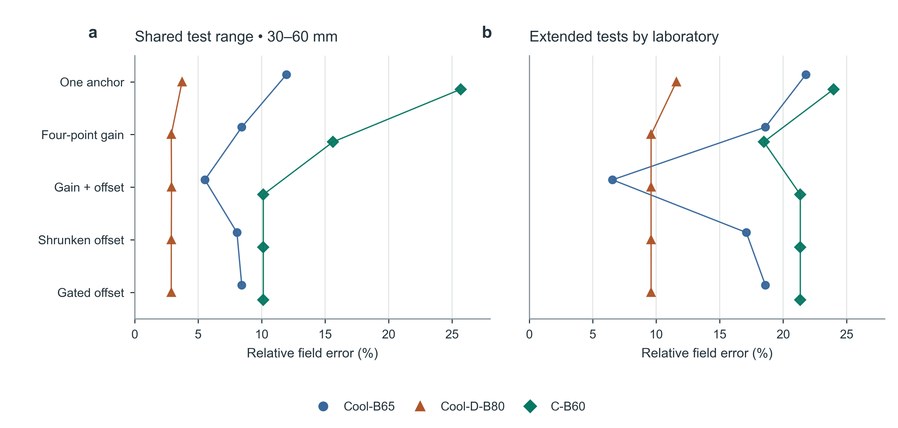

# 用四个近端测点校准同型号线圈的衰减曲线

把一条已知形状的衰减曲线叠到实验图上，除了沿纵轴放大，还可以沿横轴平移。前者描述驱动幅度或仪器比例不同，后者可能来自模型零面与探头有效中心之间的位置偏差。对另一实验室的真实台架，仅用四个近点能辨别这两项吗？本实验事先固定校准和测试距离，比较了五种做法。统一测试区间内，三款线圈的四点幅值模型均优于历史单点基线，允许额外距离偏移的收益则取决于线圈和评价区间。[运行前写定的比较规则](protocol.md) · [逐点预测](predictions.csv)

## 与近年工作的关系

Drakaki 等根据台架测量估计商业线圈的等效磁偶极子，提供了本实验采用的三个型号。其后，2025 年发表的多位点 TMS 平台研究在半径 70 mm 的球面上取 1,000 点测 E，明确将线圈底面距测量球面的距离控制为与模型相同的 15 mm。Gomez 等 2026 年在 7 cm、6 cm 两个半球壳上分别实测新型线圈和商用参考件的 E，并分别核对模拟。这两项工作说明了两种可借鉴的实验设计：先核对探头与线圈实际距离，再在另一个空间位置检验预测。〔1〕 · 〔2〕 · 〔3〕

本项目将这个问题转到只有少量距离均值的空气磁场 B 台架上。法国 Quesada 等报告 Cool-B65、Cool-D-B80 的 MAGPROBE-3D 读数，将探头采集的 dB/dt 换算为 B。三个通道怎样合成图示强度没有完整公布，这里沿用模长假设。德国 Schecklmann 等用单轴横向霍尔探头测 C-B60，按论文给的传感面方向，采用丹麦模型中心轴处的法向分量绝对值。法国和德国的公开曲线都是论文图中均值，法国 140 mm 值还可从正文直接读取。丹麦模型与两处测量按具体型号匹配。〔4〕 · 〔5〕 · [法国数字化说明](../lyon/README.md) · [德国数字化说明](../regensburg/README.md)

## 哪些参数是项目估计的

设 $d$ 为探头从台架名义表面量起的距离，$M(d)$ 为丹麦 CCD 的每安培预测，$y$ 为测量。本项目估计一个正的有效增益 $g$ 和一个有效偏移 $\delta$，得到

$$
\hat y(d)=g\,M(d+\delta),\qquad
\alpha(\delta)=\log g=\frac{1}{4}\sum_{i=1}^4
\big[\log y_i-\log M(d_i+\delta)\big].
$$

在近端的 10、15、20、25 mm 上，先对每个候选偏移解析求出 $\alpha$，再一维寻优。使用对数是为了让校准关注比例误差。评分时恢复 T 或 mT，使用未经对数变换的常规相对 L2。收缩版本的目标为

$$
\min_{-5\leq\delta\leq5}\ 
\sum_{i=1}^4\frac{[\log y_i-\alpha(\delta)-\log M(d_i+\delta)]^2}{0.05^2}
+\frac{\delta^2}{(5\ \mathrm{mm})^2}.
$$

这里 $\delta$ 以 mm 计。±5 mm 沿用原项目对零点不确定性的敏感性区间。0.05 是本项目固定的单点对数差设计尺度，实际各传感器噪声未知。带留一检查的版本依次只用三个近端距离估参、预测第四个近端距离，再比较四折合计的对数平方误差。只有收缩版本优于固定零点时才启用偏移，随后用四点重新估参、一次性预测远端。这给出了台架上实际可执行的决定方法；额外的远端观测只用于评价。[参数、留一误差与触发结果](calibration.csv) · [每折输出](near_leave_one_out.csv)

## 同一组留出距离上的消融

所有行的主评价使用 30、35、40、45、50、55、60 mm 七点。表内数值为相对 L2（%）。后四行在每个型号上共用相同的四个校准读数，因此它们的差异可归于模型选择；第一行只用 10 mm 一个读数。

| 模型 | 法国 Cool-B65 | 法国 Cool-D-B80 | 德国 C-B60 |
|---|---:|---:|---:|
| 10 mm 单点幅值 | 11.95 | 3.72 | 25.68 |
| 四点幅值，固定零点 | 8.43 | 2.88 | 15.62 |
| 四点幅值 + 偏移，只有硬边界 | 5.53 | 2.90 | 10.13 |
| 四点幅值 + 偏移，加入收缩 | 8.05 | 2.88 | 10.13 |
| 根据四个近端点的留一结果决定是否启用收缩偏移 | 8.43 | 2.88 | 10.13 |

左图共用 30–60 mm 的七个测点；右图法国两款取 140 mm 单点的绝对相对偏差，德国 C-B60 取 41–70 mm 的 30 点相对 L2。越靠左表示越接近测量。法国两个型号的近端留一检查都选择固定零点。Cool-B65 在远端反而是未经收缩的 +5 mm 方案误差更小，说明四个近点有时分辨不出对外推有利的修正。Cool-D-B80 在各个四点版本间差别很小。德国 C-B60 的近端留一对数均方根差由 0.1423 降为 0.1050，因此启用偏移。得到的 +5 mm 正好碰到搜索边界；在七个留出距离上的 RMSE 由单点的 16.49 mT 降至四点幅值的 10.03 mT，再降至允许偏移的 6.50 mT。[矢量 PDF](../../figures/methods/depth_calibration.pdf) · [全体分数](test_scores.csv)

## 到更远的位置重测，哪个结论还能保留

| 单独评价的远段 | 历史单锚 | 四点幅值 | 无收缩的偏移 | 收缩偏移 | 近端留一决定 |
|---|---:|---:|---:|---:|---:|
| Cool-B65，140 mm，带符号偏差（%） | −21.79 | −18.60 | −6.55 | −17.09 | −18.60 |
| Cool-D-B80，140 mm，带符号偏差（%） | −11.59 | −9.60 | −9.59 | −9.60 | −9.60 |
| C-B60，41–70 mm 共 30 个整数距离，相对 L2（%） | 23.97 | 18.48 | 21.35 | 21.35 | 21.35 |

德国 C-B60 增加偏移后，七个统一距离的误差变小，然而在覆盖更远距离的 30 点集合上反而从 **18.48% 增至 21.35%**。两种评分集合有少量共用距离，不能当作两轮采集。法国两个 140 mm 端点分别来自一次发表均值。四点幅值比单点更稳定的观察，在这里经受了两种评分范围的检验；仅凭这些数据无法将改进推广到所有线圈。[远端逐点残差所需数据](predictions.csv)

## 偏移能否当作真实探头坐标

校准只观察 $gM(d+\delta)$。如果四个测点处 $\log M(d)$ 的斜率几乎相同，平移 $\delta$ 后的曲线近似等比缩放，增益便能抵消它。令 $s_i$ 为各点该斜率。以固定零点和前述 0.05 设计尺度做局部线性化，偏移分辨尺度 $0.05/\sqrt{\sum(s_i-\bar s)^2}$ 对法国两款分别为 **15.45、40.65 mm**，德国为 **4.01 mm**。前两项都超过 5 mm 搜索半宽。这些量反映设计矩阵对偏移的灵敏度，不能充当实测置信区间。[线性化诊断与参数](calibration.csv)

德国四个近点的模型法向分量仅占磁场模长的 **2.13%–3.10%**。一个很小的探头转角、横向偏心或模型绕组非对称都可能显著改变这一弱分量。四点法的有效增益约 $1.41\times10^5$，允许偏移后约 $2.02\times10^5$。这些比例包含传感方向和空间配准的影响，无法倒推出该设备的实测线圈电流。德国数据能检验归一化曲线形状，要辨认真实偏移还需要独立的探头位置、方向或电流记录。[近点三维场模与法向分量](probe_components.csv) · 〔5〕

## 复跑

在项目根目录打开 MATLAB，执行以下两行。脚本校验三个固定版本 CCD 的 SHA-256，首次使用缺少的模型时会从 SimNIBS 下载。计算仅用 CPU，完整复跑已在 MATLAB R2025a 上执行。

~~~matlab
addpath('external_measurements/decay_calibration')
run_decay_calibration
~~~

[MATLAB 源码](run_decay_calibration.m) · [近端校准参数](calibration.csv) · [所有测试分数](test_scores.csv) · [逐距离预测](predictions.csv) · 〔6〕

## 论文、数据集与项目出处

1. [Drakaki 等的线圈模型](https://doi.org/10.1016/j.brs.2022.04.017)
2. [2025 年球面平台的布置](https://doi.org/10.1186/s12938-025-01393-6)
3. [Gomez 等，图 17](https://pmc.ncbi.nlm.nih.gov/articles/PMC12951185/)
4. [法国原文](https://doi.org/10.1097/PR9.0000000000001134)
5. [德国原文](https://doi.org/10.1038/s41598-020-58034-2)
6. [固定版本 CCD 库](https://github.com/simnibs/simnibs/tree/fde509f6f8de38a4b03947944cf7ee93b8bebabe/simnibs/resources/coil_models/Drakaki_BrainStim_2022)
