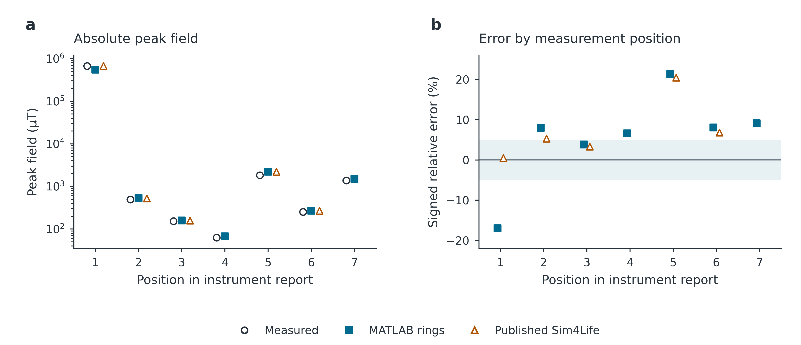
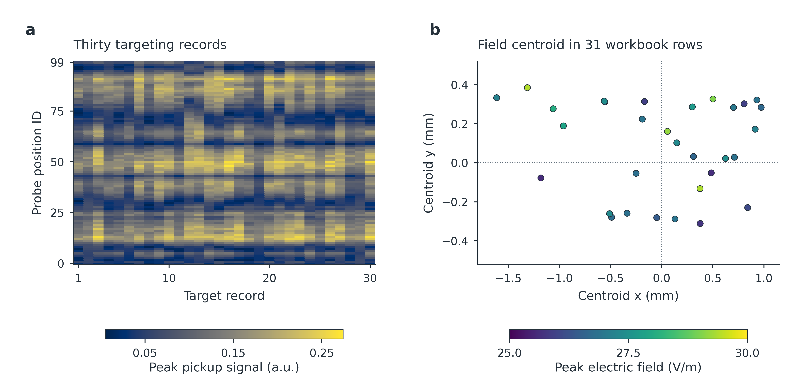

# 两组台架实测能检验什么

意大利的实验在圆线圈周围摆放磁场探头，留下了有坐标、有单位的峰值磁通密度 $B$。这组数据可以回答“给定电流和绕组，代码算出的绝对磁场差多少”。芬兰阿尔托大学与巴西圣保罗大学等单位的合作组用另一种探头测量多线圈阵列的感应电场 $E$。它回答“机械臂移动后，电子控制能把电场中心放回多准”。这两个问题分别对应线圈模型的幅值和台架的定位重复性，适合分别检验。〔1、2〕

## 圆线圈的七个绝对磁场值

2009 年，Bogi、Zoppetti 和 Pinto 在装有 3 L、0.01 mol/L 盐水的容器旁，用 Magstim BiStim 驱动 MAG-9784-00 圆线圈。设定为最大输出的 70%，用带 3 cm² 探头的 Narda ELT-400 记录磁场峰值。$D_1$ 沿轴向，原报告从容器边缘起算。$D_2$ 是相对线圈轴线的水平径向距离。$H$ 是探头离地高度，线圈中心高 113 cm。此处保留表 1 的原始顺序。〔1〕

| 点 | $D_1$ / $D_2$ / $H$（cm） | 实测峰值（µT） | 本项目 MATLAB（µT） | 相对实测偏差 | 已发表 Sim4Life（µT） |
|---|---|---:|---:|---:|---:|
| 1 | 4 / 0 / 113 | 667000 | 553684 | −16.99% | 669900 |
| 2 | 64 / 0 / 113 | 494 | 533.5 | +7.99% | 520 |
| 3 | 96 / 0 / 113 | 153 | 158.9 | +3.85% | 158 |
| 4 | 128 / 0 / 113 | 63 | 67.16 | +6.60% | — |
| 5 | 0 / 32 / 113 | 1827 | 2216.9 | +21.34% | 2200 |
| 6 | 0 / 64 / 113 | 251 | 271.2 | +8.04% | 268 |
| 7 | 32 / 0 / 141 | 1378 | 1503.4 | +9.10% | — |

D’Agostino 等后来引用了这次测量的五个点，并用 Sim4Life 建模。我们采用其正文表 1 的 14 匝和 70/122 mm 内外径，按等宽径向区间放置 14 条共面的导线中心线，每匝分为 1,536 段。取论文用于匹配实测的峰值电流 6.8 kA，沿用本项目的有限直导线求解器。这个电流值依赖同一次测量的背景信息；原报告没有给出独立电流探头波形。点 4、7 只见于 2009 表格，后来论文未列出对应模拟值。〔3、4〕



左图用对数纵轴，同时看见 63 µT 与 667,000 µT 两个量级相差很大的测点。右图以实测为分母计算带符号偏差 $100(B_{\rm calc}/B_{\rm meas}-1)$。七点平均绝对相对偏差为 **10.56%**，只有点 3 落入补充材料报告的 ±5% 测量不确定度。全体的相对 $L_2$ 误差为 16.99%，几乎完全受最近的点 1 支配。径向 32 cm 的点 5 有最大的相对偏差 **21.34%**。[各点结果与灵敏度](italy_results.csv) · [按测点集合汇总](italy_summary.csv)

我们把 $D_1$ 近似为到绕组平面的轴距。原始报告给出容器边缘、探头参考点和设备外形，未精确给出导线平面与两者的偏移。在点 1，把轴距从 40 mm 改为 35 或 45 mm，预测从 554 mT 变为 646 或 474 mT。变更用于量化位置敏感性，主结果保持 40 mm。改用原报告给出的 67/126 mm 内外径，点 1 变为 551 mT。离散检查将每匝 768 段加倍，七点变化均小于 0.001%；轴上四点另用各圆环轴向解析解求和核对。有限探头面积、真实绕组截面及三维引线均未建模。数据不足以从中唯一识别误差原因。[MATLAB 实现](run_italy.m) · 〔1〕

同一测点也能检验二手文献的数字。后续论文补充材料给出的径向 32 cm 模拟值是 2.2 mT，实测是 1.827 mT，据表重算得到 **+20.42%**。径向 64 cm 为 **+6.77%**。补充材料文字给出的“最大 5.26%”只与轴向三点的最大相对偏差相符。图中的橙色三角对应原表数值。本项目未运行 Sim4Life。〔4〕

## 五线圈球面台架的定位和场峰

Matsuda 等在半径 70 mm 的球形导体等效模型上测量感应电场，线圈底面距探头 15 mm。阵列含两只四叶形、两只八字和一只椭圆线圈。作者通过移动整套线圈并电子调节电场位置，来检验重新瞄准的误差。数据仓库同时保存测试波形、统计工作簿和分析材料。〔2、5〕

| 来源和范围 | MATLAB 的处理 | 可以据此回答的问题 |
|---|---|---|
| 30 个靶位 TXT，各含通道 0 的 100 个位置，每个位置 400 个样本 | 按位置编号读取波形，扣除最初 8 个样本的中位数，取绝对峰值 | 编号相同的位置在不同靶位文件中有多大信号变化？ |
| 5 个线圈，各 2 个采集通道的 10 个 TXT，布局同上 | 保留线圈与通道身份，逐位置抽取峰值，另存峰值最大的位置 | 哪个位置编号在该通道得到最大信号？ |
| 作者工作簿首表 B2:D32，共 31 行 | 按作者工作簿自身公式使用的全体行重算均值与样本标准差 | 球面上焦区中心与已换算电场的离散程度如何？ |
| 论文图 5 的 5 对有单位峰值 | 转录图中数字，按原文式 (1) 逐对计算 | 把线圈固定在机器人法兰上后，峰值改变多少？ |

40 个 TXT 共 **4,000 条波形、1,600,000 个采样值**，脚本核实每个文件的位置编号恰为 0–99。TXT 缺少带单位的通道标定及完整二维坐标，保留归档信号单位和位置编号。31 行工作簿与 30 个靶位文件之间的对应关系未记载，分别汇总。这个工作簿的作者统计公式也明确引用 2–32 行。[41 个输入文件的字节数、官方 MD5 和下载链接](finland_source_manifest.csv) · [按通道提取的结果](finland_coil_channel_peaks.csv)



左图每列是一份靶位文件。建立每个位置跨 30 列的信号中位数作为参照曲线，逐列求相对 $L_2$ 偏离，范围 17.62%–34.48%，中位数 **24.24%**，Pearson 相关中位数 **0.911**。这个量同时受到信号幅度、空间形状和电子补偿条件影响。右图每一点代表工作簿一行，颜色是作者给出的峰值 $E$。其均值 ± 样本标准差分别为 $x=-0.0011\pm0.7198$ mm、$y=0.0785\pm0.2373$ mm、$E_{\rm peak}=27.1395\pm1.0417$ V/m。两幅图显示的是不同的数据表达；结合论文坐标、单位和标定过程才能解释场强。原文报告的三个离散量按一位小数分别为 0.7 mm、0.2 mm 和 1.0 V/m，与工作簿复算相符。[30 个靶位曲线指标](finland_target_profiles.csv) · [工作簿汇总](finland_targeting_workbook.csv) · 〔2〕

图 5 使用另一组 250 个测点，覆盖直径 40 mm，测量机器人法兰安装与移除两个状态。图中每幅分布有单独标出的峰值（V/m），可复算 $100\lvert E_{\rm with}-E_{\rm without}\rvert/E_{\rm without}$。五个线圈分别得到 **6.70%、7.86%、1.93%、1.33%、0.00%**。图中文字只有一位小数，五个结果的算术均值 3.56%；即使每个输入只浮动半个末位，均值允许范围亦为 3.19%–4.07%，覆盖文章报告的 3.3%。归档波形中的通道编号不能直接解释成这两个法兰状态。[图中读数](finland_fig5_peaks.csv) · [相对差及舍入区间](finland_attachment_comparison.csv) · 〔2〕

这组台架资料适合作为线圈摆位复现性的量级参照。若要据此验证项目里某一只八字线圈的绝对电场，需要逐一匹配绕组、激励和空间坐标，并采用同一球形导体的探头响应。由当前材料无法给出 H1、双锥和八字的临床效果排名。

## 另外三组公开实测可追溯到什么程度

| 研究团队 | 测量对象和可借鉴之处 | 本次查阅到的材料 |
|---|---|---|
| 密歇根大学 Hernandez-Garcia 等，2013 | 7 T MRI 中直径 3 cm、两翼夹角约 130° 的自制折叠八字线圈。研究通过改变摆向，从数个磁场投影恢复三分量，说明单个 MRI 分量与磁场模长应分别比较。 | 〔6〕 |
| Duke／Purdue 的 Gomez 等，2026 | 用机器人探头在两个球壳测量 F65、F80 及常规 B65、B80 的感应电场，可借鉴其在相同深度比较聚焦度的做法。 | 论文图 17 展示模拟与实测，作者另发布设计代码。〔7、8〕 |
| 弗吉尼亚联邦大学／麻省总医院的 Lohr 等，2026 | 在导电鼠脑体模中用偶极探头测四种小型线圈，适合了解探头方向和组织电导率对空间采样的影响。 | 〔9、10〕 的公开根目录列出脑、脑脊液、颅骨、皮肤四个 STL 与一个仿真文件，未见独立探头数表。〔11〕 |

以上三组是调研来源。本页数值复跑的输入只来自前两节列明的数据。

## 从项目根目录复跑

在 MATLAB 中执行以下命令。意大利入口直接读取项目内转录的原表。芬兰入口优先使用项目的本地原始数据缓存，否则从作者记录按文件下载，上机前核对字节数及 MD5。两个实验均在 MATLAB R2025a 的 CPU 上运行；复跑芬兰实验需联网下载或事先备妥原始文件。

```matlab
addpath(fullfile(pwd,'external_measurements','independent_lab'))
run_italy
run_finland
% 本地已有作者原文件时，也可直接指定缓存目录
% run_finland('D:/data/zenodo-15398706')
```

[七点原始转录](italy_measured.csv) · [圆线圈脚本](run_italy.m) · [多线圈探头脚本](run_finland.m) · [提取后的每位置峰值矩阵](finland_profiles.mat)

## 论文与数据来源

1. [意大利原始测试报告，表 1](https://www.portaleagentifisici.it/filemanager/userfiles/DOCUMENTAZIONE/CEM/valutazioni/cem_rapporto_valutazione_transcranica.pdf?lg=IT)
2. [Matsuda 等，2025](https://doi.org/10.1088/1361-6560/adf36e)
3. [2026 论文，表 1 及建模方法](https://www.frontiersin.org/journals/public-health/articles/10.3389/fpubh.2025.1705893/full)
4. [补充材料，表 2–4](https://doi.org/10.3389/fpubh.2025.1705893.s001)
5. [作者 Zenodo 实测数据，CC BY 4.0](https://doi.org/10.5281/zenodo.15398706)
6. [论文及图 1–6](https://pmc.ncbi.nlm.nih.gov/articles/PMC3645268/)
7. [论文](https://pmc.ncbi.nlm.nih.gov/articles/PMC12951185/)
8. [fdTMS 设计项目](https://github.com/luisgo/fdTMS)
9. [正式论文](https://pubmed.ncbi.nlm.nih.gov/41671583/)
10. [作者 OSF](https://osf.io/aqtwh/)
11. [文件目录 API](https://api.osf.io/v2/nodes/aqtwh/files/osfstorage/)
