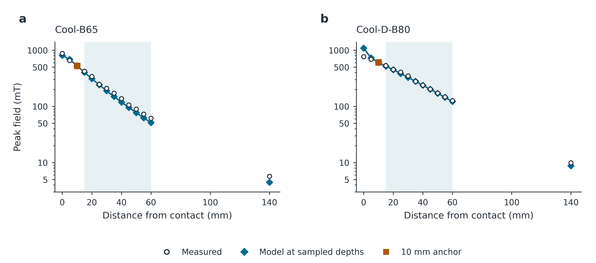

# 里昂与圣艾蒂安空气台架的同型号线圈对照

Quesada 等把平面八字线圈 **Cool-B65** 和有倾角的 **Cool-D-B80**（原文写作 Cool-DB80）固定在非金属支架上，用直尺引导 MAGPROBE-3D 从线圈中心表面的接触位置向空气方向移动。每款线圈以 100% 刺激器输出完成五轮测量，步距 5 mm，最远 140 mm。原论文还包含其他实验，本目录只使用其**空气台架**部分。它与[雷根斯堡霍尔试验](../regensburg/README.md)采用不同的线圈型号、仪器和放置方式。〔1、2〕

空心圆为从论文取得的空气场均值，菱形是同位置的模型预测，方块是唯一的 10 mm 幅值标定点。浅色区域的 15–60 mm 读数留到标定后评分。60 mm 与 140 mm 之间没有可核对的中间测量值，图中留白。对数纵轴使远端的毫特斯拉量级也能看清。[矢量 PDF](../../figures/measurements/m03_french_decay.pdf)

## 能取得哪些观测

- 图 2A 每款线圈画出 0、5、…、60 mm 的 **13 个平均值**及 SD 误差条。正文给出接触位置的场强（0.88 T、0.77 T）和额外的 140 mm 空气端点（0.00570 T、0.00993 T）。由此共获得 **28 个型号与位置组合**。0 mm 使用正文明列数值，CSV 另存同位置的读图结果。拟合曲线所在的图 2B 没有作为新增测量。
- 出版图宽 578 像素，图 2A 的纵轴约 3.82 mT/像素。蓝色圆和橙色菱形的中心由原色栅格提取；接触位置对照正文，读图差异为约 4.1 和 0.6 mT。近似读取的标记值、实验端点和模型曲线在数据文件中分别标注。五轮逐次波形和 65–135 mm 的中间测量值没有出现在本次使用的公开数据里。〔3〕 · [整理后的均值](air_observations.csv)

## 模型与标定

Drakaki 等用独立台架测量重建了商业线圈的等效磁偶极子源。此处使用 SimNIBS 归档中与法国实验**同型号**的 Cool-B65（1,000 个偶极子）和 Cool-D-B80（2,495 个）。每项数据含源位置和加权方向，可以按磁偶极子的毕奥–萨伐尔场计算任意外部观测点的磁场向量。对于距第 j 个源的位移向量 **r**，贡献与 `[3r(mⱼ·r)/|r|² − mⱼ]/|r|³` 成正比。程序按 SI 单位乘以 μ₀/(4π)，合计为一安培的 Bx、By、Bz。〔4、5〕

MAGPROBE-3D 是三轴感应探头，电压响应 dB/dt。法国团队报告 1 V 对应 1.4 kT/s，并在 MATLAB 中将信号换算为 T。论文未公开三通道波形、时间积分细节或将三分量合成图 2 标量的完整算式。本次把报告的“磁场强度”与模型三分量模长比较，属于明示的物理量假设；三分量和模长均导出供复核。〔2、6〕

取模型中心轴 (0,0,d)，名义工况令模型 z=0 与实验探头端部接触线圈外壳的中心零点对齐。原文没有给出探头内部有效中心相对端面的偏移、与模型的空间配准或峰值线圈电流。仅在 d=10 mm 的一个点确定幅值，之后固定比例预测其余位置。

$$
\widehat B(d)=B_{\rm obs}(10)\,\frac{\|\mathbf B_{\rm model}(d)\|_2}{\|\mathbf B_{\rm model}(10)\|_2},
\qquad
\varepsilon=100\,\frac{\|\widehat B-B_{\rm obs}\|_2}{\|B_{\rm obs}\|_2}.
$$

式中距离单位为 mm，ε 在 15–60 mm 的十个等间距测点上计算。另把模型取样位置固定平移 −5 和 +5 mm，在每个假设中仍只用 10 mm 标定，检查衰减曲线对零面定义的敏感性。主结果使用零偏移，不按最低残差挑选摆位。[零点敏感性](axial_origin_sensitivity.csv)

## 复跑所得的衰减误差

| 型号 | 15–60 mm RMSE | 15–60 mm 相对 L2 差 | 140 mm 预测 | 140 mm 文章读数 | 140 mm 带符号相对偏差 |
|---|---:|---:|---:|---:|---:|
| Cool-B65 | 17.52 mT | 8.01% | 4.458 mT | 5.700 mT | −21.79% |
| Cool-D-B80 | 11.11 mT | 3.47% | 8.779 mT | 9.930 mT | −11.59% |

同型号等效源和独立实验的近中距离衰减较接近，最远端两款都低估了读数。单点标定吸收了刺激器输出、电流及读出增益的整体差异，因此这些百分数描述**指定配置下的空间衰减误差**。最远端用正文均值单独报告；一个远端点并不能验证整个 65–140 mm 区间。[评分](air_metrics.csv) · [逐位置计算和实测](air_profiles.csv)

## 复现

在本目录打开 MATLAB，执行 `run_lyon_distance`。初次联网下载两个固定版本的 CCD 并校验 SHA-256，随后缓存于项目 `tmp/lyon`。如需从公开图重做数字化，先运行 `python digitize_air.py`（NumPy、Pillow），再运行 MATLAB。出版图采用 CC BY 4.0，图中观测来源为 Quesada 等 2024 年图 2A 和正文，曲线预测与误差均为本次计算。[MATLAB 源码](run_lyon_distance.m) · [提点代码](digitize_air.py)

## 论文与数据来源

1. [原文第 2.3–2.5 节及图 2](https://doi.org/10.1097/PR9.0000000000001134)
2. [开放全文](https://pmc.ncbi.nlm.nih.gov/articles/PMC10876241/)
3. [出版图 2](https://pmc-oa-opendata.s3.amazonaws.com/PMC10876241.1/painreports-9-e1134-g002.jpg)
4. [等效源原论文](https://doi.org/10.1016/j.brs.2022.04.017)
5. [模型归档](https://github.com/simnibs/simnibs/tree/fde509f6f8de38a4b03947944cf7ee93b8bebabe/simnibs/resources/coil_models/Drakaki_BrainStim_2022)
6. [探头厂家目录](https://magventure.com/wp-content/uploads/2023/05/MV_Productcatalog_210x297_2023_10_UK_WEB-1.pdf)
