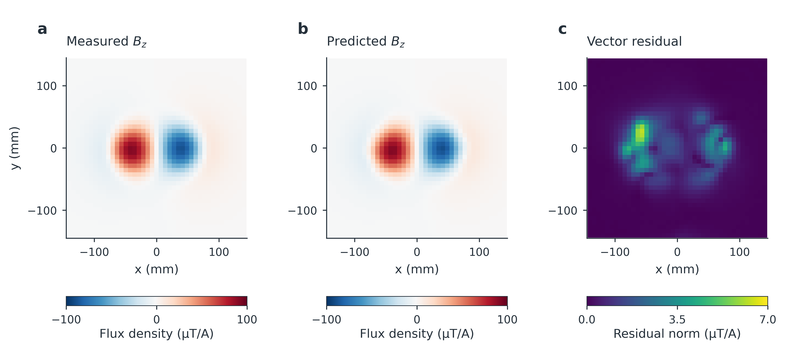
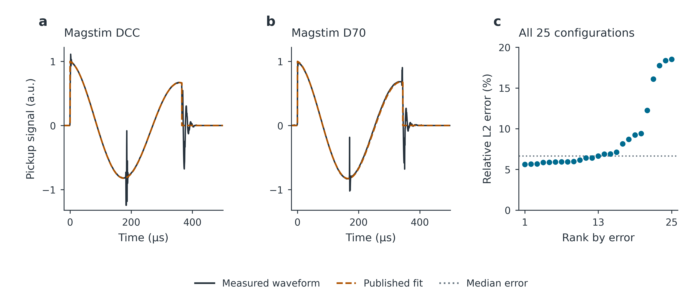

# 丹麦线圈扫描台的空间场和脉冲波形复核

丹麦技术大学、丹麦磁共振研究中心与 MagVenture 合作开展线圈测量。本目录有两类实验。Madsen、Drakaki 和 Thielscher 公开了 MC-B70 的 95,773 个探头位置及三分量实测 B，适合检查空间磁场模型能否预测没用来估计参数的测量平面。Drakaki 等另发布 25 款线圈的拾取脉冲波形，适合检查时间波形的拟合程度。两项研究有共同作者及测量技术，统计实验室数量时归于同一来源。〔1、2〕

## 对完全留出的测量层预测三分量磁场

上游使用步进电机移动三轴 Hall 探头，翻转线圈以采集两侧的磁场。该团队采用固定激励、按 1 A 报告磁通密度的测量协议。MC-B70 数据的 `xyz` 为测点坐标（mm），`data` 为该处三个磁场分量（T，按 1 A 归一）；`tipstop` 记录探头停止位置。程序仅把前两个数组用于场验证。另一个公开文件 STL 给出外壳表面，供放置等效磁偶极子。SimNIBS 另发的 CCD 存储从场估计的偶极子，不计入实测点。〔3、4〕

令 $\mathbf r_j=\mathbf x-\mathbf s_j$ 为从第 $j$ 个偶极子源指向测点的位移，则单位驱动电流的场模型为

$$
\frac{\mathbf B(\mathbf x)}{I}
= \frac{\mu_0}{4\pi}\sum_j
\left[\frac{3\mathbf r_j(\mathbf m_j\cdot\mathbf r_j)}{\|\mathbf r_j\|^5}
-\frac{\mathbf m_j}{\|\mathbf r_j\|^3}\right].
$$

$\mathbf m_j$ 是每安培驱动电流对应的等效磁偶极矩，单位为 m²。我们在 STL 内以 12 mm 面内间距选点，每个穿壳区间在其厚度的 30% 与 70% 处各放一层，排除与任一探头位置相距 6 mm 以内的源点，得到 254 个偶极子、762 个未知分量。使用全部探头**坐标**检查几何间隙，留出层的磁场**读数**只用于最后评分。该设计是在作者方法启发下建立的较小模型，可在本项目的 MATLAB 环境中运行。

拟合解最小化 $\|Gm-b\|_2^2+\lambda\,\sigma_{\max}(G)^2\|m\|_2^2$。从原扫描中预留 z 接近 −34.5、23.8、43.65 mm 的三个完整测量层，选择层的容差为 ±0.2 mm。另取 z≈33.7 mm 的 2,642 个测点选取正则化强度。其他位置按输入行序每八个取一个，实际用 10,771 个点拟合。九个候选 $\lambda=10^{-10},\ldots,10^{-2}$ 中，验证层误差最小者为 $10^{-4}$。坐标对应扫描台原生坐标，层的 z 不代表头皮下深度。测量域内其余 z 层参与拟合，因而这项实验评价层间空间预测，在同一装置上实施。

| 测试平面 z（mm） | 测点数 | 三分量相对 L2 差 | 向量 RMSE（µT/A） | 预测 / 实测均方根 |
|---:|---:|---:|---:|---:|
| −34.5 | 1,681 | 2.508% | 0.521 | 0.9952 |
| 23.8 | 2,642 | 2.570% | 1.131 | 0.9988 |
| 43.65 | 2,642 | 1.978% | 0.340 | 0.9973 |
| 合并测试点 | 6,965 | **2.501%** | **0.771** | **0.9983** |

向量 RMSE 将每个点三个分量的差的平方和取平均再开方。综合相对误差的分母是全部测试点实测向量的二范数。合并测试集的 x、y、z 分量相对差分别为 1.94%、3.94%、2.29%。拟合、选参、测试三类数据逐项列在 [MATLAB 结果](mc_b70_scores.csv)，还可查看[逐个测试点的测量和预测](mc_b70_heldout_points.csv)、[九个候选正则化量](mc_b70_regularization.csv)及[源的位置和权重](mc_b70_equivalent_sources.csv)。



图中前两幅显示同一 Bz 分量并共享对称色限。第三幅显示三个分量的合成残差，颜色越亮表示偏差越大。每个方格对应一个实际探头位置。为让各点代表相同面积，图上只绘出该层 7 mm 等间距扫描的 1,681 点；表中该层指标还含中央细网格的 961 点。[矢量 PDF](../../figures/measurements/m01_vector_scan.pdf)

## 全部 25 款拾取波形

Drakaki 等用已知环数和面积的拾取线圈连接示波器，记录与刺激器输出对应的感应脉冲。官方每个 TSV 含三列，分别是时间、发布的测量波形和同名 `_fit` 拟合波形。本次固定原有时轴、极性及相对幅度，直接核算 $100\|y_{\rm fit}-y_{\rm meas}\|_2/\|y_{\rm meas}\|_2$，不再估计时间偏移或增益。波形使用发布的相对单位；测量得到的绝对最大电流变化率另见原论文表 2。〔5、2〕

25 个文件各含 5,201 个时刻，−20 至 500 µs，间隔 0.1 µs，共 130,025 个时间样本。发布拟合的整段相对 L2 差中位数为 **6.65%**，最低为 Cool-B65 的 5.62%，最高为 PMD70 的 18.52%。这些值量化作者拟合对自身记录的近似程度，不代表新一次空间场验证。公开核实到的三分量空间测量点属于 MC-B70；另外 24 款没有在这两处发布相同形式的三轴扫描数组。[逐款波形评分](waveform_scores.csv) · [输入文件名和 Git blob](waveform_manifest.csv)



左、中两幅将实测拾取波形与发表的拟合画在相同的时间轴上，局部尖峰最容易看出差异。右图按误差从小到大排列全部 25 种线圈与刺激器组合，虚线是 6.65% 的中位数。每种组合的评分覆盖原时轴的全部 5,201 个时刻。[矢量 PDF](../../figures/measurements/m02_pickup_waveforms.pdf)

## 复跑

从 `coil_study` 在 PowerShell 运行，首次下载至 `tmp/measured_coil_library`。脚本校验 NPZ 和 STL 的 SHA-256，并用固定提交的 Git blob 校验 25 个 TSV。NumPy、SciPy 仅用于准备数据，场计算、模型选择、评分及图像全部由 MATLAB 完成。

```powershell
& .\.venv\Scripts\python.exe .\external_measurements\measured_coil_library\prepare_inputs.py
matlab -batch "addpath('external_measurements/measured_coil_library'); run_mc_b70; run_waveforms; plot_lab_validation"
```

以色列另一个团队测量了盐水体模中的 H1 与八字线圈感应电场，两种物理量的结果分开保存于[盐水体模 E 场剖面复核](roth/README.md)。

## 论文与数据来源

1. [MC-B70 研究](https://arxiv.org/abs/2112.14548)
2. [25 款研究](https://doi.org/10.1016/j.brs.2022.04.017)
3. [作者数据及代码](https://github.com/simnibs/dipole-fit/tree/63d8cba254e3ade29c3db58eca9f5397a23e07c4)
4. [原测量与截面示例](https://arxiv.org/pdf/2112.14548)
5. [官方数据目录](https://github.com/simnibs/simnibs/tree/fde509f6f8de38a4b03947944cf7ee93b8bebabe/simnibs/resources/coil_models/Drakaki_BrainStim_2022)
