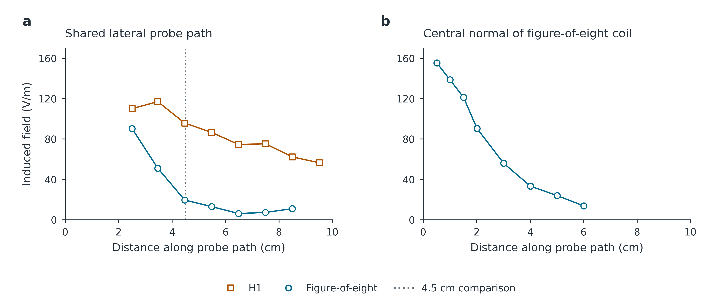

# 盐水头形体模中 H1 和八字线圈的电场剖面

Roth 等（以色列 Sheba Medical Center、Weizmann Institute of Science 等）在生理盐水头形体模中移动双线探头，测量由 TMS 线圈诱导的电场。两探针尖端相距 1.7 cm，在每个位置采集前后及左右方向的电压，并据此计算场强。该结果可比较同一头模内的空间衰减。这里的量是 E，单位 V/m，与丹麦实验的 B（µT/A）和 MRI 实验的 Bz 不同。〔1、2〕

根据原图 8c 的标记中心，读出同一左侧上下方向探测线的 8 个 H1 点和 7 个八字点；另读图 9c 八字线圈中心法线 8 个点。仅采用示意曲线上的测量标记，未把图中的连线当作额外数据。原图 8c 左侧 H1 是实心方块，左侧八字是叉号。根据坐标刻度在 MATLAB 做线性换算，并在相邻两个读图点间插值到 4.5 cm。图 8c 两种线圈的 E 约为 **95 V/m（H1）** 和 **19 V/m（八字）**。原文正文另外报告该位置相对于各自整个体模峰值为 66%、12%；本次取点未使用这些比例做标定。图 9c 中，八字线圈沿自身中心法线约从 0.5 cm 的 155 V/m 降到 6 cm 的 14 V/m，这是另一条测量路径。这些量来自发表的图形，不具备原始示波器数据的精度。

原文对其空间场图采用逐款校准的刺激器设置，报告 H1 为最大输出的 46%，八字为 45%。图 8c 图注没有另列两种线圈的线圈电流或 $dI/dt$。因此，上述 4.5 cm 读数用于描述原装置、原测量线下的电场分布；在本项目的同电流工况下比较线圈效率，仍需要每款线圈的驱动标定。

左图虚线标出同一条侧方测量线的 4.5 cm，两种线圈的电场在这里仍有明显差异。右图的八字线圈沿另一条中央法线取样。细线连接相邻原图标记，读数单位是 V/m。[矢量 PDF](../../../figures/measurements/m08_saline_electric_field.pdf)

用 Poppler 执行 `pdfimages -f 7 -l 7 -j 原文.pdf fig`。在上述版本，`fig-001.jpg` 和 `fig-002.jpg` 分别是两张原始 300 dpi 图，宽度均为 1020 像素。从左上角按零起点记录标记坐标。图 8c 的横轴以 x=250、697 px 对应 0、10 cm，纵轴 y=961、493 px 对应 0、160 V/m。图 9c 的横轴 x=264、968 px 对应 0、8 cm，纵轴 y=919、497 px 对应 0、180 V/m。若标记中心读数变化 4 px，仅坐标换算误差约为 0.09 cm 与 1.37 V/m（图 8c），或 0.05 cm 与 1.71 V/m（图 9c）。这是读图分辨率估算，未包括仪器或线圈定位误差。

从本目录运行 `run_roth_profiles`，MATLAB 会输出 [23 个位置的实验剖面](digitized_e_fields.csv)，原始[像素读数](figure_marker_pixels.csv)可逐点检查。原文 PDF 的 SHA-256 为 `95794364cbf50f6100c34f36371de882f2f73d4eb4db57c15eb7a4b0a67c11a8`。

## 论文与数据来源

1. [原文](https://doi.org/10.1097/WNP.0b013e31802fa393)
2. [公开全文 PDF，第 37 页的图 8、图 9](https://www.brainsway.com/wp-content/uploads/2018/12/Roth_Journal_of_Clinical_Neurophysiology_2007_Fig-8_H-coil_Electrical_Field_Distribution.pdf)
