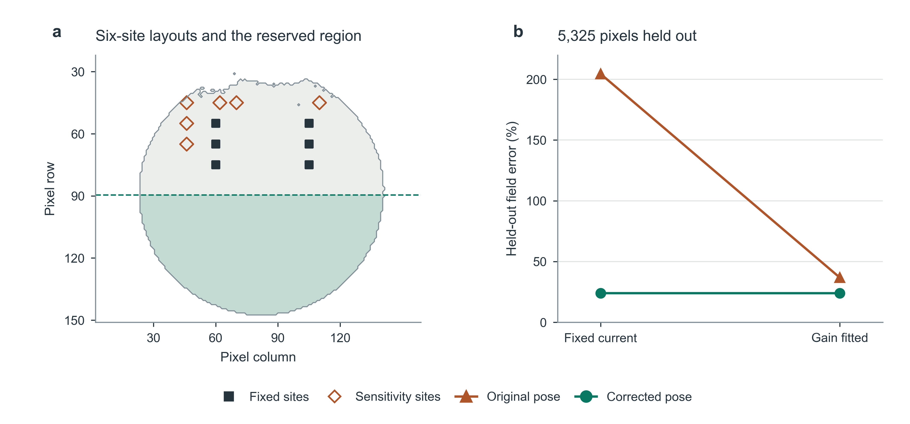

# 六个抽查点略有偏移，能否分辨已知的摆位错误？

这是对 Utrecht 团队同一次八字线圈体模 MRI 实验的回顾检查。源自作者旧版 v1.0 和更正版 v1.1 的两张计算场图预先冻结。使用公开的 3.576 A 等效电流，不用读数拟合增益。零假设式的工程问题很具体：在两份既有的候选姿态中，面对同一张实测切片，六个位置的读数更支持哪一个？[数据版本和根因](../../placement_pilot/public_benchmark/matched_figure8/README.md)

基准六点为 MATLAB 图像行 55、65、75 与列 60、105 的笛卡尔积。将这个完整网格的行、列各平移 −4、−2、0、2、4 个像素，共 25 种固定组合。每种组合先检查六点都位于有效体模内，且全部位于第 90 行之前。远侧第 90 行起的 5,325 个有效像素在选择时始终留出。各候选的六点残差二范数越小越符合测量。

| 请求网格数 | 合法网格数 | 选中更正摆位 | 旧版减新版的最小相对 L2 差值 | 最小 RMSE 差值 |
|---:|---:|---:|---:|---:|
| 25 | 25 | 25 | 314.052 个百分点 | 94.181 µT |

最接近判定边界的网格是行 +4、列 −4。其旧版相对 L2 差为 318.030%，新版为 3.978%。该结论说明小幅平移这组抽查位置后，此次已知摆位错误仍能检出。多个网格共享同一张实测图且局部重合；25 次选择不能充当十几台设备或一批新体模的识别率估计。[逐网格分数](translated_grid_scores.csv) · [汇总](translated_grid_summary.csv)

黑方块是原六点，绿色区域的 5,325 个像素在拟合时留出。左图另标出后一项几何选点实验的六个菱形位置；右图仅使用原六点。旧版在远处的误差从固定电流的 204.48% 降至只调幅值的 36.73%，更正文件对应的两个结果均约为 24%。[矢量 PDF](../../figures/methods/six_point_replay.pdf)

## 测量读数离判定边界还有多远

设 y 是六个实测 Bz（µT），p₀、p₁ 分别为旧版和更正版的六点预测。注入加性扰动 δ 后，两个平方残差之差为

$$
D(y+\delta)=\|y-p_0\|_2^2-\|y-p_1\|_2^2+2\,\delta^\mathsf{T}(p_1-p_0).
$$

当 D(y)>0，抵达等误差边界所需的最小六点扰动 RMS 为

$$
\frac{D(y)}{2\sqrt{6}\,\|p_1-p_0\|_2}.
$$

25 组中最小值为 **48.035 µT**。这是已知两张候选图固定时、任意方向加性读数误差的代数边界。它没有估计 MRI 噪声分布，也没有包含未建模的系统偏差、新姿态或试件差异。在本目录于 MATLAB 执行 `replay_point_sensitivity` 即可从项目的 MAT 切片复跑。[计算脚本](replay_point_sensitivity.m)
