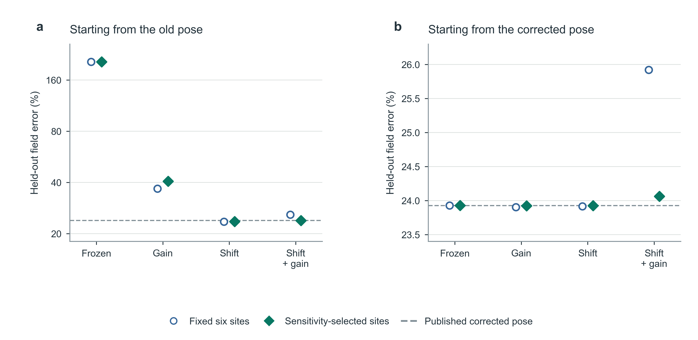

# 用六个磁场读数估计八字线圈的安装位移

假设实验室只留下了旧导航文件，却知道驱动电流。原来的六点检验只能从已知文件中二选一。这里把问题改为：从旧绕组出发，能否用六个有符号磁场读数算出应当移动多少毫米？在 Petrov 等公开的单次体模 MRI 中，固定原论文电流，六点给出沿扫描仪 z 轴 **+32.56 mm** 的估计。作者后来公布的两版变换相差 **+32.27 mm**。另有 5,325 个未参与估计的像素，其相对 L2 误差从 **204.48% 降至 23.49%**。〔1〕 · 〔2〕 · [实验评分](pose_ablation.csv)

两幅图的纵轴都是 5,325 个留出像素的场误差。左图从旧文件开始，用对数轴容纳超过 200% 的原始误差；右图从更正文件开始，用线性轴放大剩余差别。空心圆为原固定六点，菱形为依绕组灵敏度选出的六点。从正确的起点把位移和增益都放开时，原六点反而把远侧预测推离实测。[矢量 PDF](../../figures/methods/axial_refinement.pdf) · [测点位置图](../../figures/methods/six_point_replay.pdf)

## 与已有工作的联系

- Matilainen 等在 2024 年用结构光三维扫描独立测量导航的几何偏差，在十位参与者中观察到两种定位给出的线圈位置平均相差 10.2 mm。这里沿用“报告毫米位移及其对场的影响”这一思路，输入改为台架有符号 Bz。〔3〕
- MacLachlan 等在 2025 年用电磁场模型拟合磁跟踪系统的校准参数，分析位置与其他参数的耦合。Joshi 与 Boyd 系统讨论过通过信息矩阵选取有限传感器。本文采用这两种已有思想，针对八字绕组、一张 MRI 切片和有限测点，设计跨多个候选位移的选点和参数消融。〔4〕 · 〔5〕

本项目提出并检验的是这个具体的小样本估计方案。选择扫描仪 z 轴来自对此次旧版偏差的既有认识。作者修正参考值用于事后打分，测试区域内的场值不参与任何参数估计。整张切片已用于前期研究，应将这项实验视为回顾性研究。换成未知方向的位置误差，需要新的采集或独立几何信息。

## 从位移到预测读数

沿用每翼九匝的 2,700 个有向直线段及 3.576 A 等效电流。设旧版绕组为 $W_0$，沿扫描仪 z 轴整体平移 $s$ mm 后，第 $i$ 个像素八个角点的磁场分量经平均得到 $p_i(s)$。同一电流倍率 $g$ 作用于所有像素。用校准点 $C$ 求解

$$
\min_{-40\leq s\leq60,\ g\geq0}
\sum_{i\in C} [g\,p_i(s)-y_i]^2,\qquad
\hat g(s)=\max\!\left(0,\frac{\sum_{i\in C}p_i(s)y_i}{\sum_{i\in C}p_i(s)^2}\right).
$$

电流已知时固定 $g=1$。代码对每个试探位移重新计算完整绕组的毕奥–萨伐尔场。先在 5 mm 间距的网格搜索，在最低代价网格点及其相邻区间内进一步作有界搜索，位移容差为 0.005 mm。搜索精度表示算法的停止条件。作者更正后的位姿、场图和留出区域读数均未作为迭代目标。用 $s=0$ 重算的六点及整个留出区，与原 v1.0 场图逐点相符，脚本容差为 $10^{-8}$ µT。[正向与反演源码](run_pose_refinement.m) · [原绕组与坐标约定](../../placement_pilot/public_benchmark/matched_figure8/README.md)

## 测点怎样选

固定六点沿用项目原有的第 55、65、75 行与第 60、105 列。另一种布置在近侧的 90 个候选位置中按几何计算选六点。每个点对两项未知量的响应为 $J_i(s)=[\partial p_i(s)/\partial s,\ p_i(s)]$，第一列用相距 1 mm 的两个完整场计算中心差分。若两列在所选测点上近似成比例，移动线圈与调大电流就难以区分。

为避免把选点局限于旧版标称位置，在假定位移 $s=-20,0,20,40$ mm 上分别建立灵敏度矩阵。将每一列除以它在全体候选点上的二范数，得到 $\widetilde J_i(s)$。从空集开始，每次加入使以下最差情形得分最高的一点，任意两点至少相距 8 像素。

$$
\min_{s\in\{-20,0,20,40\}}
\log\det\!\left(10^{-6}I_2+
\sum_{i\in C}\widetilde J_i(s)^\mathsf{T}\widetilde J_i(s)\right).
$$

这是当前候选池中的逐点贪心 D-最优设计。等方差、独立的单点误差是假定的设计模型；真实 MRI 中的相邻残差可以相关。行列范围、四个假定位移、最小间距和测点数属于本项目的设计选择。得分反映局部辨识能力，并不保证任意设备上的预测误差最小。[完整检测点及其读数](calibration_points.csv)

## 消融一：分别允许哪些参数改变？

所有行共用同一旧绕组和第 90 行起的 5,325 个测试像素。RMSE 保留 µT，训练及测试相对 L2 均用对应区域的实测二范数作分母。

| 近侧测点 | 估计参数 | 位移（mm） | 增益 | 六点相对 L2 | 测试相对 L2 | 测试 RMSE（µT） |
|---|---|---:|---:|---:|---:|---:|
| 原六点 | 全部固定 | 0.00 | 1.000 | 333.35% | 204.48% | 17.309 |
| 原六点 | 仅增益 | 0.00 | 0.230 | 7.00% | 36.73% | 3.109 |
| 原六点 | 仅位移 | 32.56 | 1.000 | 3.84% | **23.49%** | 1.989 |
| 原六点 | 位移和增益 | 44.13 | 1.591 | 3.46% | 25.81% | 2.185 |
| 几何选六点 | 仅增益 | 0.00 | 0.214 | 9.57% | 40.56% | 3.433 |
| 几何选六点 | 仅位移 | 32.75 | 1.000 | 1.38% | 23.53% | 1.992 |
| 几何选六点 | 位移和增益 | 30.09 | 0.890 | 1.29% | **23.83%** | 2.017 |

有可靠电流记录时，固定电流只估位移在两套点位上都稳定，重新选六点没有得到更低的远侧误差。电流也需要估计时，几何选点将位移与作者参考的差值由 **11.87 mm** 降为 **2.18 mm**。但这套点的两列灵敏度在联合解处仍高度相似，归一化内积的绝对值为 0.9991；六个 Bz 读数仍很难精确解耦两参数。完整作者更正文件在同一测试区为 23.93%，旧文件只代入作者 z 位移为 23.46%。不同模型在弱场测试区的零点几百分点差异不足以证明哪个姿态更接近真实安装。[全部消融结果](pose_ablation.csv) · [事后参照分数](reference_only.csv)

## 消融二：两个点够不够，随便挑六个点会怎样？

- **测点数。** 只用几何选择的前 2、3、6 点，同时估计增益与位移。两点时训练相对误差小于 0.00001%，位移却与作者参考相差 9.68 mm。三点、六点相应差值为 3.51、2.18 mm，测试区误差为 24.03%、23.83%。两个观测恰能匹配两个参数，几乎为零的训练残差在这里掩盖了误差。[逐模型得分](pose_ablation.csv)
- **随机六点。** 使用相同的 90 个候选点和 8 像素最小间距，固定种子顺次随机取 100 套。对随机布置、原六点及几何选点都使用同一套 0.5 mm 离散搜索，每个网格位移均直接计算场。100 套的绝对位移偏差中位为 **6.73 mm**，四分位范围 **3.12–10.23 mm**；几何选点为 **2.27 mm**，原固定六点为 **11.73 mm**。仍有 16 套随机布置优于几何选点。该实验评价同一切片上的空间抽样敏感性，100 套布置共享同一次 MRI 采集。[每套结果](random_layouts.csv) · [全部行列坐标](random_layout_sites.csv)

## 负对照：从已经更正的导航文件出发

换成作者更正后的 v1.1，保留相同六点和测试区域，再让完全相同的程序估计额外位移。原六点只估位移时多调 **+0.40 mm**，测试误差从 23.93% 变为 23.92%。同时估计两项参数则多调 **+10.11 mm**、增益 **1.477**；训练误差从 3.60% 降到 2.85%，测试误差反而升到 **25.92%**。使用几何六点联合估计时，多调 −2.12 mm、增益 0.892，测试误差为 24.06%。已更正的文件仍有测量和建模残差，算法会把其中一部分归因到可调参数。实际台架如能独立测电流，保留这个约束比盲目多拟合一个参数更有依据。[负对照的八组数据](corrected_start_control.csv)

## 复跑

在项目根目录的 MATLAB 中运行以下命令。程序使用基础 MATLAB R2025a 的 CPU 双精度及项目已有的直线段积分函数；缺少 Petrov 复现文件时先从固定版本重建。输出包含图、测点、随机布局、校准参数和留出区域评分。

~~~matlab
addpath('external_measurements/pose_refinement')
scores = run_pose_refinement;
~~~

## 论文、数据集与项目出处

1. [Petrov 原文](https://doi.org/10.1371/journal.pone.0178952)
2. [作者导航修正](https://github.com/pip010/plosone-data-pub01/releases/tag/v1.1)
3. [原文](https://doi.org/10.1088/1361-6560/ad33b8)
4. [磁跟踪校准](https://doi.org/10.1109/JSEN.2025.3533436)
5. [传感器选择方法](https://web.stanford.edu/~boyd/papers/sensor_selection.html)
