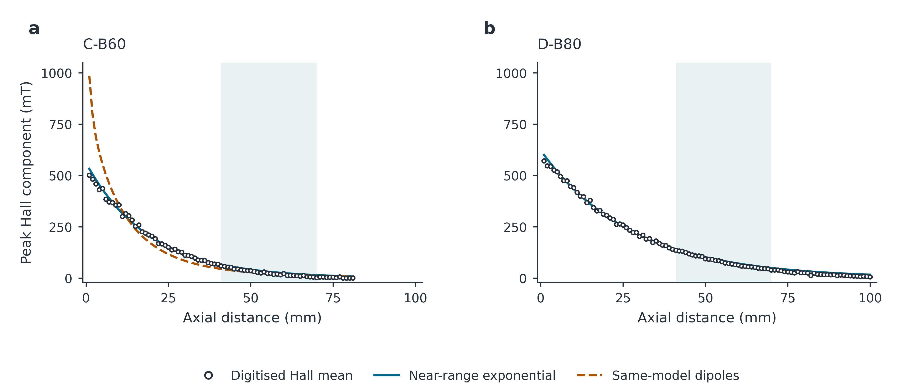

# 雷根斯堡实验室的八字与双锥线圈霍尔探头距离曲线

Schecklmann 等用横向霍尔探头沿线圈中心法线逐毫米移动，测量 MagVenture C-B60 八字线圈与 D-B80 双锥线圈在空气中产生的峰值。每个位置给三个 100% 单相脉冲，取三个读数的均值。探头从距线圈 1 mm 处起测，线圈表面与探头敏感面平行；霍尔计给出垂直于该敏感面的磁场分量。论文声明原始数据需要向通讯作者申请，图 2 则公开了两条位置均值曲线。〔1、2〕

空心圆是从期刊图 2 读取的平均峰值。每张图的浅色带为预留测试段（41–70 mm）。蓝线为近距离资料拟合的指数衰减模型。左图虚线为另一研究团队的同型号等效源计算，在 10 mm 单点对齐幅值。该图只展示公开台架的一条中心线和一种激励条件。

## 两类复算

1. 论文描述两条场强曲线呈指数衰减。只用每款线圈 5–40 mm 的 36 个近段读数，以最小化绝对场值残差平方和估计 `B(d)=a·exp(−d/λ)` 的 a、λ。随后在 41–70 mm 的 30 个位置检验读数预测。这样可定量检查近段试验能否支持远段外推。
2. 对 C-B60，采用 Drakaki 等团队根据实测场拟合的 1,960 个等效磁偶极子，从这些偶极矩计算模型中心法线 (0,0,d) 的 Bz。约定 z=0 是线圈模型中心参考面；原文没有提供装配到该模型的精确刚体配准和 100% 单相脉冲对应的峰值线圈电流。以 10 mm 单个霍尔读数确定一个常数 `s=B测(10)/|Bz模(10)|` 后，用 `s·|Bz模(d)|` 预测各点。此项检验衰减形状；约束下的绝对峰值仍待测量。残差依赖探头法向、探头敏感区、模型零面及非对称绕组细节。CSV 的 `CCD_norm_T_per_A` 是额外的自由空间模长诊断量，不参与评分。论文使用的 D-B80 是无冷却型号，厂商标注夹角 120°。本实验未将带冷却的 Cool-D-B80 或本项目的 95° 理想双锥当作同一产品。〔3、4、5〕

| 型号 | 模型 | 训练衰减长度 λ | 41–70 mm RMSE | 41–70 mm 相对 L2 差 |
|---|---|---:|---:|---:|
| C-B60 | 近段指数拟合 | 19.18 mm | 8.06 mT | 25.81% |
| D-B80 | 近段指数拟合 | 27.64 mm | 6.36 mT | 7.31% |
| C-B60 | 同型号等效磁偶极子，10 mm 单点标定 | — | 7.49 mT | 23.97% |

测试段内 D-B80 的指数预测相对误差低于 C-B60。两种线圈的测试段绝对误差量级接近，但测试段 C-B60 读数本身较小，百分比误差更大。相对 L2 使用残差二范数除以测试段实测二范数。模型内的留出测试和跨团队同型号对照均与原始 MRI 体模实验无共享测点。[评分表](held_out_metrics.csv) · [逐距离实测与预测](distance_profiles.csv)

## 数字化的证据强度

读取期刊独立提供的 995×797 像素彩色图，C-B60 为 1–81 mm、D-B80 为 1–100 mm，本次共提取 **181 个绘出的距离均值**。约 1.00 mT 对应图像 1 个纵向像素。先按坐标轴标定距离，再按照蓝、红两种颜色寻找空心标记中心，避免误把误差条端点读成均值。图中黑色差值曲线经过作者 10 mm 移动平均处理，未纳入测点。保留未经裁零的低值，接近横轴的个别点会受读图分辨率限制。[从图 2 提取的点](hall_fig2.csv) · 〔6〕

同一张图再用五像素宽中心条的颜色中位数独立估读，对比圆环中心法。C-B60 和 D-B80 的逐点绝对差中位数约 1.76、1.38 mT，95 分位为 7.53、4.77 mT。换用后一种读法，指数模型测试段 RMSE 分别变为 8.77、6.28 mT。这是两种读图规则的敏感性检查，不能作为仪器误差或统计置信区间。[数字化敏感性](readout_sensitivity.csv)

## 复跑

在本目录的 MATLAB 命令行执行 `run_hall_distance`，可从已保存的 CSV 重做拟合、磁偶极子求场、留出评分与绘图。首次获取 C-B60 模型需要联网，每次读取核对 SHA-256。若要从出版图重新读取均值，运行 `python digitize_hall.py`，随后重跑 MATLAB；需要 NumPy、Pillow、SciPy。上游图文按 CC BY 4.0 发布，数字化结果为对 Schecklmann 等（2020）图 2 的再处理。出处和处理步骤见上文。[MATLAB 源码](run_hall_distance.m) · [提点脚本](digitize_hall.py)

## 论文与数据来源

1. [论文与图 2、图 3](https://doi.org/10.1038/s41598-020-58034-2)
2. [雷根斯堡大学公开 PDF](https://epub.uni-regensburg.de/43000/1/s41598-020-58034-2.pdf)
3. [等效源论文](https://doi.org/10.1016/j.brs.2022.04.017)
4. [固定版本 C-B60 模型](https://github.com/simnibs/simnibs/blob/fde509f6f8de38a4b03947944cf7ee93b8bebabe/simnibs/resources/coil_models/Drakaki_BrainStim_2022/MagVenture_C-B60.ccd)
5. [D-B80 厂商说明](https://magventure.com/us/products/d-b80/)
6. [出版社原尺寸图](https://media.springernature.com/full/springer-static/image/art%3A10.1038%2Fs41598-020-58034-2/MediaObjects/41598_2020_58034_Fig2_HTML.png)
