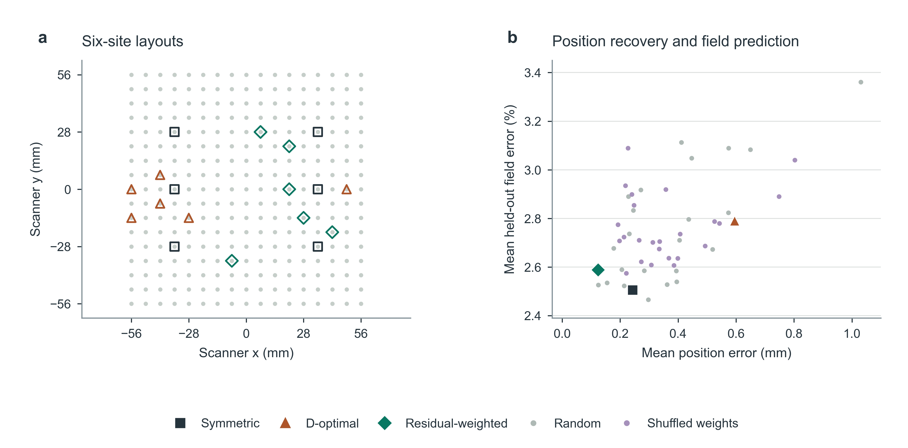

# 六个三轴测点该放在哪里？

探头装在平行于线圈的扫描台上。台架重装之后，软件中的横、纵坐标原点可能偏了，探头的幅值标定也可能有误。如果现场只允许测六个位置，应该测磁场最强处、在两翼对称取点，还是选择最有助于识别误差的位置？我们用公开 MC-B70 三轴实测扫描回放这个问题。下文的亚毫米数值均为对人为错标的恢复误差。原公开测量记录没有实际拆装产生的亚毫米位移真值。[数据集与来源](../measured_coil_library/README.md) · [本次设计及事后补充对照](protocol.md)

## 从灵敏度到残差加权

模型若预测某处磁场对横移、纵移和倍率的反应方向不同，这个位置就有助于分辨三个未知量。普通 D-最优选点据此选择不同位置的组合。不过，场在某处变化得很快，也可能意味着该处的绕组近似不够准确。**本项目试验的改进是利用另一层既有台架测量，先估计哪些平面位置容易出现模型误差，再对这些位置适当降权。**

磁跟踪领域已有信息矩阵选点。2025 年 Koval 和 Nicholson 也研究了把正向模型近似误差纳入实验设计。这里采用一种适合小规模线圈台架的实现，额外数据是一层扫描，不需要拟合完整的误差协方差。下文专门检验这层误差能否迁移到其他扫描面。〔1〕 · 〔2〕 · 〔3〕

在候选点 $i$，用磁场模型构成三列灵敏度 $J_i$，分别对应横移 7 mm、纵移 7 mm 的局部线性变化，以及倍率改变 0.1 的变化。前两列用 ±0.2 mm 中心差分近似导数再乘 7。开发层上，以同一横纵坐标为中心取最近九点，计算预测与实测三分量之差的均方模长 $s_i^2$。另取开发层全体位置残差平方模长的中位数 $s_0^2$ 作为下限，避免局部残差恰好接近零时得到过高权重。

$$
w_i\ \propto\ (s_0^2+s_i^2)^{-1},\qquad
S_{k+1}=S_k\cup\left\{\underset{i}{\arg\max}\ 
\log\det\!\left(\epsilon I+\sum_{j\in S_k\cup\{i\}} w_j J_j^\mathsf TJ_j\right)\right\}.
$$

每次从仍满足间距的候选点中增加一个点。所有权重除以其中位数；$\epsilon$ 取候选点最大未加权信息迹的百万分之一。普通 D-最优将所有 $w_i$ 设为 1。这里的权重描述经验模型误差，包含绕组近似、配准和测量残差；它的大小不能解释为探头的噪声方差。各方案的下游估计器完全相同，均用无权最小二乘拟合两轴偏移和一个倍率。[选点程序](run_sensor_design.m) · [289 个候选点及权重](candidate_weights.csv) · [各组实际测点](sensor_locations.csv)

## 怎样构造已知位移，同时保留实测误差？

1. 冻结既有的 254 个等效偶极子。+33.7 mm 面此前用来选择模型正则化参数，本次也作为权重开发层。+23.8 mm 校准面、+43.65 mm 与 −34.5 mm 两个评分面的磁场均未用于拟合这个源模型。只使用每个扫描面上完整、不重复的 7 mm 网格。[模型原始训练与选参记录](../measured_coil_library/mc_b70_scores.csv)
2. 在 +23.8 mm 面中央的 112 × 112 mm 方形内选择六个位置，任意两点至少相隔 14 mm。举例说，要模拟“横坐标少记 7 mm”，就把位置 $(x+7,y)$ 的真实三分量读数交给估计器，坐标仍标为 $(x,y)$。读数来自相邻实测位置，含真实模型残差。八种非零平移组合另将读数统一乘 1.10，模拟共同增益偏大。无扰动对照使用原位置和倍率 1.00。
3. 每组仅以选出的三轴读数估计位置和倍率，随后冻结参数，在两个评分面各取 1,369 个位置检验，共 2,738 点。位置误差是估计与注入二维位移的欧氏距离；增益误差是两倍率之差的绝对值乘 100，单位为百分点。场误差是两层合并的向量相对 L2。每个方案先按工况评分，再对八个非零工况等权平均。测试用的场插值另与精确偶极子计算抽查，两个平面的差分别为 0.00140% 和 0.00024%。[全部工况](injection_trials.csv) · [插值检查](interpolation_check.csv)

## 同样测六点，哪种方案更好？

| 六点布局，三个自由参数都开放 | 位置误差 mm | 增益误差，百分点 | 留出场相对 L2 | 原始无扰动对照的留出场相对 L2 |
|---|---:|---:|---:|---:|
| 固定对称布局 | 0.243 | 0.424 | **2.505%** | 2.397% |
| 优先选择预测场最强处 | 0.305 | 0.622 | 2.811% | 2.684% |
| 普通 D-最优 | 0.595 | 0.363 | 2.790% | 2.699% |
| **开发层残差加权 D-最优** | **0.124** | **0.183** | 2.588% | 2.558% |
| 随机布置，24 组的中位数 | 0.329 | 0.482 | 2.694% | 2.713% |
| 打乱残差权重后作 D-最优，24 组的中位数 | 0.324 | 0.508 | 2.717% | 2.693% |

两种最优性标准给出了不同的答案。目标是恢复被错标的二维位置时，加权方案比普通 D-最优少错约 0.47 mm，比固定对称少错约 0.12 mm；目标是预测两层实测场时，固定对称布局领先加权方案约 0.08 个百分点。这里随机布局中有 9/24 组的场误差低于加权布局。冻结权重的空间排列确实带来可观察的差异，但一种布局无法同时使这些指标都最小。[逐布局汇总](layout_summary.csv)

左图的每个标记是扫描平面上的一个测点，同形状的六个标记组成一套布局。右图的每个符号代表一整套布局，越靠左表示找回原位置越准，越靠下表示对留出场的预测越准。右图灰点是随机选点，紫点是打乱空间权重后重新选点。两组散点展示更换布局带来的变化，全部布局均取自同一只线圈的同一次扫描。[矢量 PDF](../../figures/methods/sensor_design.pdf)

## 三项消融分别解释了什么？

- **只校准幅值够不够？** 对同一组加权六点，原样预测的留出场误差为 27.986%，只调倍率为 27.440%，联合估计横移、纵移和倍率后为 2.588%。这是对八种带位移错标的工况求平均。在无错标对照中，原样预测为 2.511%，联合估计为 2.558%，额外校准略有代价。[全部消融](layout_summary.csv)
- **六点是最少或最优数量吗？** 加权布局取 3、6、12 个点，平均位置误差依次为 0.116、0.124、0.109 mm，留出场误差为 2.579%、2.588%、2.539%。只加测点并未使误差单调下降；六点是本次的现场预算。十二点方案在此数据上表现较好，测量次数增加一倍。[测点顺序](sensor_locations.csv)
- **开发层残差能迁移多远？** 在相同的 289 个平面位置上，开发层局部均方残差与同侧 +23.8、+43.65 mm 面的 Spearman 秩相关分别为 **0.955、0.975**，与反面的 −34.5 mm 面为 **−0.119**。这项事后诊断说明该权重在同侧识别高残差区域有依据，在反面缺少相同的空间对应关系。原实验翻面采集过线圈另一侧，现有数据无法唯一解释差别。[逐层结果](residual_transfer.csv)

## 复跑

在项目根目录先准备丹麦扫描输入，再运行以下 MATLAB 命令。已有的冻结源表随项目保存；需要重新估计源表时，可先运行上一级线圈库中的脚本。实验使用 CPU，MATLAB R2025a。[原始扫描的准备方法](../measured_coil_library/README.md) · [三项方法实验的统一入口](../run_method_experiments.m)

~~~matlab
addpath('external_measurements/sensor_design')
run_sensor_design
plot_sensor_design
~~~

## 论文、数据集与项目出处

1. [Talcoth 和 Rylander 的磁跟踪选点](https://publications.lib.chalmers.se/records/fulltext/177444/local_177444.pdf)
2. [Koval 和 Nicholson，2025](https://doi.org/10.1007/s10915-025-03008-7)
3. [作者发布的 MC-B70 磁场与外壳](https://github.com/simnibs/dipole-fit/tree/63d8cba254e3ade29c3db58eca9f5397a23e07c4)
