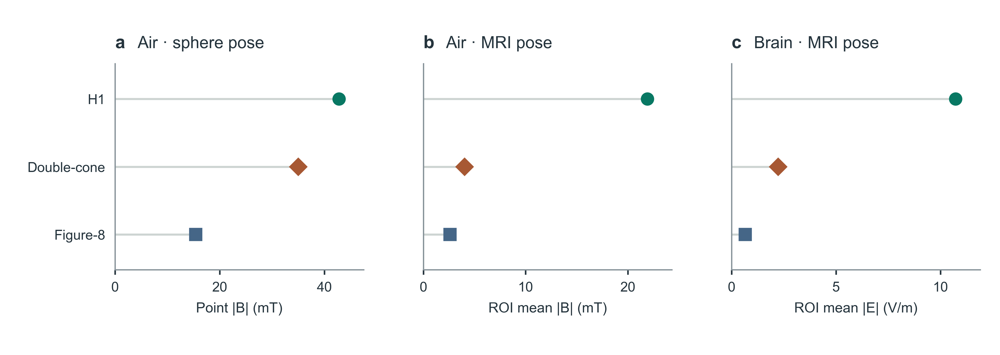
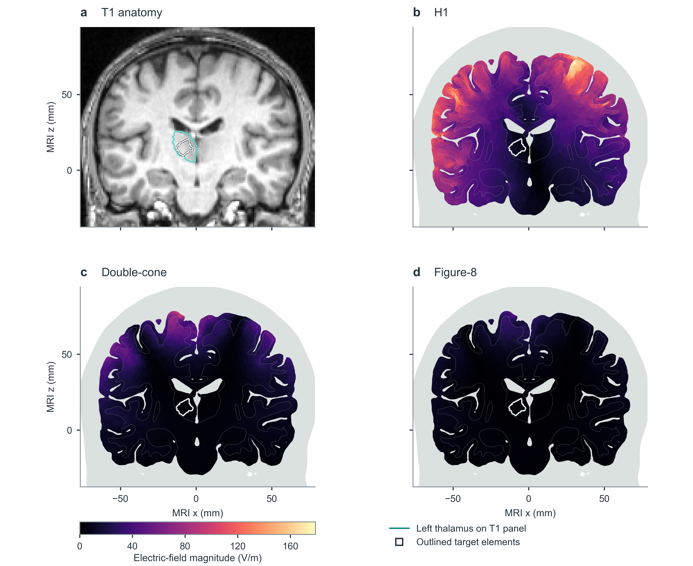

# 一个深部靶区，三种线圈

这里的靶区位于公开个体 Subject01 的左丘脑。先从分割标签中找出最接近左丘脑几何中心的体素，再以其中心为球心，选入重心落在 5 mm 半径内、同时属于左丘脑灰质的四面体。所有线圈都评价同一组单元。三组计算共用同一 MRI、组织电导率和电流变化率。

**图 B1　沿同一行读一种线圈，在每一列内部比强弱。** 左列取以往球面台架上 30 mm 深的单点。中列把绕组放到真实头形上，取左丘脑靶区中的空间位置，计算这些位置的自由空间磁场。右列保留相同摆位与靶区，加入组织电导率，计算头内的感应电场。三列中，H1 都居首，双锥次之，八字第三。右列的靶区平均电场依次是 **10.72、2.23、0.65 V/m**。各列从零起算、使用各自的横轴。前两列按 1,000 A 报告磁场，单位是 mT；第三列按 $\mathrm{d}I/\mathrm{d}t=100~\mathrm{A}/\mu\mathrm{s}$ 报告电场，单位是 V/m。[排版 PDF](target_comparison.pdf) · [两种几何条件下的空气场](../../brain_field/results/air_field.csv) · [电场与皮层参照](../../brain_field/results/summary.csv)

个体靶心沿 MRI 头脚轴距头皮约 80.0 mm。把球面台架的观测点也移到 80.0 mm，H1、双锥、八字的磁场分别为 20.76、3.83、2.55 mT。这项等深对照可以从深度差异中分辨摆位的影响。[等深空气场结果](../../brain_field/results/air_field.csv)

中列和右列的靶区平均都按四面体体积计算。设 $v_i$ 为第 $i$ 个单元体积，$\mathbf F_i$ 为该处磁场或电场矢量。先取各单元的场强，再计算体积加权均值

$$
\overline{|F|}_{\mathrm{ROI}}=
\frac{\sum_{i\in\mathrm{ROI}}v_i\,|\mathbf F_i|}{\sum_{i\in\mathrm{ROI}}v_i}.
$$

相邻位置的场方向即使不同，仍可用这个量比较当地场强。神经元对电场的响应还取决于方向、波形和组织结构。

**图 B2　先在个体 T1 MRI 上找靶区，再在三张电场图中找同一个白框。** 左上绿色勾出分割得到的整个左丘脑，白色轮廓沿实际参与靶区评分的网格单元。其余三幅共用从 0 到 179.04 V/m 的线性色标，深色到亮色表示脑灰质和白质内电场逐渐增强。灰色背景给出其余头部组织的位置。图面水平向右是个体右侧，垂直向上是头顶。该切面穿过靶心，只截到 62 个目标单元中的 32 个；上一图的数字使用完整三维靶区。[排版 PDF](coronal_fields.pdf) · [切面坐标、解剖与场值](../../brain_field/results/coronal_section.npz) · [靶区纳入规则](../../brain_field/results/target.json)

冠状面取个体 MRI 坐标 $y=-20.079$ mm。T1 灰度在 1 mm 网格上线性采样，以非零灰度的第 99 百分位作显示白点，解剖标签按最近体素读取。电场则直接沿平面切开原四面体，给每块多边形赋该单元的 $|\mathbf E|$；组织边界两侧保留各自的数值。三张图中的色标包含同一切面上全部已显示脑组织的场值。靶区的颜色整体较暗，较浅处的灰质有较亮区域。放回三维网格计算，H1、双锥、八字的靶区均值分别为本线圈双侧大脑皮层电场第 99 百分位的 **8.69%、3.36%、2.17%**。这些比例描述本例深部与皮层的场强差异。[皮层参照与靶区结果表](../../brain_field/results/summary.csv)

## 重绘

从仓库根目录运行 `python brain_field/plot_results.py`，即可从随库提供的两个 CSV 与切面 NPZ 重绘 PNG 和 PDF。若已重跑完整头模 FEM，在 SimNIBS 的 Python 环境中运行 `python brain_field/extract_section.py` 可重新提取切面。[重绘脚本](../../brain_field/plot_results.py) · [切面提取脚本](../../brain_field/extract_section.py)

## 参考与数据来源

- FieldTrip 公布了 Subject01 的 T1 MRI、组织标签与对应的 CHARM 四面体头模。[建模方法](https://www.fieldtriptoolbox.org/getting_started/othersoftware/simnibs/) · [原始头模与解剖数据](https://download.fieldtriptoolbox.org/getting_started/simnibs/m2m_Subject01/)
- 绕组选择、空气场模型、磁场实测和相关论文见[项目文献与数据目录](../../README.md#sources)。SimNIBS 在原生个体空间保存四面体场值。[场文件说明](https://simnibs.github.io/simnibs/build/html/documentation/file_formats.html)
