# 绕组几何、空间磁场与数值验证图册

本图册回答三个问题：不同绕组在相同驱动电流下产生怎样的空间磁场；改变摆位基准后，靶点读数会变化多少；换求解器后，预测还能否复现。全部图从保存的绕组坐标和三分量磁场重绘，图宽 180 mm。PNG 为 600 dpi；同名 PDF 中的文字和曲线可单独选取。场图保留原采样网格，等值线和坐标为矢量。文末列出重绘方法及出处。

## 绕组怎样改变空间场？

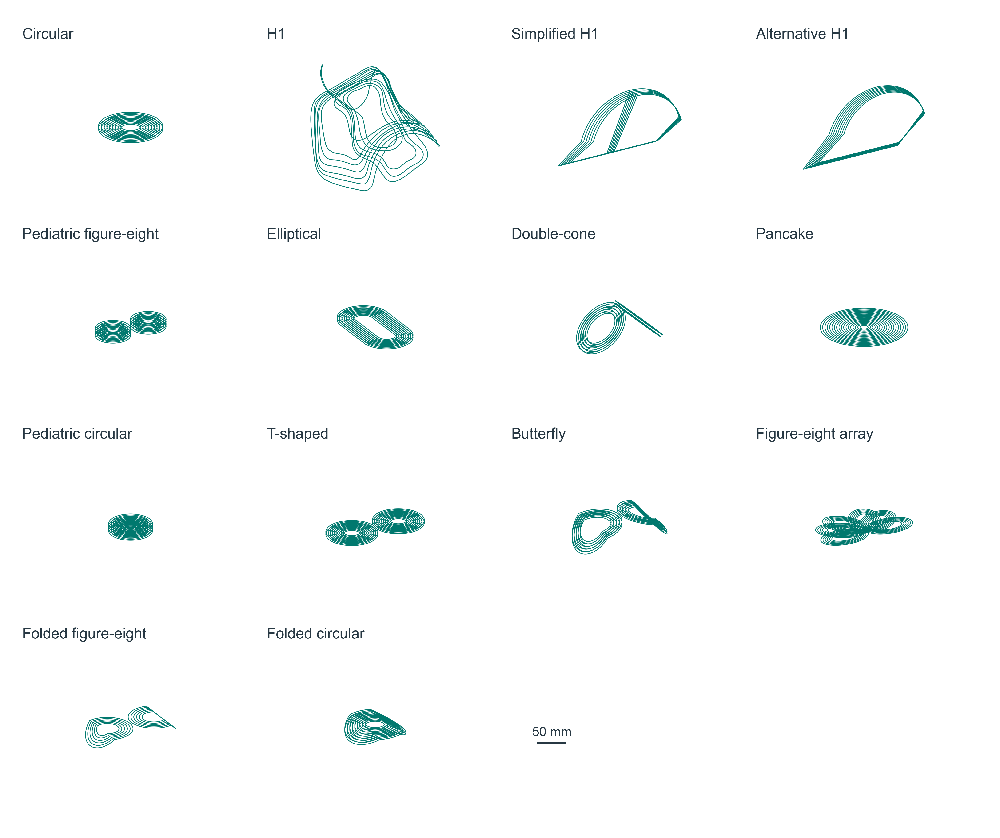

**图 1　十四类绕组有多大、怎样弯曲。** 各格采用相同的正交投影和长度比例，每个绕组平移到格子中央，右下方标尺为 50 mm。双锥的一翼在这个方向上接近侧视，窄线来自投影重叠。图中省略外壳、手柄及未定义的引线。H1 来自公开重建，其余模型的尺寸和假设可在几何清单中核对。

[图 1 PDF](geometry_overview.pdf)

各有向导线段对测点的贡献按方向求和。$\mathbf r'$ 在导线上，$\mathbf r$ 是测点，以下图形显示三分量合成的磁感应强度模长。

$$
\mathbf B(\mathbf r)=\frac{\mu_0}{4\pi}\sum_k I_k
\int_{C_k}\frac{\mathrm d\boldsymbol\ell'\times(\mathbf r-\mathbf r')}
{\|\mathbf r-\mathbf r'\|^3},\qquad
B=\sqrt{B_x^2+B_y^2+B_z^2}.
$$

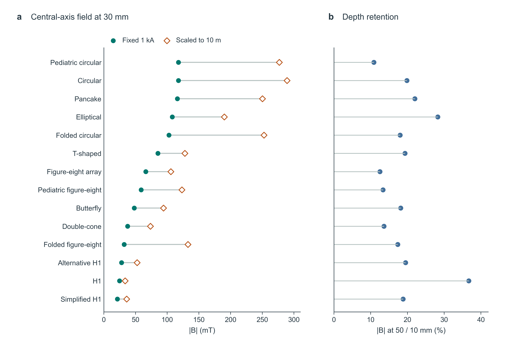

**图 2　场强高和衰减慢是两个指标。** 左图按固定 1 kA 时的 30 mm 轴场降序排列，空心菱形用各自的加权线长折算电流。右图对每只线圈只比较自身的 50 mm 与 10 mm 轴场。H1 在右图保留约 36.7%，而 1 kA 下其 30 mm 轴场为 24.80 mT。深度从最近导线的支撑平面量起。线长折算只约束电流与加权线长的乘积。

[图 2 PDF](coil_comparison.pdf)

$$
L_w=\sum_k |w_k|\ell_k,\qquad
B_{\rm scaled}(30)=B_{1\,\rm kA}(30)\frac{10\,\mathrm m}{L_w},\qquad
R_{50/10}=100\,\frac{B(50)}{B(10)}\%.
$$

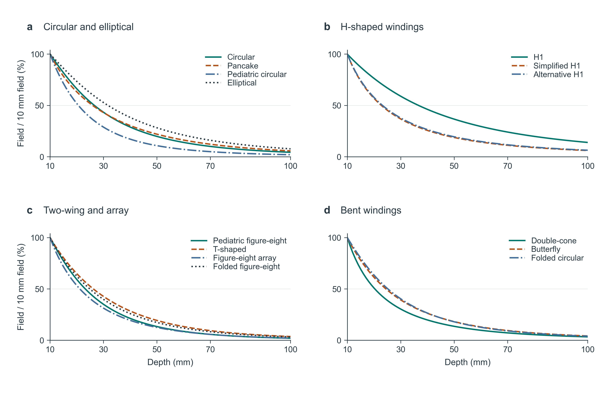

**图 3　沿同一条轴看磁场如何衰减。** 每条曲线均以自身的 10 mm 读数作为 100%。H1 与两种变体在这个摆位下的衰减形状差异明显。右下图蝶形和折叠圆形的曲线接近，但它们在 30 mm 的绝对场分别为 47.98 和 102.82 mT。归一化曲线适合比较形状，绝对幅值见图 2。

[图 3 PDF](normalized_depth.pdf)

## 相同净距与摆位

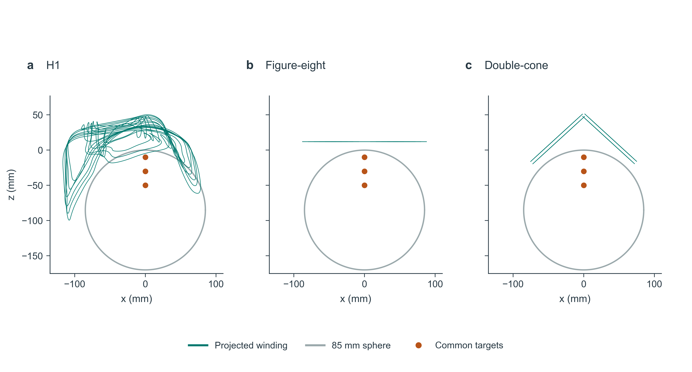

**图 4　最近导线到球面的间隙相同，靶点到导线的距离仍可不同。** 灰线为半径 85 mm 的参考球，橙点分别位于球顶内侧 10、30、50 mm。三组绕组的球面最小净距均为 12 mm，但球顶到最近导线的距离分别为 H1 23.74、理想八字 12.00、双锥 37.34 mm。这里显示 $x$–$z$ 投影，H1 侧翼的不同 $y$ 坐标投影到同一面，判断接触要看三维间距。

[图 4 PDF](placement.pdf)

设球心为 $\mathbf c$、半径为 $R$、绕组中心线为 $W$，沿全部线段求出净距：

$$
g_\mathrm{sphere}=\min_{\mathbf r'\in W}\|\mathbf r'-\mathbf c\|-R=12\ \mathrm{mm}.
$$

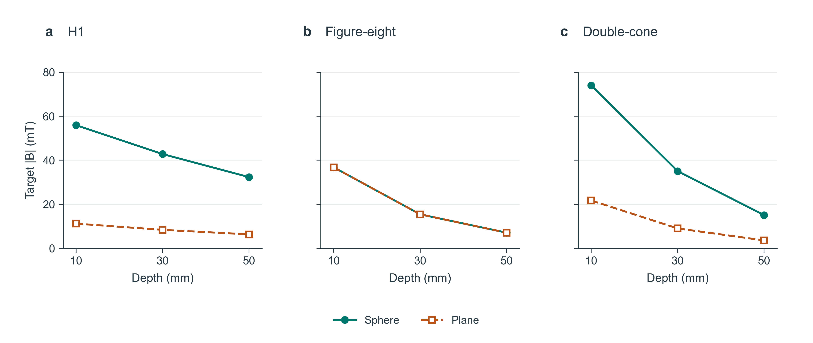

**图 5　“距表面 12 mm”必须写明采用哪个表面。** 绕组朝向固定，绿线把间距量到球面，橙色虚线把间距量到球顶切平面。平面八字线圈的两条曲线重合。双锥改用平面约束后整体移动约 31.56 mm，30 mm 靶点场从 35.02 降至 8.99 mT。三个面板共用纵轴范围。

[图 5 PDF](reference_surfaces.pdf)

## 数值求解与参数敏感性

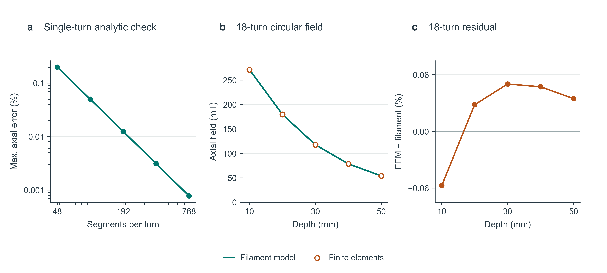

**图 6　先用单圆环检验离散误差，再用有限元检验完整绕组。** 左图每个点代表一次单匝计算，增加线段后最大轴向误差持续降低。中图两套 18 匝计算结果几乎重合，右图放大它们带符号的差。五个深度中的最大绝对百分差为 0.0572%。该数值衡量两种求解方法的一致程度。

[图 6 PDF](solver_validation.pdf)

$$
B_{z,\mathrm{ring}}(z)=\frac{\mu_0IR^2}{2(R^2+z^2)^{3/2}},\qquad
e(z)=100\frac{B_{z,\mathrm{FEM}}(z)-B_{z,\mathrm{line}}(z)}{B_{z,\mathrm{line}}(z)}\%.
$$

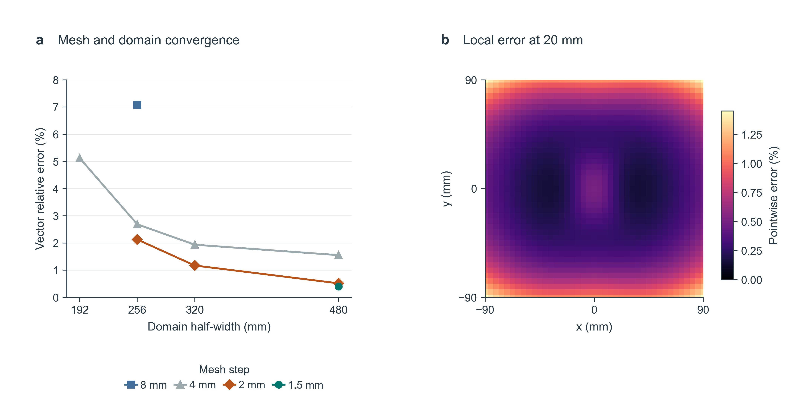

**图 7　双锥的几何没有轴对称性，需要独立三维检验。** 左图每个点代表实际求解的网格和空气域组合，相同网格步长的点以线相连。空气域半宽 480 mm、网格步长 1.5 mm 时，3,571 个观测点的整体三分量相对差为 0.4009%。右图只显示 20 mm 截面的逐点误差；全体点的最大值为 2.479%。整体指标容易受到强场点较大权重的影响，逐点图补充了局部信息。

[图 7 PDF](double_cone_fem.pdf)

$$
E_\mathrm{all}=100\sqrt{\frac{\sum_i\|\mathbf B_{\mathrm{FEM},i}-\mathbf B_{\mathrm{line},i}\|^2}
{\sum_i\|\mathbf B_{\mathrm{line},i}\|^2}}\%,\qquad
e_i=100\,\frac{\|\mathbf B_{\mathrm{FEM},i}-\mathbf B_{\mathrm{line},i}\|}
{\|\mathbf B_{\mathrm{line},i}\|}\%.
$$

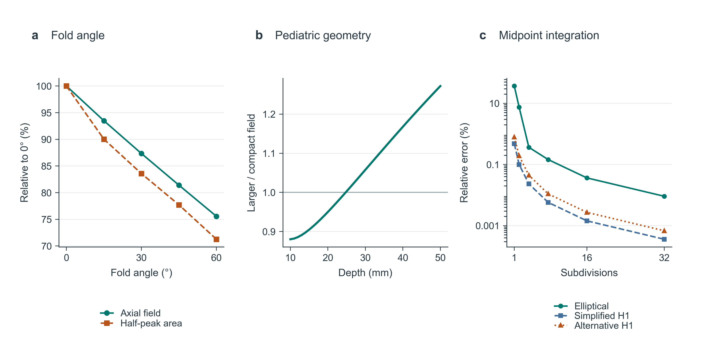

**图 8　几何改变与积分近似分别影响读数。** 左图增加圆形绕组折角，30 mm 轴场及 20 mm 半峰面积均下降。中图给两套儿童八字几何相同匝数和电流，较大版本在 10 mm 处只有紧凑版本的 0.880 倍，到 50 mm 却达到 1.272 倍。右图用直段解析积分作参考：中点积分在长直段上误差明显，追加细分后逐渐接近参考值。

[图 8 PDF](model_sensitivity.pdf)

## 逐型磁场图

每页从左上到右下依次为绕组斜投影、$z=20$ mm 平面场模、中轴 $(0,0,z)$ 深度曲线及 $y=0$ 纵截面场模。同页两张空间图共用绝对 mT 色标，各型号的上限按本型号的场值范围设置。白线为横截面峰值一半的等值线；面积按网格结点计数，图示等值线在相邻结点间插值。

$$
A_{1/2}(z)=\Delta x\,\Delta y\sum_{i,j}
\mathbf1\!\left[B(x_i,y_j,z)\geq\tfrac12\max_{k,l}B(x_k,y_l,z)\right].
$$

### 圆形

**图 A1　圆形线圈。** 同心圆匝使 20 mm 截面呈轴对称分布，中轴穿过中央峰。模型每层九匝，共 18 匝，在 30 mm 处为 117.72 mT，20 mm 面半峰面积为 69.05 cm²。图 6 对同一几何作了独立有限元核验。

[图 A1 PDF](atlas/circular.pdf)

### H1

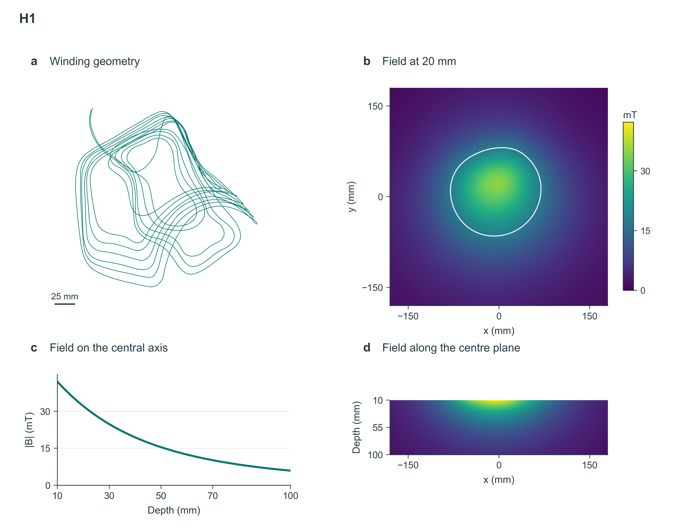

**图 A2　H1 线圈。** 包覆式绕组的回线延伸至侧方，20 mm 面的强场区比圆形基准宽。在此摆位下，30 mm 中轴场为 24.80 mT，20 mm 半峰面积为 171.3 cm²。工作面与支撑平面之间的位置关系会影响深度解释，可与图 4、图 5 对读。

[图 A2 PDF](atlas/h1.pdf)

### 简化 H1

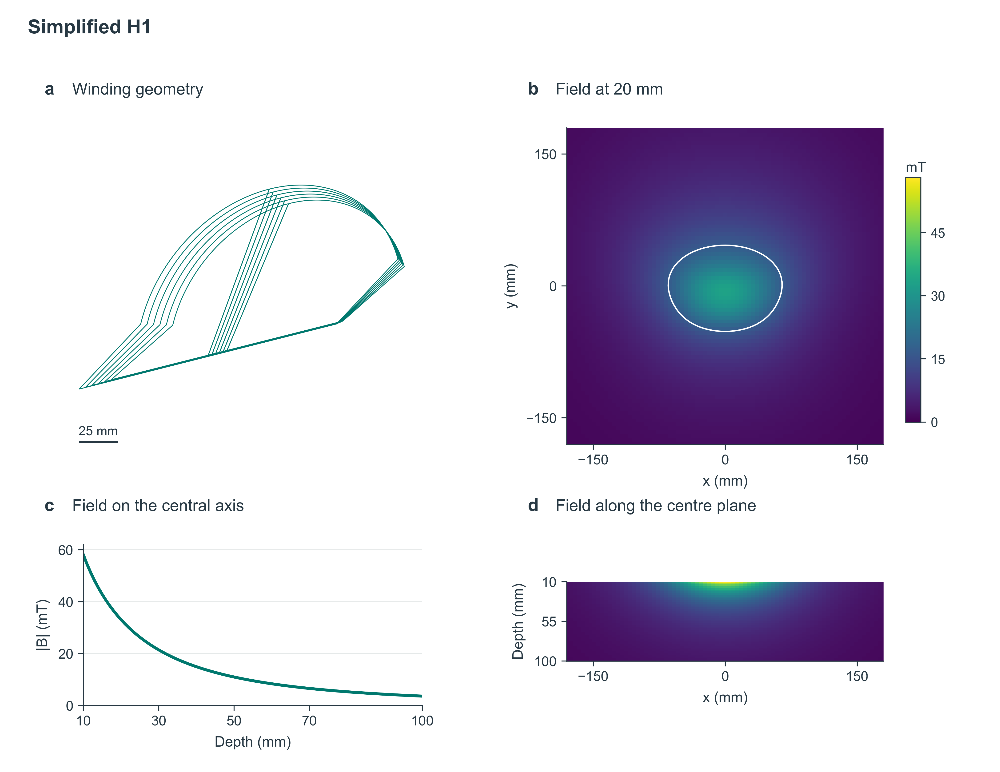

**图 A3　简化 H1。** 弯曲的近侧导线与拉远的回线组成闭合通路。30 mm 中轴场为 21.40 mT，20 mm 半峰面积为 101.25 cm²。几何源图未给齐尺寸，这些读数依赖本模型选定的弧半径和回线距离。

[图 A3 PDF](atlas/h1_simplified.pdf)

### 另类 H1

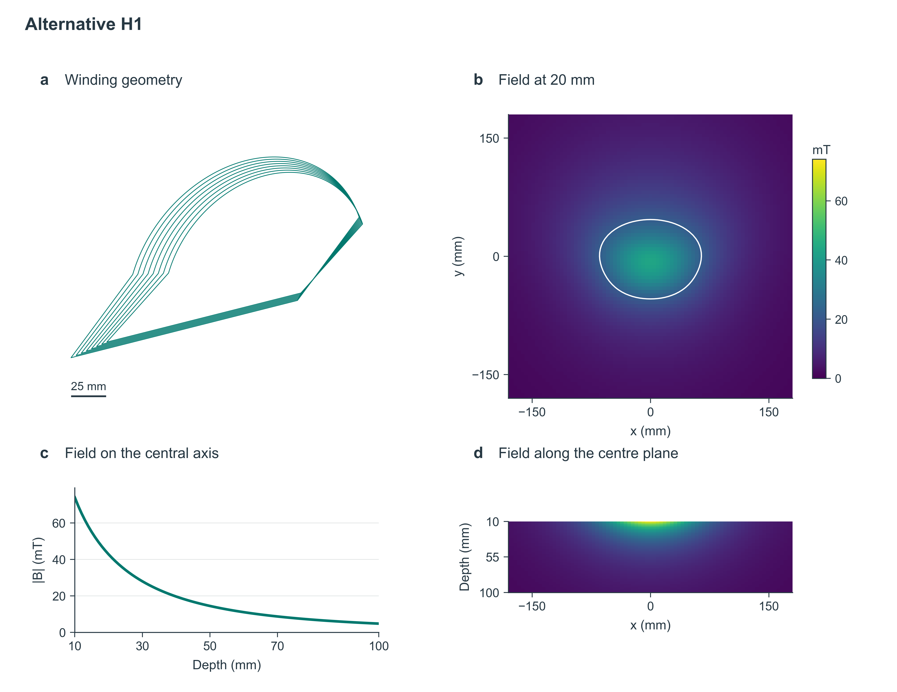

**图 A4　另类 H1。** 八个横向拱环在近侧并排，回线从远处返回。30 mm 中轴场为 27.96 mT，高于简化 H1；两种模型的 20 mm 半峰面积分别为 102.26 和 101.25 cm²。相近的面积可以对应不同绝对场。

[图 A4 PDF](atlas/h1_alternative.pdf)

### 儿童八字

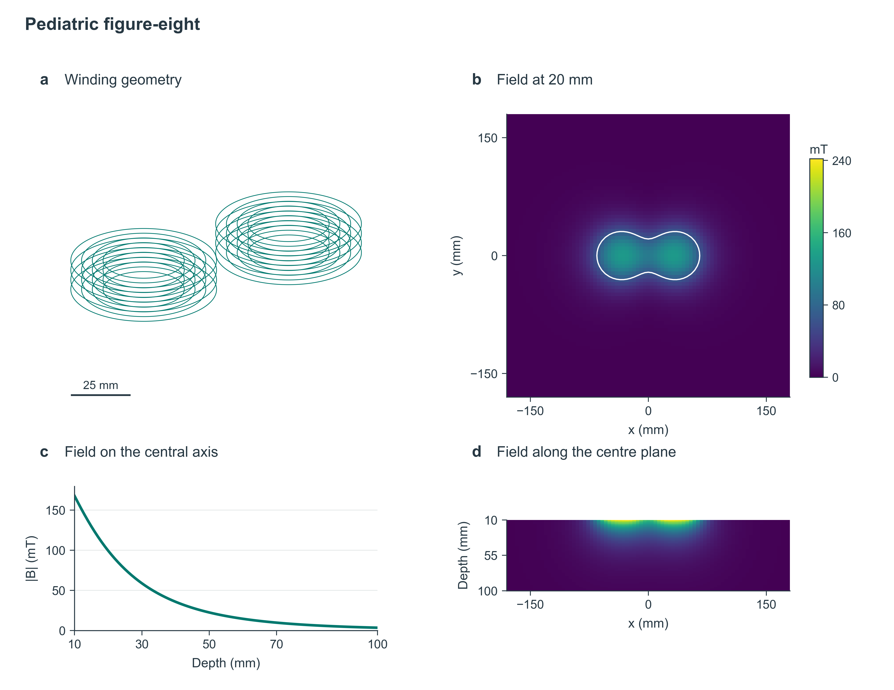

**图 A5　儿童八字线圈。** 这里采用翼心相距 70 mm 的紧凑尺寸。20 mm 截面可见两个相邻强场区，30 mm 中轴场为 58.79 mT。两种几何尺寸在浅、深位置的关系发生改变，受控对照见图 8。

[图 A5 PDF](atlas/pediatric_figure8.pdf)

### 椭圆

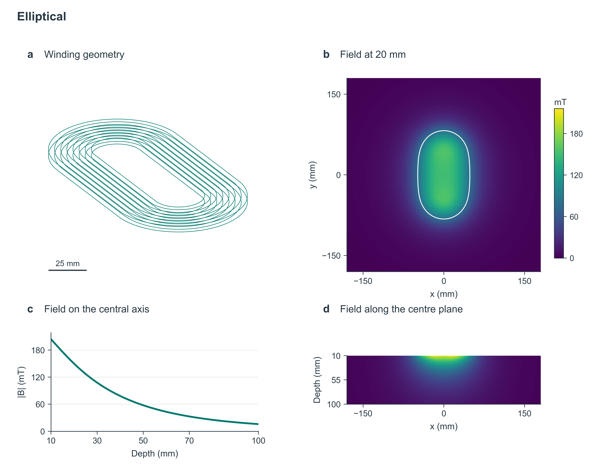

**图 A6　椭圆线圈。** 两条直边连接两个半圆端部，20 mm 截面的半峰轮廓沿长边拉长。该面半峰面积为 134.66 cm²，30 mm 中轴场为 107.94 mT。直边的数值积分单独在图 8 检验。

[图 A6 PDF](atlas/elliptical.pdf)

### 双锥

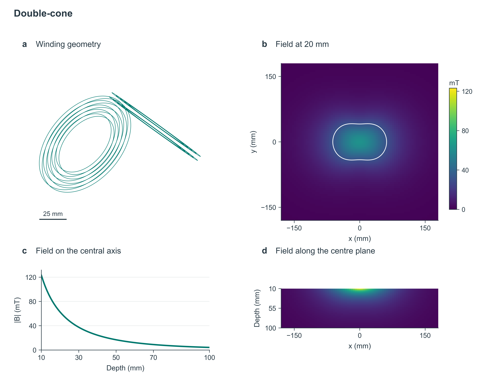

**图 A7　双锥线圈。** 两翼整体倾斜成 95° 内夹角。支撑平面下 30 mm 的轴场为 37.44 mT；图 5 的 35.02 mT 使用球面净距重新摆位，两个数分别描述两种空间工况。

[图 A7 PDF](atlas/double_cone.pdf)

### 盘底

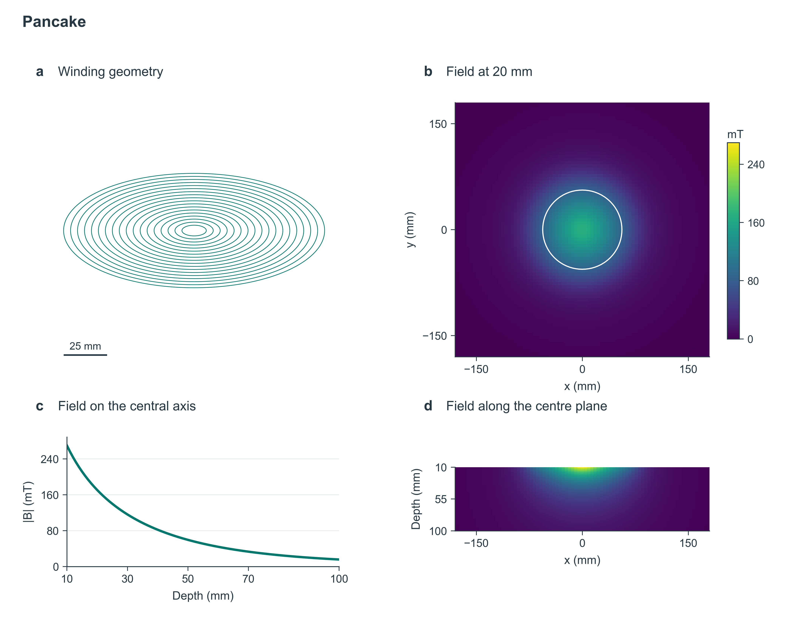

**图 A8　盘底线圈。** 十八个同心环在单层展开，20 mm 半峰面积为 99.02 cm²，比双层圆形基准的 69.05 cm² 更宽。两者在 30 mm 的轴场却相近，盘底为 116.04 mT，圆形为 117.72 mT。

[图 A8 PDF](atlas/pancake.pdf)

### 儿童圆形

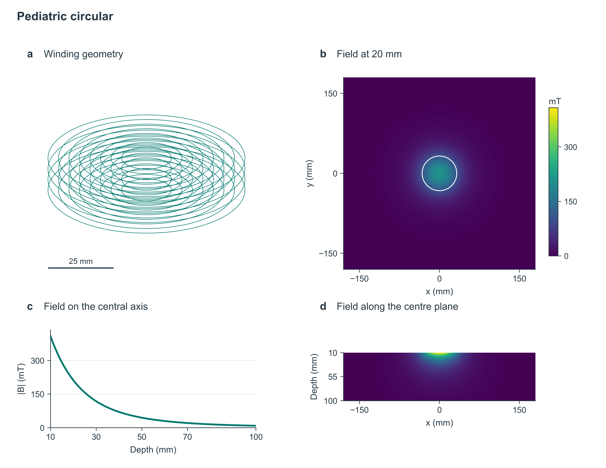

**图 A9　儿童圆形线圈。** 较小直径使近处强场集中在中心，20 mm 半峰面积为 34.22 cm²。中轴从 10 mm 处的 407.93 mT 降至 50 mm 处的 44.26 mT。四层绕组中的每层最外环，以半权重表示等效安匝。

[图 A9 PDF](atlas/pediatric_circular.pdf)

### T 型

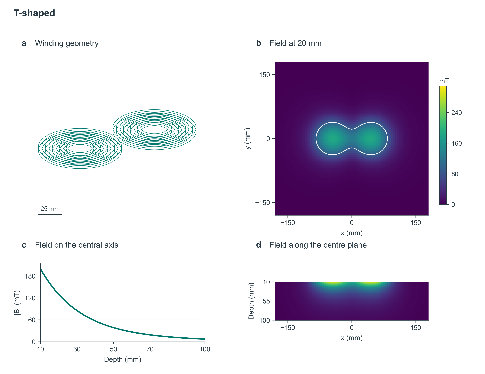

**图 A10　T 型线圈。** 两个平面多匝绕组形成相邻强场区，20 mm 面峰值为 185.93 mT，同一深度的中轴值为 129.73 mT。峰值位置可以偏离中轴。这里只计算尺寸已知的绕组部分，完整 T 形引线的回流路径尚未给定。

[图 A10 PDF](atlas/t_coil.pdf)

### 蝶形

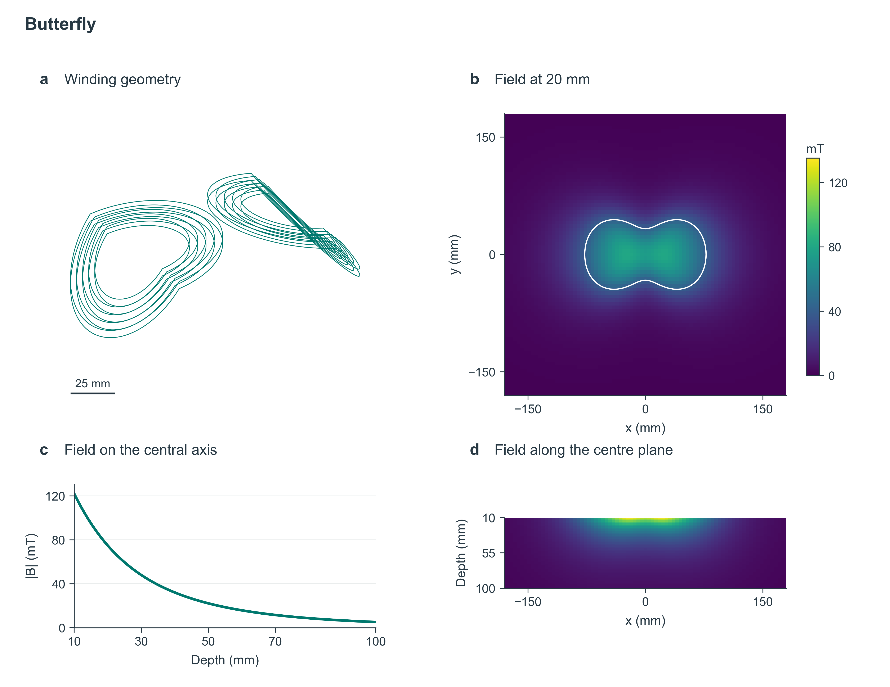

**图 A11　蝶形线圈。** 两翼中央和外侧采用不同倾角，30 mm 中轴场为 47.98 mT，20 mm 半峰面积为 116.03 cm²。与整翼折成一个角度的双锥相比，折弯位置和回流路径均发生变化。

[图 A11 PDF](atlas/butterfly.pdf)

### 八字阵列

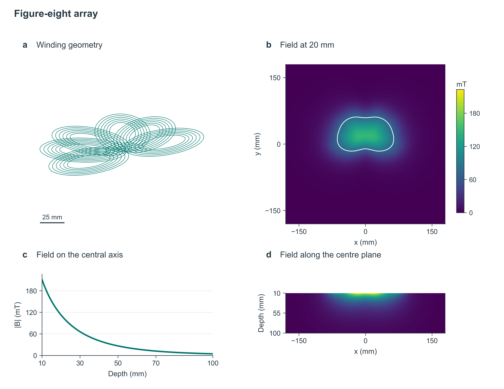

**图 A12　八字阵列。** 三对绕组以给定扇角展开并同步等幅驱动。支路向量场相加后，20 mm 面峰值为 149.42 mT，30 mm 中轴场为 66.15 mT。读数与所设扇角及各通道电流有关。

[图 A12 PDF](atlas/figure8_array.pdf)

### 折叠八字

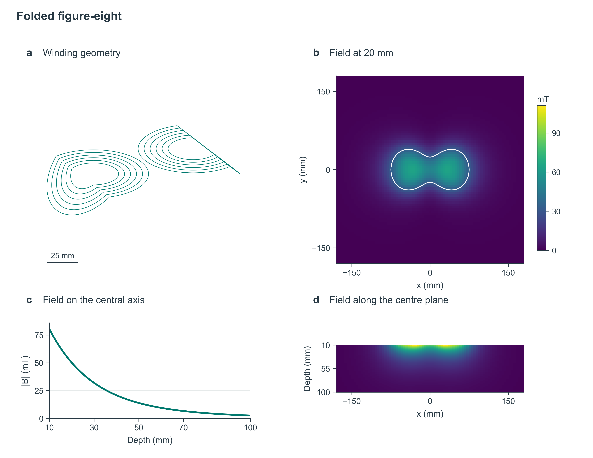

**图 A13　折叠八字线圈。** 两翼外侧在距各自圆心 10 mm 的铰线处折起 45°，中央区仍在原平面内。20 mm 横截面的半峰轮廓跨越两个强场区，面积约 95.38 cm²；30 mm 中轴场为 32.01 mT。

[图 A13 PDF](atlas/folded_figure8.pdf)

### 折叠圆形

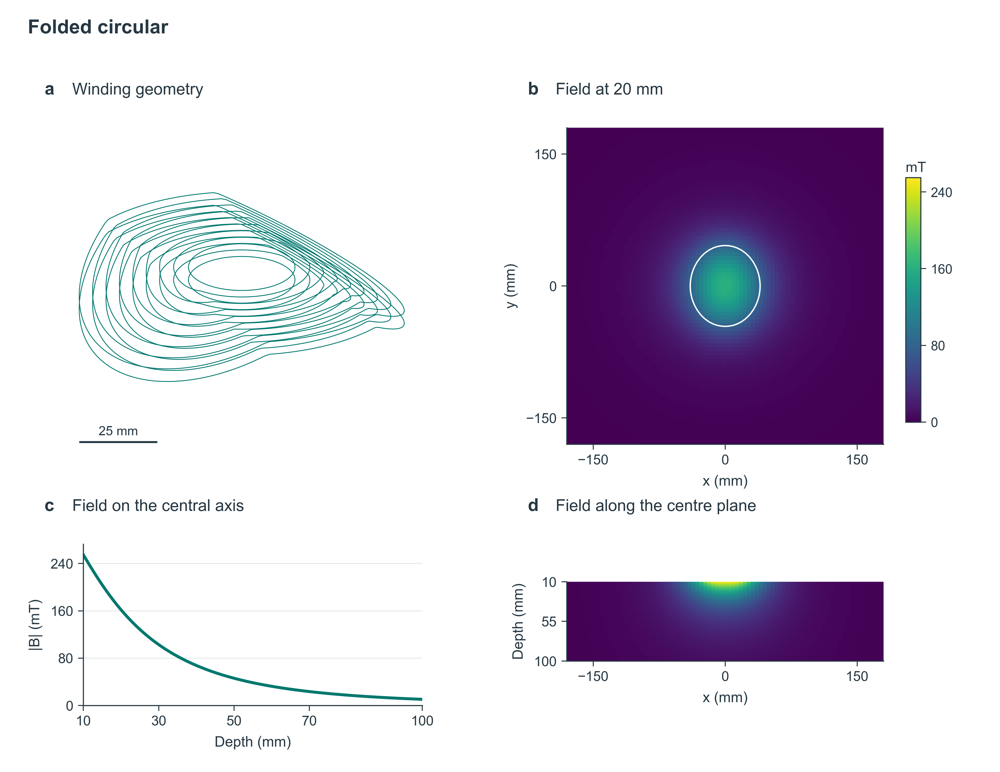

**图 A14　折叠圆形线圈。** 在双层圆形绕组两侧取 30° 折角，20 mm 半峰面积从平面绕组的 69.05 降至 57.71 cm²，30 mm 中轴场从 117.72 降至 102.82 mT。连续改变折角的结果见图 8。

[图 A14 PDF](atlas/folded_circular.pdf)

## 重绘图件

从仓库根目录运行以下命令。渲染使用 CPU，仅需数值结果及 Python 绘图库。图中曲线均对应确定性模型和固定输入，网格及几何变化代表不同工况。

~~~shell
python -m pip install "numpy>=1.24" "scipy>=1.10" "matplotlib>=3.8"
python figures/core/render_core.py
~~~

单独重绘某型号可加参数 <code>--only h1</code>；<code>--only summary</code> 重绘八幅总览。用 <code>--svg-dir</code> 指定单独的输出目录可额外保存 SVG。

## 数据、代码与模型来源

- [MATLAB 三分量磁场与绕组坐标，每型一个 MAT](../../results/fields)；[主指标](../../results/metrics.csv)；[几何模型参数与假设](../../research/geometry_research.md)。
- [H1 数据及校验值](../../reference_models/h1_metadata.json)；[SimNIBS 线圈库](https://simnibs.github.io/simnibs/build/html/documentation/coils.html)；[Worbs 等，2025](https://doi.org/10.1016/j.brs.2025.05.136)。
- [摆位后的线元](../../placement_pilot/placement/target_frame_segments)；[球面与平面数据](../../placement_pilot/reference_surface_comparison.csv)；[靶点与净距](../../placement_pilot/placement/README.md)。
- [单匝解析校验](../../results/validation/circle_analytic_convergence.csv)；[18 匝有限元计算](../../fem/results/multiturn_main_circular/main_model_comparison.csv)；[双锥有限元及误差定义](../../placement_pilot/fem3d/README.md)。
- [几何及积分敏感性数据](../../results/sensitivity)；[本图册的重绘代码](render_core.py)。
