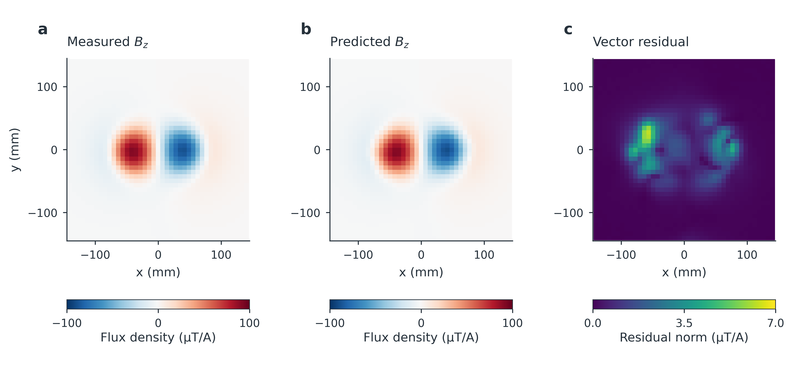
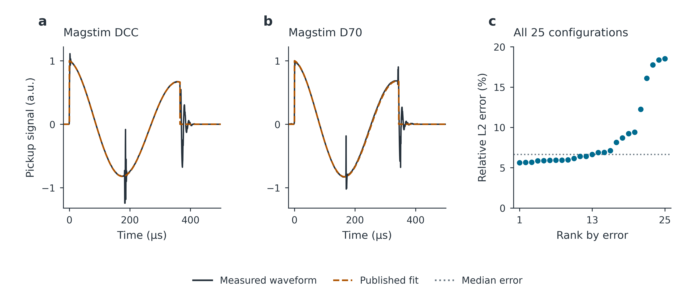
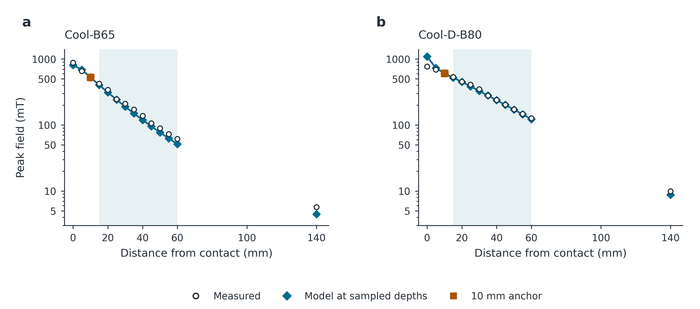
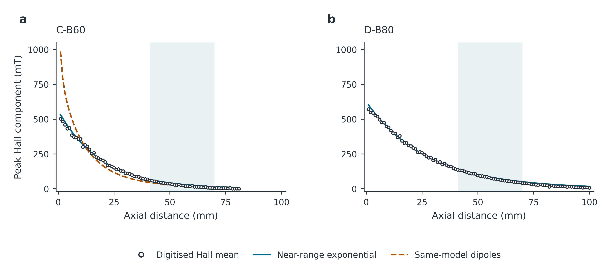
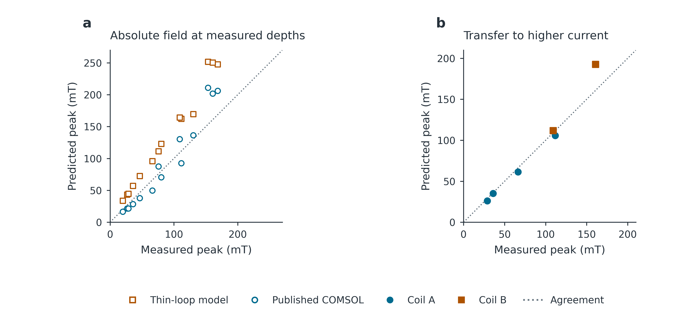
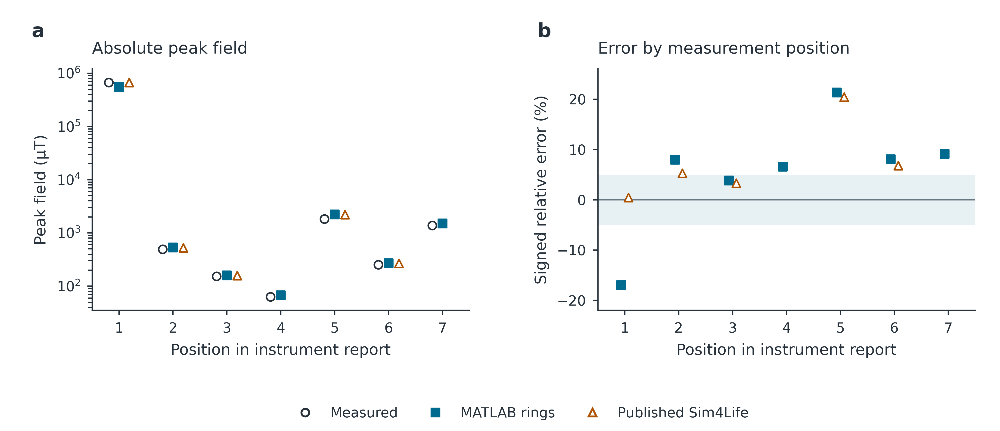
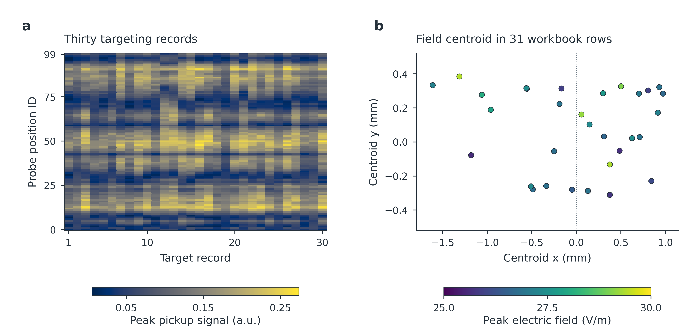
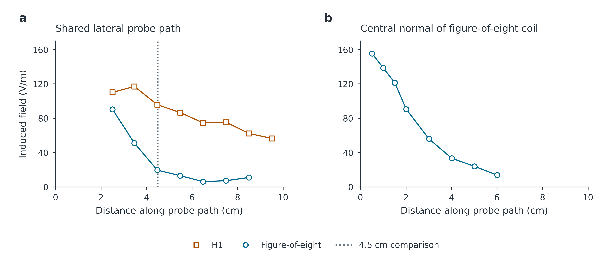

# 七组外部台架实测图册

八幅图分别回答空间磁场、时间波形、距离衰减、电流换档和电场定位的问题。先读清探头记录的量，再看横纵坐标。空气中的磁感应强度 $B$ 用 T、mT 或 µT 表示；导电体模中的感应电场 $E$ 用 V/m 表示。丹麦三轴扫描的读数已经按线圈电流归一，用 µT/A。不同装置的测量条件详见文末。

设 $y_i$ 是第 $i$ 个实测值，$p_i$ 是相同位置或时刻的预测值。下文的相对 L2 误差先累加平方差，再以本组实测信号的总能量归一化：

$$
\epsilon_{\rm rel}=100\sqrt{\frac{\sum_i\lVert p_i-y_i\rVert^2}{\sum_i\lVert y_i\rVert^2}}\%.
$$

对标量，一项只有一个差值；对三轴测量，一项包含三个方向的平方差。图中的线、点和热图保留各实验的真实分辨率。原始论文仅给出均值或印刷图时，图注中会说明哪些值通过读图获得。

## M01　模型能重现未参与拟合的三轴磁场吗？

**读图。** 前两幅的红蓝颜色表示磁场分别朝向扫描仪轴的正、负方向，两幅使用完全相同的色标。右图计算 $\lVert\mathbf B_{\rm 预测}-\mathbf B_{\rm 实测}\rVert_2$，颜色越亮，三个方向合在一起偏差越大。为让每个方格表示相同面积，图中展示约 +23.8 mm 处、步距 7 mm 的 41 × 41 个真实测点，每格使用本点读数。该层另有 961 个中央细网格点；全层 2,642 点相对误差为 2.570%，三个完整留出层合计 6,965 点为 2.501%。这些平面在估计等效源权重和选择正则化参数时均保留。 [矢量 PDF](m01_vector_scan.pdf) · [逐点三分量](../../external_measurements/measured_coil_library/mc_b70_heldout_points.csv)

## M02　一个拟合波形能复现真实脉冲的细节吗？

**读图。** 左、中两幅的黑线来自拾取线圈实测，橙色虚线是作者给出的拟合。主体脉冲重合，快速尖峰处仍有差异。右图每个点对应一份共 5,201 个时刻的完整记录，按相对误差从小到大排列；虚线为 25 份记录的中位数 6.65%。只用同一时轴上的原始相对幅值评分，范围为 5.62%–18.52%。这里考察的是拾取信号 $u(t)\propto-\mathrm d\Phi/\mathrm dt$ 的时间形状。 [矢量 PDF](m02_pickup_waveforms.pdf) · [各型号逐项结果](../../external_measurements/measured_coil_library/waveform_scores.csv)

## M03　单点标定能把另一实验室的模型用到多远？

**读图。** 空心圆是法国论文图中均值或正文数值，蓝色菱形是同一距离的模型值。橙色方块是唯一参与标定的 10 mm 测点。若 $M(d)$ 为丹麦同型号模型在距离 $d$ 的场模长，预测为 $\hat B(d)=B_{\rm 实测}(10)\,M(d)/M(10)$。浅色带内十个距离的误差分别为 8.01% 和 3.47%；到 140 mm，模型分别低估 21.79% 和 11.59%。60–140 mm 之间只有远端观测，故该区间不画插值线。原研究用探头信号换算磁场，未公开三通道合成细节，本对照沿用模长假设。 [矢量 PDF](m03_french_decay.pdf) · [逐距离观测与预测](../../external_measurements/lyon/air_profiles.csv)

## M04　用近距离数据推测远距离衰减，误差有多大？

**读图。** 两款线圈都沿中心法线每隔 1 mm 测量，空心圆取自原刊图 2 的三次脉冲均值。本项目仅用 5–40 mm 数据拟合指数曲线 $B(d)=a\exp(-d/\lambda)$。进入浅色的 41–70 mm 测试段后，C-B60 与 D-B80 的误差分别为 25.81% 和 7.31%。C-B60 的橙色虚线是另一实验室的同型号模型，按霍尔敏感方向投影，再用 10 mm 处对齐幅值，测试段误差为 23.97%。表面附近两条 C-B60 模型曲线相差明显，说明探头方向和距离零点影响实际使用。 [矢量 PDF](m04_german_decay.pdf) · [181 个数字化均值与曲线](../../external_measurements/regensburg/distance_profiles.csv)

## M05　微型八字线圈换一档电流，原曲线还能用吗？

**读图。** 横轴是真实霍尔标记读数，纵轴是预测。落在对角线上的点表示两者相等，线上方表示预测偏大。左图在两只原型、四档实测电流的 14 个位置上，比较简化双圆模型与作者发表的 COMSOL 曲线。右图只使用两档电流共同测过的深度，以 $\hat B(I_2,d)=B(I_1,d)\,I_2/I_1$ 预测高档读数。A 原型四个位置的误差为 6.04%，B 原型两个位置为 16.48%。横轴数据来自论文图 7、8 的标记，未取得各次脉冲的原始波形。 [矢量 PDF](m05_current_transfer.pdf) · [原型与读图记录](../../external_measurements/abbasi/hall_depths.csv) · [电流换档记录](../../external_measurements/abbasi/current_transfer.csv)

## M06　圆形线圈的绝对场在哪些位置算得准？

**读图。** 左图按仪器报告中的测点编号排列；编号相邻仅表示在同一张表中相邻。对数纵轴让 63 µT 和 667,000 µT 的测量都能看清。右图使用 $100(B_{\rm 预测}-B_{\rm 实测})/B_{\rm 实测}$，浅色带为文献报告的 ±5% 测量不确定度。七点的绝对相对误差平均为 10.56%，MATLAB 模型只有第 3 点落在带内。五个橙色三角来自后续文献的 Sim4Life 表格，其余两点没有发表对应模拟值。6.8 kA 峰值电流沿用后续研究利用同一次测量确定的工况。 [矢量 PDF](m06_circular_field.pdf) · [实测坐标与逐点误差](../../external_measurements/independent_lab/italy_results.csv)

## M07　重复瞄准时，实际电场的中心位置能否保持一致？

**读图。** 左图每列是一次靶位文件，每行是一个原始探头位置编号，色深表示扣除基线后的峰值，采用数据归档的相对单位。右图每点是作者工作簿中的一条质心记录，位置用 mm，颜色是峰值电场（V/m）。用样本标准差 $s=\sqrt{\sum_i(x_i-\bar x)^2/(n-1)}$ 计算，横、纵坐标的离散程度分别为 0.720 mm 和 0.237 mm，峰值电场为 $27.14\pm1.04$ V/m（均值 ± 样本标准差）。30 个靶位文件与 31 行工作簿记录没有可核验的一一映射，因此两图各自保持原来的记录顺序和单位。 [矢量 PDF](m07_target_repositioning.pdf) · [重绘数组](../../external_measurements/independent_lab/finland_profiles.mat) · [工作簿统计](../../external_measurements/independent_lab/finland_targeting_workbook.csv)

## M08　H1 与八字线圈在同一体模路径上的电场怎样变化？

**读图。** 左图沿同一条侧方探测线比较两种线圈，右图沿八字线圈自己的中央法线测量。空心标记是从原图读取的 23 个数据点，细线仅连接相邻标记。以相邻读数对 4.5 cm 作线性插值，左图的 H1 和八字分别约为 95、19 V/m。盐水探头通过尖端间电压获得局部感应电场，沿测量方向有 $E_\parallel\approx-\Delta V/\Delta\ell$。这组结果依赖作者当时的激励、放置和探测路径，两款线圈还分别使用了不同的输出设置。 [矢量 PDF](m08_saline_electric_field.pdf) · [各点原图坐标和电场](../../external_measurements/measured_coil_library/roth/digitized_e_fields.csv)

## 文件与复现

以上每张 PDF 的页面宽 183 mm，曲线、散点、方格和坐标文字为矢量对象，字体嵌入；600 dpi PNG 用于在浏览器阅读。可以直接编辑[绘图脚本](render.py)中的尺寸、单位和配色。各图沿用原实验的观测范围和计量单位，不同量的图分别标出色标。印刷版的最终尺寸和文件格式可随目标期刊调整。

需要 SVG 或 TIFF 的排版流程可在绘图命令后附加参数 `--print-dir <输出目录>`。程序会向指定目录写入保留文字的 SVG 和 600 dpi、LZW 无损压缩的 TIFF。

在已配置的项目根目录运行以下命令。依赖 NumPy、SciPy、Matplotlib 和 pandas。第一行用于首次恢复丹麦两个示例波形所需的公开缓存，程序校验其固定版本的 Git 文件摘要。其余图直接从随项目的实验结果重绘。

~~~powershell
& .\.venv\Scripts\python.exe external_measurements/measured_coil_library/prepare_inputs.py
& .\.venv\Scripts\python.exe figures/measurements/render.py
~~~

## 论文与数据来源

1. **M01 丹麦 MC-B70 扫描。** Madsen、Drakaki、Thielscher 的测量、等效源研究及固定版本的探头原始位置、三分量读数和外壳数据。[研究](https://arxiv.org/abs/2112.14548) · [作者仓库及原始数据](https://github.com/simnibs/dipole-fit/tree/63d8cba254e3ade29c3db58eca9f5397a23e07c4)
2. **M02、M03、M04 丹麦商用线圈库。** Drakaki 等，*Brain Stimulation*，2022。25 款波形及由另一套台架测量反演的商业线圈等效源。[论文](https://doi.org/10.1016/j.brs.2022.04.017) · [固定版本波形与线圈库](https://github.com/simnibs/simnibs/tree/fde509f6f8de38a4b03947944cf7ee93b8bebabe/simnibs/resources/coil_models/Drakaki_BrainStim_2022)
3. **M03 法国空气测量。** Quesada 等，*PAIN Reports*，2024。近段用图 2A 的均值标记，远段用正文 140 mm 数值。[论文及图表](https://doi.org/10.1097/PR9.0000000000001134) · [可访问全文](https://pmc.ncbi.nlm.nih.gov/articles/PMC10876241/)
4. **M04 德国霍尔测量。** Schecklmann 等，*Scientific Reports*，2020。点来自图 2，原文注明完整原始数据按申请提供。[论文及原图](https://doi.org/10.1038/s41598-020-58034-2)
5. **M05 美国原型。** Abbasi 等，*Sensors*，2024。图 7、8 给出霍尔标记、原型电流和作者仿真曲线。[论文](https://doi.org/10.3390/s24051584) · [出版图 7](https://mdpi-res.com/sensors/sensors-24-01584/article_deploy/html/images/sensors-24-01584-g007.png) · [出版图 8](https://mdpi-res.com/sensors/sensors-24-01584/article_deploy/html/images/sensors-24-01584-g008.png)
6. **M06 意大利圆形线圈。** Bogi、Zoppetti 和 Pinto，2009 年仪器测试报告表 1。D’Agostino 等的后续论文给出五点 Sim4Life 表值及驱动工况。[原测试报告](https://www.portaleagentifisici.it/filemanager/userfiles/DOCUMENTAZIONE/CEM/valutazioni/cem_rapporto_valutazione_transcranica.pdf?lg=IT) · [后续论文](https://doi.org/10.3389/fpubh.2025.1705893) · [补充表格](https://doi.org/10.3389/fpubh.2025.1705893.s001)
7. **M07 芬兰与巴西球面测量。** Matsuda 等，*Physics in Medicine & Biology*，2025。Zenodo 记录含原始探头 TXT、作者工作簿和分析资料，数据许可 CC BY 4.0。[论文](https://doi.org/10.1088/1361-6560/adf36e) · [Zenodo 数据](https://doi.org/10.5281/zenodo.15398706)
8. **M08 以色列盐水体模。** Roth 等，*Journal of Clinical Neurophysiology*，2007；取图 8c、9c 的探测线标记。[论文](https://doi.org/10.1097/WNP.0b013e31802fa393) · [作者公开的全文与图](https://www.brainsway.com/wp-content/uploads/2018/12/Roth_Journal_of_Clinical_Neurophysiology_2007_Fig-8_H-coil_Electrical_Field_Distribution.pdf)
