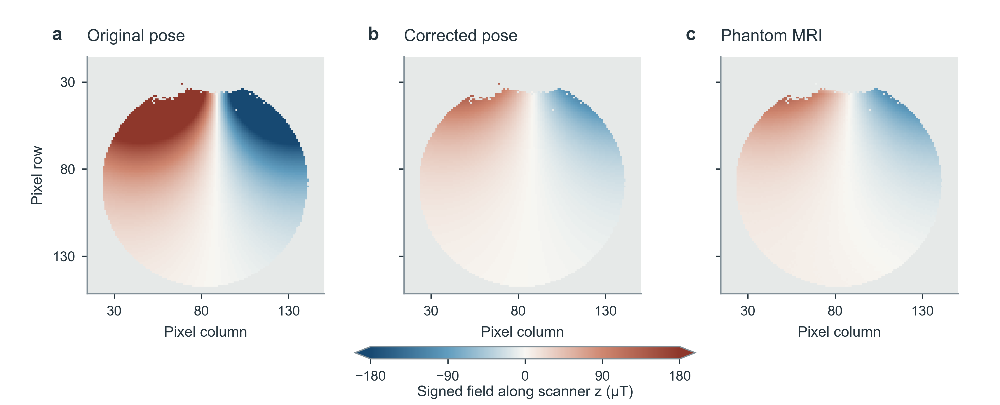
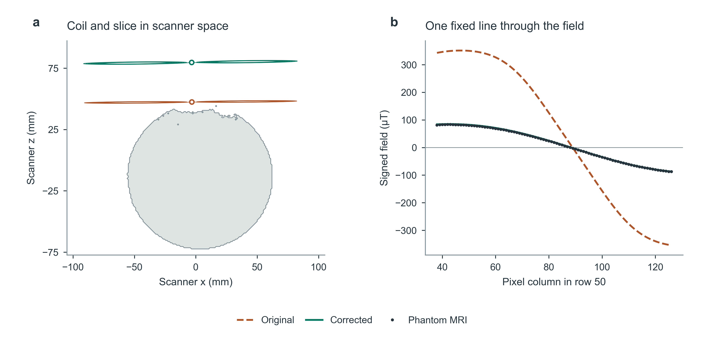
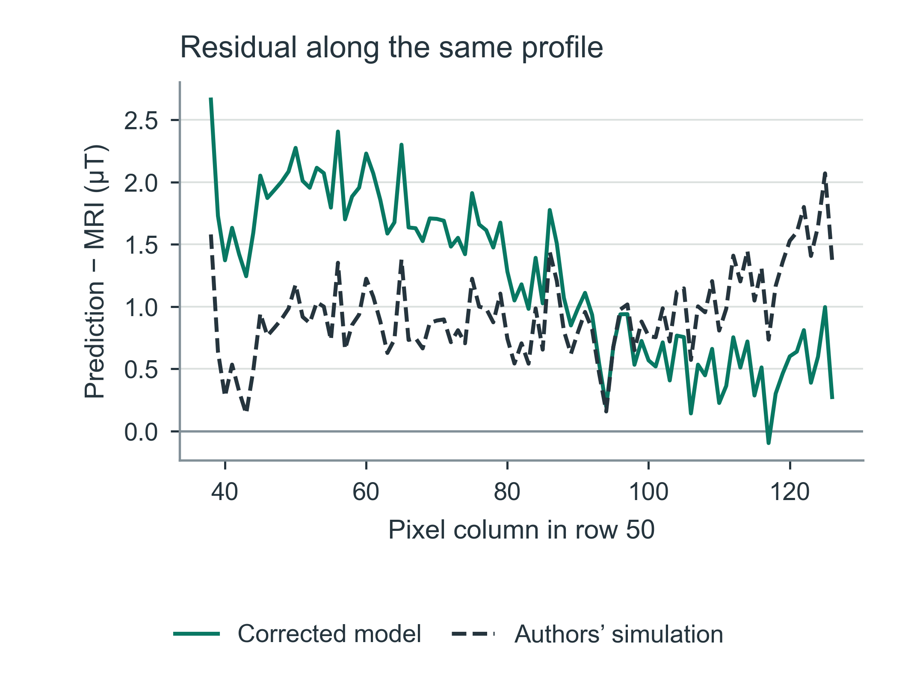
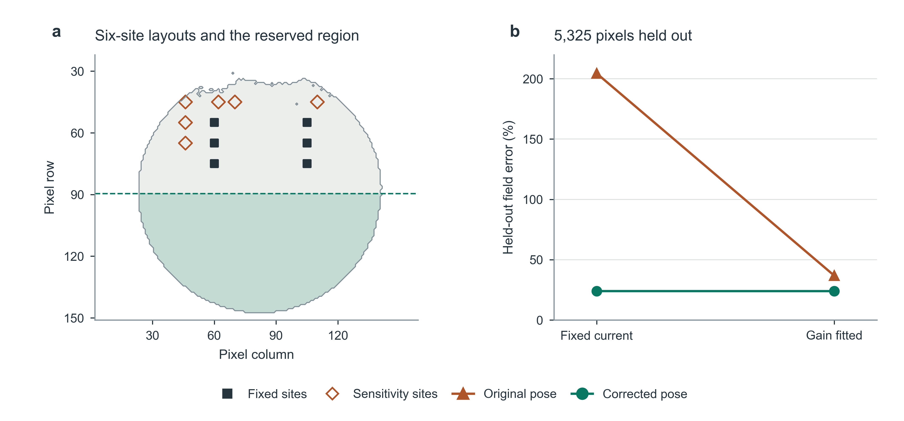
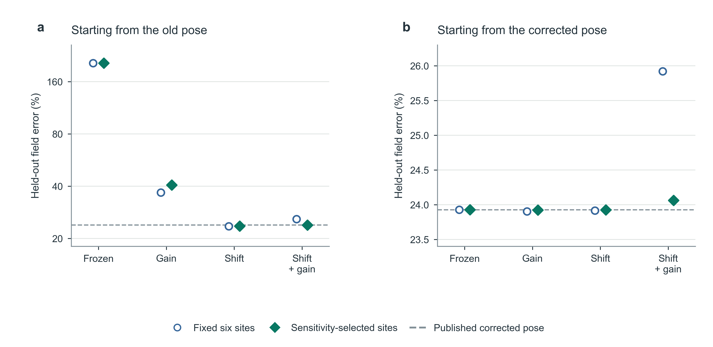
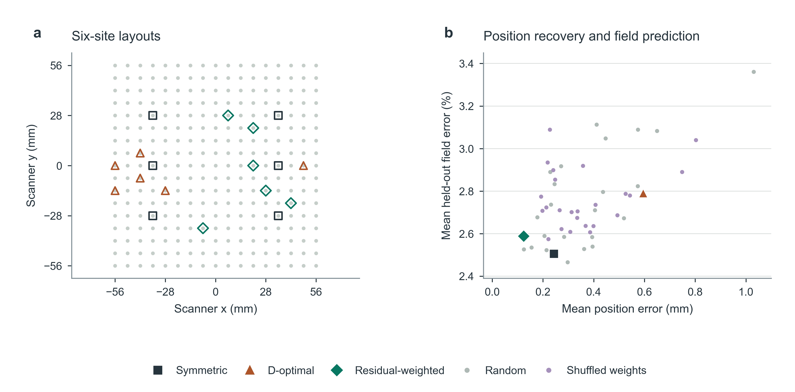
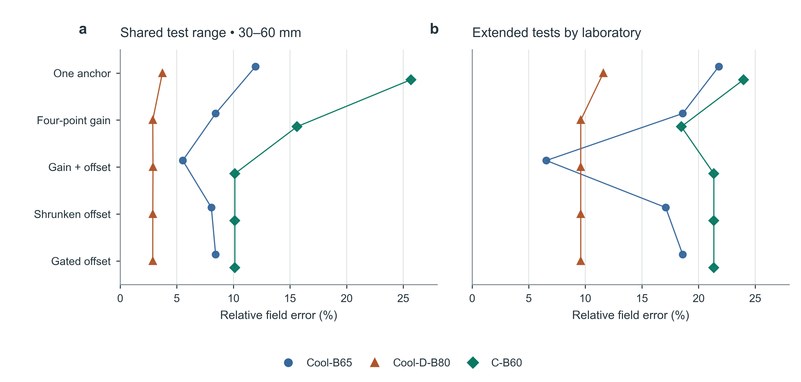

# 从 MRI 场图到稀疏测点校准

这组图回答一个台架问题。重装一只线圈后，计算和实测出现偏差，怎样用少量读数判断应当移动线圈，还是调整幅值？前三幅图解释一次公开的八字线圈导航修正，后四幅图检验有限测点能够辨认哪些误差。图内采用英文坐标与单位，便于在英文稿件中沿用。线圈与体模均来自公开的归档实验，本项目重新计算场与评分。

## 一、同一只线圈为什么会高出 4.50 倍

**图 M1　改变摆位会改变磁场在整张图上的强弱。** 从左到右分别是原始导航文件给出的预测、更正后的预测和体模 MRI 测到的磁场。红、蓝表示磁场沿扫描仪轴向的两种相反方向，灰色是体模有效区外。三图以同一色标显示原始像素，范围为 ±180 µT，两端箭头表示超过色限的值。计算整体幅值比 $R=\lVert p\rVert_2/\lVert y\rVert_2$ 时使用全部 10,622 个有效像素的未截断数值，其中 $p$ 是预测，$y$ 是实测。两版的 $R$ 分别为 **4.5018、1.0162**。每翼九匝和 3.576 A 等效电流在两次计算中相同。[矢量 PDF](mri_field_maps.pdf) · [原始切片矩阵](../../placement_pilot/public_benchmark/matched_figure8/figure8_slice_results.mat) · [数值表](../../placement_pilot/public_benchmark/matched_figure8/placement_version_comparison.csv)

**图 M2　左边看位置，右边看这个位置会算出多大的场。** 左图将绕组和灰色体模切片投影到扫描仪的 x-z 平面。两套绕组接近侧视，小圆圈是各自原点。旧版和更正版原点沿 z 分别位于 47.48、79.75 mm，相差 **32.27 mm**。右图沿作者预先指定的第 50 行比较预测与实测，虚线的两侧峰值明显偏大。只在计算中替换 z 平移，整图相对误差就从 352.56% 降至 7.73%。此处误差按 $\epsilon=100\lVert p-y\rVert_2/\lVert y\rVert_2$ 计算。[矢量 PDF](mri_pose_profile.pdf) · [绕组原点](../../placement_pilot/public_benchmark/matched_figure8/coil_origins.csv) · [剖线数据](../../placement_pilot/public_benchmark/matched_figure8/profile_row50.csv)

**图 M3　大幅偏差消除后，仍能看见局部误差。** 这张放大图把预测减去实测，得到每个像素的残差 $r_i=p_i-y_i$。正值表示预测偏高，负值表示预测偏低。绿实线来自本项目按更正摆位重建的九匝模型，黑虚线来自原作者发布的模拟矩阵。这条剖线上两种预测大多略高于实测，差值仍随像素位置起伏。第 50 行只展示一个剖面，整幅切片两种模拟的相对 L2 误差分别为 7.63% 和 7.36%。[矢量 PDF](mri_profile_residual.pdf) · [两个预测与实测的逐列记录](../../placement_pilot/public_benchmark/matched_figure8/profile_row50.csv)

## 二、只有六个测点时怎样校准

**图 M4　先在近处测六点，再到远处查验。** 左图的黑色方块是原来的六个固定位置，橙色菱形为下一幅图使用的另一套六点；绿色阴影内的 5,325 个像素都留到检验时才用。右图只用黑色方块对应的六个读数校准。给定电流时，旧版在远侧的场误差为 204.48%。只让这六点估计一个幅值倍率，远侧误差降到 36.73%，更正版对应误差为 23.90%。倍率取 $\hat g=\sum_{i\in C}p_i y_i/\sum_{i\in C}p_i^2$，其中 $C$ 是六个校准点。能让六点的幅值接近，仍可能在其他位置留下系统性偏差。[矢量 PDF](six_point_replay.pdf) · [六点评分](../../external_measurements/pose_check/pose_holdout_scores.csv) · [测点坐标](../../external_measurements/pose_refinement/calibration_points.csv)

**图 M5　估计哪些参数，比只看六点的拟合误差更重要。** 横轴从左至右依次是参数固定、只估倍率、只估轴向位移、同时估两者。左图从旧文件开始，右图从已更正文件开始；两边的纵轴范围不同，左边采用对数刻度。灰虚线给出直接使用更正文件时的远侧误差。固定公开电流，在原六点只估位移，可以得到 32.56 mm，与作者文件中的修正相差 0.29 mm。用同一六点从更正文件开始，同时放开两项参数却会多推 10.11 mm，远侧误差升至 25.92%。求解的目标是 $\min_{s,g}\sum_{i\in C}[g\,p_i(s)-y_i]^2$，$s$ 是沿扫描仪 z 轴的平移。此方向根据已知事件事先选定，参考值来自作者导航文件。[矢量 PDF](axial_refinement.pdf) · [旧文件起点消融](../../external_measurements/pose_refinement/pose_ablation.csv) · [更正文件起点对照](../../external_measurements/pose_refinement/corrected_start_control.csv)

**图 M6　想找准位置和想预测整张场图，最合适的六点可能不同。** 左图是在同一只丹麦 MC-B70 线圈的扫描网格上布置六个三轴测点。黑方块是固定对称布局，橙三角按模型灵敏度选点，绿菱形进一步给已有扫描层上容易预测错的位置降权。右图越靠左，平均位置误差越小；越靠下，两个留出平面上的场预测越准。每个布局均在 8 种人为坐标错标和 10% 倍率扰动下使用真实邻位读数。加权六点的位置误差为 **0.124 mm**，在图中三个指定方案里，固定对称六点的留出场误差最低，为 **2.505%**。灰色和紫色分别是 24 套随机布局、24 套打乱空间权重的布局；部分随机布局有更低的场误差。权重采用 $w_i\propto(s_0^2+s_i^2)^{-1}$，其中 $s_i^2$ 来自开发层近邻的均方残差。一个工况的定位误差定义为 $\sqrt{(\hat d_x-d_x)^2+(\hat d_y-d_y)^2}$。[矢量 PDF](sensor_design.pdf) · [全部布局](../../external_measurements/sensor_design/sensor_locations.csv) · [留出误差](../../external_measurements/sensor_design/layout_summary.csv)

## 三、只保留距离曲线还能判断什么

**图 M7　距离零点能改善中段拟合，在更远的位置也可能失效。** 每一行是一种校准方法，误差越靠左越小。从上至下依次为单点校准、四点只估幅值、加入自由距离偏移、对偏移施加约束、用近端留一法决定是否启用偏移。左图统一检验 30–60 mm 七个距离。右图对两款法国线圈检验唯一的 140 mm 端点，对德国 C-B60 检验 41–70 mm 的 30 个点。全图使用非负相对 L2，单一端点时它化为 $100|\hat b-b|/|b|$，法国两款的预测在该端点均偏低。德国 C-B60 在中段加入偏移后误差从 **15.62% 降至 10.13%**，在扩展区间却从 **18.48% 升至 21.35%**。两个德国区间有若干共用距离。观测方程 $\hat b(d)=gM(d+\delta)$ 中的 $\delta$ 同时受到探头方向和模型误差影响。[矢量 PDF](depth_calibration.pdf) · [所有区间的幅值与带符号误差](../../external_measurements/decay_calibration/test_scores.csv) · [逐距离预测](../../external_measurements/decay_calibration/predictions.csv)

## 重绘

在项目根目录运行以下命令。图 M1–M5 使用已保存的 MRI 矩阵或结果表，图 M6、M7 使用相应实验目录中的 CSV。只要这些输入存在，重绘即可离线完成。若删除了 MRI 矩阵，可以先运行 MATLAB 的 [validate_petrov_figure8](../../placement_pilot/public_benchmark/matched_figure8/validate_petrov_figure8.m) 从作者的固定版本恢复。

~~~powershell
python -m pip install numpy scipy pandas matplotlib
python figures/methods/draw_methods.py
~~~

全部图从数值数据重新绘制。PDF 嵌入字体，曲线、坐标、图例与散点可编辑，MRI 场图保留原像素。M3 为 89 mm 单栏图，其他为 180 mm 双栏图。PNG 全部导出 600 dpi。图中每个实验组共享相应的扫描记录，随机布局和故障回放数另列；此组数据无法给出独立设备之间的置信区间。

## 论文及数据来源

- Petrov 等，2017，八字线圈几何与 MRI 体模实测。[原论文](https://doi.org/10.1371/journal.pone.0178952) · [v1.0 导航与测量资料](https://github.com/pip010/plosone-data-pub01/tree/v1.0/phantom_experiments) · [v1.1 更正说明](https://github.com/pip010/plosone-data-pub01/releases/tag/v1.1)
- Madsen、Drakaki 和 Thielscher，MC-B70 三轴磁场扫描与等效磁源重建。[研究](https://arxiv.org/abs/2112.14548) · [作者代码及原始扫描](https://github.com/simnibs/dipole-fit/tree/63d8cba254e3ade29c3db58eca9f5397a23e07c4)
- Drakaki 等，2022，商用线圈测量及等效源模型。[论文](https://doi.org/10.1016/j.brs.2022.04.017) · [线圈模型目录](https://github.com/simnibs/simnibs/tree/fde509f6f8de38a4b03947944cf7ee93b8bebabe/simnibs/resources/coil_models/Drakaki_BrainStim_2022)
- Quesada 等，2024，法国空气台架距离曲线。[论文与图 2](https://doi.org/10.1097/PR9.0000000000001134)
- Schecklmann 等，2020，德国 C-B60 霍尔探头距离曲线。[论文与图 2](https://doi.org/10.1038/s41598-020-58034-2)
- Matilainen 等，2024，TMS 导航位置的独立几何核验；MacLachlan 等，2025，磁跟踪校准中的有效增益与位置。[TMS 结构光研究](https://doi.org/10.1088/1361-6560/ad33b8) · [磁跟踪校准研究](https://doi.org/10.1109/JSEN.2025.3533436)
- Joshi 和 Boyd，传感器选点；Koval 和 Nicholson，2025，考虑正向模型误差的实验设计。[信息矩阵与传感器选择](https://web.stanford.edu/~boyd/papers/sensor_selection.html) · [模型误差感知设计](https://doi.org/10.1007/s10915-025-03008-7)

