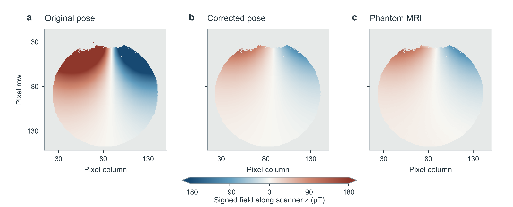

# 八字线圈公开体模磁场的复核

Petrov 等把八字线圈放在琼脂体模旁，利用 MRI 测出线圈磁场沿扫描仪主场方向的分量 Bz。每个像素的正负号表示该处磁场沿扫描轴的方向。数据文件 `data.mat` 中的 `data_MRI1` 是作者依据 MRI 相位处理得到的 160 × 160 实测图，其余四个数组为作者的模拟图。原始论文〔1〕 · 公开数据文件〔2〕

## 第一步，检查作者发布的预测图

按作者脚本的方向显示图像，保留落在体模掩膜中的 10,622 个像素，用发布的预测值直接减去实测值。相对 L2 误差是整幅掩膜内误差的二范数除以实测值的二范数，RMSE 是每个像素误差平方取平均后再开方。三种模型使用相同的实测切片和掩膜。作者评估脚本〔3〕 · [MATLAB 计算结果](published_predictions_vs_mri.csv)

| 作者发布的绕组模型 | 与 MRI 的相对 L2 误差 | RMSE（µT） |
|---|---:|---:|
| BSM-811，每翼一匝 | 9.00% | 2.76 |
| BSM-819，每翼九匝、单层 | 7.36% | 2.26 |
| BSM-879，每翼九匝、七层 | 7.71% | 2.37 |

在 MATLAB 中进入本目录并运行 `rescore_petrov` 可重算这张表。也可向函数传入本地 MAT 文件的路径。v1.0 和 v1.1 的 `data.mat` 字节相同，大小为 405,875 字节，SHA-256 为 `6f8276720f7de75aec05e68f018693f0bdf5b905507a8210b4ac2410d931ed6d`。论文所引 v1.0 数据归档〔4〕

## 第二步，从绕组重新计算同一张图

单独读取作者的预测图能检查文件、方向和误差公式。要检验我们自己的程序，还需用同一线圈、同一电流，在 MRI 对应的位置独立计算每个像素的 Bz。这里的“配准”就是将线圈自身的坐标换到扫描仪坐标。初次照论文所引的 v1.0 配置运行，九匝模型预测场的均方根是实测的 4.50 倍。2017 年 11 月作者发布 v1.1，明确说明旧工作流用了过时的神经导航对齐矩阵。作者的修复说明〔5〕 · 两个版本之间的修改〔6〕

本次用相同算法、电流、实验切片与掩膜，对两版配准分别重跑。对于单层九匝 BSM-819，采用作者修正的摆位后，预测与实测的均方根幅值比从 **4.5018** 降到 **1.0162**，相对 L2 误差从 **352.56%** 降到 **7.63%**。修复后的计算与作者自己发布的预测图相差 **1.37%**（相对 L2）。这为九匝参考线圈在这张体模切片上的场形与幅值提供了定量检验；本项目的六匝八字线圈使用其他绕组尺寸。[版本对照 CSV](matched_figure8/placement_version_comparison.csv) · [独立重建方法和逐模型结果](matched_figure8/README.md)

三张图从左到右是旧摆位的预测、更正摆位的预测和 MRI 实测。红蓝两色表示磁场沿扫描仪轴向的两个相反方向。三张图共用色标，所以可以直接看出旧摆位预测的两个强场区更大。下方色标两端的箭头表示超出显示范围的值。沿单行检查更正后仍有多大局部偏差，可看剖面残差图。[图版 PDF](../../figures/methods/mri_field_maps.pdf) · [剖面残差图](../../figures/methods/mri_profile_residual.png) · [完整项目图解与重跑入口](../../README.md)

## 论文与数据来源

1. [原始论文](https://doi.org/10.1371/journal.pone.0178952)
2. [公开数据文件](https://github.com/pip010/plosone-data-pub01/blob/v1.1/phantom_experiments/error_metrics/data.mat)
3. [作者评估脚本](https://github.com/pip010/plosone-data-pub01/blob/v1.1/phantom_experiments/error_metrics/metrics.m)
4. [论文所引 v1.0 数据归档](https://doi.org/10.5281/zenodo.161564)
5. [作者的修复说明](https://github.com/pip010/plosone-data-pub01/releases/tag/v1.1)
6. [两个版本之间的修改](https://github.com/pip010/plosone-data-pub01/compare/v1.0...v1.1)
