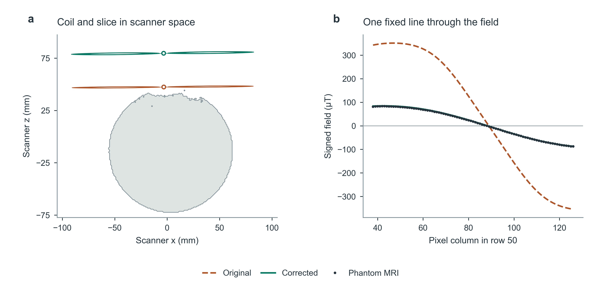
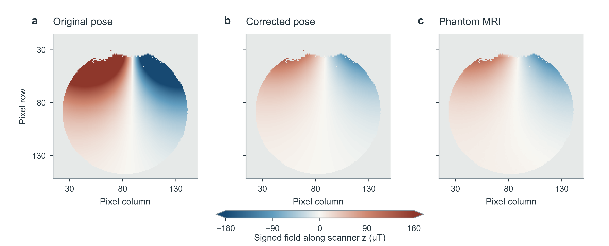
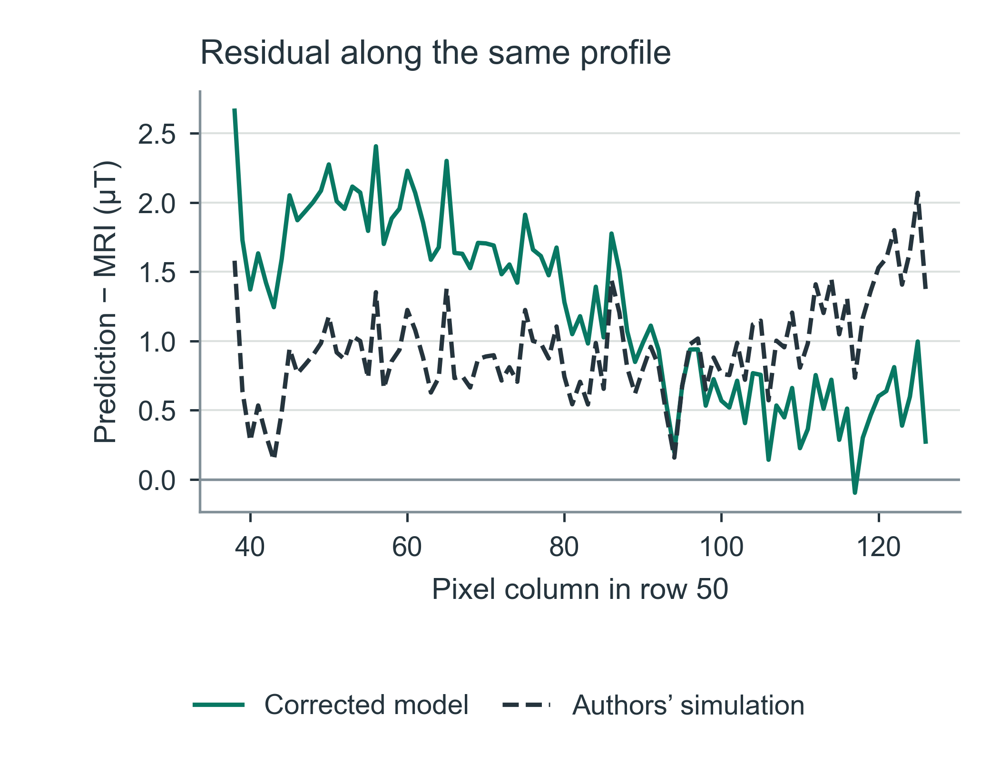

# Petrov 八字线圈 MRI 体模的独立复算

**复算结论。** 原项目此前使用论文所引数据仓库 v1.0 的导航矩阵 A，导致九匝单层线圈 BSM-819 过于接近体模。作者在论文发表后修正了该矩阵。本次在 MATLAB 重跑两个版本，电流均为 3.576 A，逐点评分使用同一张 10,622 像素的有符号 Bz 实测图。换成 v1.1 后，均方根幅值比从 **4.5018** 降到 **1.0162**，对 MRI 的相对 L2 差从 **352.56%** 降到 **7.63%**。[入门图解与整个项目的背景](../../../README.md) · 〔1〕



左图用棕色和绿色区分旧、更正两套绕组在扫描仪 x-z 平面上的投影，右图给出同一条剖线上的模型曲线和 MRI 实测点。线圈原点由 (−3.280, 55.935, 47.478) mm 移至 (−3.418, 53.921, 79.746) mm。两套 J 的文件哈希不同，解出的数值矩阵逐项相等。A 的 z 平移元素本身增加 30.002 mm，完整变换作用于绕组原点后，扫描仪 z 的净位移为 **32.268 mm**。两者属于不同计算步骤。[坐标 CSV](coil_origins.csv) · 〔2〕

## 数据、代码和单位如何对上

1. **输入。** 读取 v1.0 和 v1.1 各自的 A、J 和 `error_metrics/data.mat`。两个版本的 MAT 场图文件哈希完全相同。实测分量来自 `data_MRI1`；另外三张用于比较的数组 `data_singlecoil`、`data_multicoil`、`data_layercoil` 是作者各自的 SCIRun 预测。原始 MRI 采集使用体模，本项目使用作者整理的切片。〔3〕 · 〔4〕
2. **绕组与激励。** BSM-811 采用每翼半径 44 mm 的单环。BSM-819 每翼单层九匝，BSM-879 每翼七层、每层九匝，层间距 1 mm。电流按原文表 2 取 25.032、3.576、0.511 A，已经包含单环与七层的权重。双翼电流方向相反。单环依论文表 1 每翼 92 段；螺旋按发布配置的弧精度生成，得到全绕组 2,700 与 12,600 段。论文表 1 所载分段数与这两项并不完全相同。发布配置的翼间距参数为 4 mm，生成器把该值的一半加到外半径，两翼中心在 ±46 mm；论文表 1 写作 2 mm。本次始终采用同一套几何，保留这些差异以便复核。〔3〕 · 〔5〕
3. **从线圈坐标换到扫描仪坐标。** 按工作流对局部坐标列向量应用组合变换 `p_scanner = A · J · Tz(+15 mm) · Rx(−4°) · p_coil`。先转动绕组，再加外壳偏移，随后做捕捉与导航配准。保留 A 中的尺度成分。扫描仪切片网格的节点坐标为 `(85.033−i, 53.931+2k, −85.401+j)` mm，其中 i、j 从 0 到 160，k 为 0 或 1。旧版由 m29 定义这个切片仿射，新版由 m27 定义，数值未变。〔6〕 · 〔7〕
4. **求场、生成像素、评分。** MATLAB 将毫米换成米、用安培输入逐段积分，输出特斯拉。取每个体素八个角点 Bz 的平均，在作者的显示坐标中旋转模拟矩阵。用发布的单环预测非零区定义有效体模掩膜，三个模型及所有姿态均共享它。显示色限不参与评分。原软件采用沿导线的数值求积，本项目对每条直线段用解析积分。[本项目场核](../../../matlab/field_segments.m) · 〔8〕 · 〔9〕 · 〔10〕

## 先比软件，再比实测

设 p 为掩膜内预测 Bz，y 为同一批像素上的参考 Bz。**幅值比**为 ‖p‖₂ / ‖y‖₂；**相对 L2 差**为 100 × ‖p−y‖₂ / ‖y‖₂；**均方根误差 RMSE** 保留场的单位。参考取作者模拟时，检验同一场计算的复现程度；参考取 MRI 时，检验整个几何和物理模型与实测的一致程度。

| 模型 | 旧摆位幅值比，参考 MRI | 更正后幅值比，参考 MRI | 更正后对作者模拟的 L2 差 | 更正后对 MRI 的 L2 差 | 更正后对 MRI 的 RMSE | 更正后与 MRI 的相关系数 |
|---|---:|---:|---:|---:|---:|---:|
| BSM-811，每翼单环 | 4.3266 | 1.0308 | 0.372% | 9.107% | 2.797 µT | 0.99645 |
| BSM-819，每翼九匝 | 4.5018 | 1.0162 | 1.366% | 7.627% | 2.343 µT | 0.99726 |
| BSM-879，七层各九匝 | 4.5289 | 1.0201 | 0.347% | 7.741% | 2.378 µT | 0.99726 |

旧版的偏差也随位置而变。以作者九匝预测场为基准，靠近绕组的第 31–40 行（253 像素）旧版幅值比为 **5.64**，远侧第 136–145 行（535 像素）为 **2.70**；新版分别为 **1.012** 与 **1.018**。给整幅图统一除以 4.50 会保留这种空间失真。只把旧版最终变换的 z 平移替换为新版值，对 MRI 的幅值比已降到 **1.0104**，相对 L2 差为 **7.729%**。这一对照隔离了位移的主要作用。[近远侧分区](row_band_comparison.csv) · [所有版本和控制条件](placement_version_comparison.csv)



三幅图使用同一色标。旧版的强场区明显扩大，更正后与实测的颜色和范围更接近。箭头表示色限以外的像素，数值评分始终使用未经截断的全部有效像素。[矢量 PDF](../../../figures/methods/mri_field_maps.pdf)



图中第 50 行沿用作者脚本选取的剖线。即便模拟和实测的场形高度相关，每个像素仍有可见差异。作者自身的九匝模拟对同一 MRI 图的相对 L2 差为 **7.36%**，本项目为 **7.63%**。当前数据支持这个参考件在指定激励及切片上的幅值和分布对照。没有逐项测量能把余下误差精确分给绕组近似、积分与 MRI 测量，也不能据此验证其他线圈或脑内感应电场。[作者预测的重评分](../published_predictions_vs_mri.csv) · [可重画的第 50 行 CSV](profile_row50.csv)

## 复跑和核对来源

从本目录打开 MATLAB R2025a，运行下列命令。程序使用 CPU 双精度，首次运行自动下载输入到项目 `tmp/petrov_benchmark/<commit>/`，各版本缓存相互独立。每次读取都检查 SHA-256。复跑会更新本目录的 CSV、MAT 和三张插图。

```matlab
validate_petrov_figure8
plot_petrov_comparison
```

| 固定输入 | Git 版本或文件校验值 |
|---|---|
| v1.0 | `5d65b6f2dd3a6658748e59c02b5fa8182b998d5a` |
| v1.1 | `9e8de2a708b1d0c1d527f5fb30199ce8a1354771` |
| 两版相同的 `data.mat` | `6f8276720f7de75aec05e68f018693f0bdf5b905507a8210b4ac2410d931ed6d` |

导航矩阵的四个完整校验值保存在计算脚本。MAT 输出包含原始单位 T 的测量值、作者预测值、三种摆位计算切片、有效掩膜、位姿矩阵及两版计算所用绕组坐标，可独立重算表中指标。[MATLAB 重建与评分](validate_petrov_figure8.m) · [绘图脚本](plot_petrov_comparison.m) · [最终六行数值](matched_figure8_scores.csv) · [切片和位姿 MAT](figure8_slice_results.mat)

## 论文、数据集与项目出处

1. [作者更正说明](https://github.com/pip010/plosone-data-pub01/releases/tag/v1.1)
2. [修改 A 的原始提交](https://github.com/pip010/plosone-data-pub01/commit/4cb22180d192a689f92b2473669cfa1505e81202)
3. [论文](https://doi.org/10.1371/journal.pone.0178952)
4. [作者数据](https://github.com/pip010/plosone-data-pub01/tree/v1.1/phantom_experiments)
5. [作者几何生成器](https://github.com/pip010/scirun4plus/blob/v4.7.2/src/Core/Algorithms/Math/TMS/ModelGenericCoilAlgo.cc)
6. [旧版工作流](https://github.com/pip010/plosone-data-pub01/blob/v1.0/phantom_experiments/set_coil.srn)
7. [新版工作流](https://github.com/pip010/plosone-data-pub01/blob/v1.1/phantom_experiments/set_coil.srn)
8. [SCIRun 求场工作流](https://github.com/pip010/plosone-data-pub01/blob/v1.1/phantom_experiments/solve_coil_field.srn)
9. [上游积分代码](https://github.com/pip010/scirun4plus/blob/v4.7.2/src/Core/Algorithms/Math/BiotSavartSolver/BiotSavartSolver.cc#L267-L374)
10. [作者的掩膜与方向约定](https://github.com/pip010/plosone-data-pub01/blob/v1.1/phantom_experiments/error_metrics/metrics.m)
